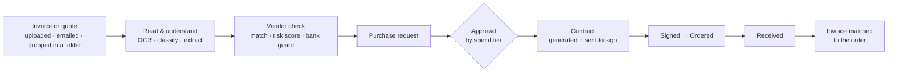
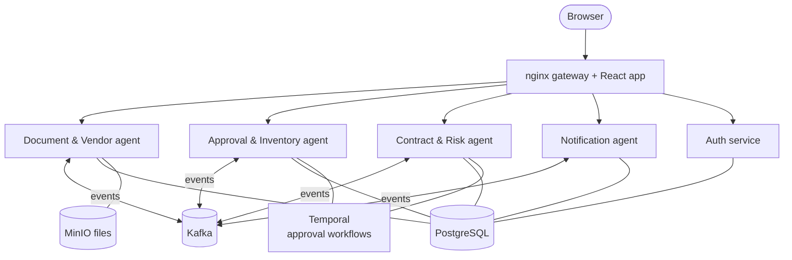
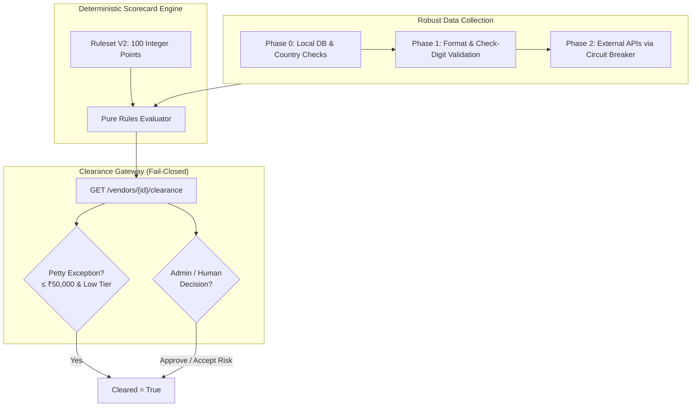

# IT Procurement Intelligence Platform

**Buying software and hardware for a company, automated end to end** — from a
vendor's invoice landing in a folder to a signed contract and a matched
payment, with AI reading the documents and people only stepping in where a
decision is needed.


> Student team project (Fractal Analytics, 2026–27) · a working, tested prototype.

---

## Why

Procurement in most companies is a chain of hand-offs: someone retypes an
invoice, chases an approver by email, drafts a contract, waits for a
signature, then checks the invoice against the order by eye. Each step is
slow, and the risky ones — a fake invoice, a changed bank account, an
unreliable vendor — are easy to miss.

## What it does



Every arrow is automatic. People approve, sign, confirm delivery and
review anything the system isn't sure about.

## How — five cooperating agents



| Agent | In one line |
|---|---|
| **Document & Vendor** | Takes documents by upload, email or folder, virus-scans them, straightens and reads PDFs and scans (Docling, PaddleOCR, LayoutLMv3 cross-check), sorts invoices / POs / quotes / other, converts foreign currency to INR, checks each invoice's GST and signed e-invoice QR, reconciles GSTR-2B, onboards and matches vendors |
| **Approval & Inventory** | Routes requests by spend and budget, enforces who may approve what, runs the IT catalog and requests for quotation, tracks licences, stock and partial deliveries, suggests reorders, matches invoices to orders and to what was received, works out TDS and MSME payment deadlines |
| **Contract & Risk** | Writes contracts and reads their clauses with Legal-BERT, collects e-signatures, reminds before notice deadlines, tracks what signed contracts commit to (SLA credits, seat limits, warranties), screens vendors against sanctions lists, keeps a vendor scorecard, rates vendor risk with a deterministic 100-point ruleset and decides clearance before buying or signing (a sanctioned vendor can't be signed at all) |
| **Notification** | Turns events into emails and an in-app feed; the bell counts only unread, important ones |
| **Auth** | Accounts, roles, and the business rules admins can change live |

The services share one PostgreSQL database but hand work to each other
through **events**: an outbox makes each event commit together with the
change it describes, and consumers retry and park failures in a
dead-letter queue instead of losing them.

## Highlights

| | |
|---|---|
| **Document AI** | A sample scanned invoice went from **0.50 → 0.93** confidence after reading table rows by position and cross-checking totals |
| **Risk you can audit** | A deterministic 100-point vendor scorecard: every point traces to a check and its source, hard overrides (sanctions, cancelled GSTIN) force High, a vendor with checks missing is never shown as Low, and any past score replays exactly. A red team of 22 attack profiles passes; the ruleset ranks synthetic incidents with ROC-AUC 0.738 (the retired ML model: 0.715) |
| **Contract clauses** | Legal-BERT on 102 held-out, lawyer-annotated contracts: F1 **0.85 / 0.80 / 0.91** for renewal, notice and expiry clauses vs **0.50 / 0.19 / 0.02** for the regex rules it replaced (kept as fallback) |
| **Fraud controls** | Bank-detail changes need a second person; look-alike vendor names are flagged; vendors are screened against 25,000 sanctioned companies; invoices are held until bank details are verified |
| **Separation of duties** | Nobody — not even an admin — approves their own request |
| **Spend control** | Budgets per department and quarter checked before approval; RFQs with sealed quotes compared on price, lead time, warranty, support, risk and delivery record |
| **Indian tax** | Every invoice's GST split, rate and arithmetic checked, its signed e-invoice QR verified offline, imported SaaS put under reverse charge, GSTR-2B reconciled; TDS kept with each booked invoice; MSME 45-day deadlines (rates to be confirmed by a CA) |
| **Reliable by design** | Long-running steps (approvals, renewals, reminders) are Temporal workflows that survive restarts; failed events are kept and shown, never lost |
| **Traceable** | One correlation id follows a request through every service's logs and events (Grafana + Loki) |
| **One Control Panel** | Admins see the Input / Processed / Failed folders and every file's stage, the live event log, approval queues, every contract as *Pending E-Signature* or *E-Signature Complete* with its PDFs, and edit every notification email without a code change |
| **Tested** | 1,261 unit tests across six services plus end-to-end runs through the gateway (invoice lifecycle **71/71**, GST **44/44**, risk **49/49**, assistant **20/20**, demo **28/28**) |

## Vendor Risk & Clearance Architecture (Prompt 9C)

The platform evaluates vendor risk using a 100% deterministic, audit-logged ruleset engine paired with a purpose-aware clearance gateway.



### Key Architectural Principles

1. **100-Point Deterministic Allocation**:
   - Total points equal 100: Identity (39), Performance (35), Cyber (17), Company standing (6), Reputation (3).
   - Rating bands: **Low** (0–24), **Medium** (25–49), **High** (50–100).
   - Outcome points are strictly integer values; overrides lock the rating band to High.

2. **Rating Status Contract & No False Lows**:
   - `not_rated`: 0% assessed due diligence share (e.g. brand new vendor where collection has not run). Score is `None`, band is `Unrated`.
   - `provisional`: Incomplete checks (< 100% assessed share or an unsatisfied required check for the effective tier). **A vendor with missing checks must NEVER look Low**: if total points fall in 0–24, `final_band` is forced to `Unrated`. If points fall in Medium or High, that band is reported with `points_is_lower_bound = True`.
   - `assessed`: 100% assessed due diligence share AND all tier-required signals satisfied (`assessed` or `not_applicable`).

3. **Purpose-Aware Clearance (`GET /vendors/{id}/clearance`)**:
   - Downstream services (contracts, purchase approvals, payment disbursement) **never check `risk_band == 'Low'` directly**. They always query `/clearance`.
   - **Activation Deadlock Prevention**: For `purpose=activation`, the gateway permits `vendor.status in ('onboarding', 'active')` so a vendor can be cleared prior to flipping status to active (while still failing closed if due diligence checks are provisional). For `purpose in ('purchase', 'contract')`, `vendor.status == 'active'` is strictly required.
   - **Fail-Closed**: Unscored vendors or unreachable endpoints always return `cleared=false`.

4. **Petty Purchase Exception**:
   - For routine low-value purchases (spend amount ≤ `risk.petty_threshold`, ₹50,000) with **petty**-tier vendors whose checks are still provisional, clearance is granted under `cleared_under_petty_exception` as long as no hard override is active and no sanctions result awaits review.
   - A **non-remediable** override (sanctions match `R-SAN-01`, prohibited country `R-JUR-01`) is never cleared: an admin can't accept the risk and contract signing is blocked. One function (`clearance.py`) decides for `/clearance` and for signing. Red team, evaluation and limits: [docs/index.html#risk](docs/index.html#risk).

5. **Foreign Vendors & GST Limitations**:
   - `vendor.country` (ISO 3166-1 alpha-2) is required at onboarding with no default.
   - Foreign vendors trigger rule `R-GST-04` (`not_applicable`, 0 pts, 0 potential) and `R-BNK-04` (foreign bank SWIFT/IBAN `not_applicable`).
   - *Accepted limitation*: Foreign vendors cannot earn GST or Indian IFSC points, so their attainable maximum point ceiling is lower. This is an accepted operational boundary that will be calibrated against foreign registries in future iterations.

6. **External Collector Robustness & Circuit Breaker**:
   - External providers (ClearTax, OpenCorporates, SecurityTrails, HaveIBeenPwned, NewsAPI) are protected by a sliding-window circuit breaker: 3 failures within 5 minutes transitions to `OPEN` for 15 minutes, followed by a `HALF-OPEN` probe.
   - Fast-fail phased execution: non-remediable blocks immediately short-circuit Phase 2 external calls with reason `skipped_nonremediable_override`.

7. **"Models Produce Observations, Never Points"**:
   - Machine learning models (Legal-BERT, PaddleOCR, LayoutLMv3, NER) produce structured observation values (e.g. classification labels, confidence scores, extracted entities), never points or risk scores.
   - The risk evaluator contains zero model inference or external network code, enabling pure deterministic replay and auditability.

## Try it

**Prerequisites:** Docker with Compose v2 (Docker Desktop on macOS/Windows,
Docker Engine + compose plugin on Linux; on Windows run inside WSL2), with
about **8 GB of memory** given to Docker and ~20 GB of disk (images ~15 GB, plus models and build cache);
internet for the first build. Optional: Python 3 for the end-to-end test
scripts, Ollama for the assistant (retrieval-augmented: it answers from the platform's own contracts, documents and records, with citations). Node isn't needed (the frontend builds
in a container).

```bash
git clone <repo-url> && cd ProcurementAutomation
./run.sh                       # builds and starts everything; ends with "All services healthy."
./scripts/seed-demo-data.sh    # optional demo data
./scripts/download-models.sh   # optional, once: LayoutLMv3 + Legal-BERT (~1 GB)
```

**Configuration:** `run.sh` creates `.env` from
[`.env.example`](.env.example) on the first run, and the defaults work
locally without editing. The database schema, migrations and Kafka topics
are set up automatically.

Open **http://localhost:8080** and sign in as `requester@demo.example.com`
(password `DemoPass123!`), or `approver@…`, `finance@…`, `admin@…`. Light
and dark themes are in Account settings. Drop a quote PDF into
`./inbox/input` and follow it on **Control Panel** (admin).

Deploying beyond one machine, backups and restore:
[docs/index.html#deploy](docs/index.html#deploy). Every project document starts at
[docs/index.html](docs/index.html).

**Documentation site:** architecture, functional flow, every agent, APIs,
configuration, deployment, testing and troubleshooting, built with MkDocs
from [`docs/guide/`](docs/guide/index.md):
`pip install -r requirements-docs.txt && mkdocs serve` (Python 3.9–3.13).

## Tech stack

**Backend** Python · FastAPI · SQLAlchemy · Alembic &nbsp;·&nbsp;
**Messaging** Kafka (Redpanda) · transactional outbox &nbsp;·&nbsp;
**Workflows** Temporal &nbsp;·&nbsp;
**AI/ML** PaddleOCR · Docling · LayoutLMv3 · scikit-learn · MLflow &nbsp;·&nbsp;
**Data** PostgreSQL · Redis · MinIO &nbsp;·&nbsp;
**Frontend** React · TypeScript · Vite · Tailwind &nbsp;·&nbsp;
**Ops** Docker Compose · nginx · Prometheus · Grafana · Loki · ClamAV

**Team:** Anjali · Vaidehi · Niraj · Anooj
