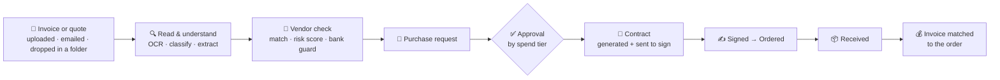

# IT Procurement Intelligence Platform

**Buying software and hardware for a company, automated end to end** — from a
vendor's invoice landing in a folder to a signed contract and a matched
payment, with AI reading the documents and people only stepping in where a
decision is needed.


> Student team project (Fractal Analytics, 2026–27) · a working, tested prototype.

---

## Why

Procurement in most companies is a chain of hand-offs: someone retypes an
invoice, chases an approver by email, drafts a contract, waits for a
signature, then checks the invoice against the order by eye. Each step is
slow, and the risky ones — a fake invoice, a changed bank account, an
unreliable vendor — are easy to miss.

## What it does



Every arrow is automatic. People approve, sign, confirm delivery and
review anything the system isn't sure about.

## How — five cooperating agents


| Agent | In one line |
|---|---|
| 📄 **Document & Vendor** | Takes documents by upload, email or folder, virus-scans them, straightens and reads PDFs and scans (Docling, PaddleOCR, LayoutLMv3 cross-check), sorts invoices / POs / quotes / other, converts foreign currency to INR, onboards and matches vendors |
| ✅ **Approval & Inventory** | Routes requests by spend, enforces who may approve what, tracks licences and stock, suggests reorders, matches invoices to orders |
| 📃 **Contract & Risk** | Writes contracts, collects e-signatures, reminds before notice deadlines, scores vendor risk from delivery and compliance history with an evaluated ML model and shows it before signing (High risk must be acknowledged) |
| 🔔 **Notification** | Turns events into emails |
| 🔐 **Auth** | Accounts, roles, and the business rules admins can change live |

The services share one PostgreSQL database but hand work to each other
through **events**: an outbox makes each event commit together with the
change it describes, and consumers retry and park failures in a
dead-letter queue instead of losing them.

## Highlights

| | |
|---|---|
| 🧠 **Document AI** | A sample scanned invoice went from **0.50 → 0.93** confidence after reading table rows by position and cross-checking totals |
| 📊 **Risk model, measured** | Random forest on 2,000 synthetic vendors: **ROC-AUC 0.715** (best possible on these labels 0.739), red-team profiles **12/12**, missing data left out instead of guessed |
| 🛡️ **Fraud controls** | Bank-detail changes need a second person; look-alike vendor names are flagged; invoices are held until bank details are verified |
| ⚖️ **Separation of duties** | Nobody — not even an admin — approves their own request |
| 🔁 **Reliable by design** | Long-running steps (approvals, renewals, reminders) are Temporal workflows that survive restarts; failed events are kept and shown, never lost |
| 🔎 **Traceable** | One correlation id follows a request through every service's logs and events (Grafana + Loki) |
| ✅ **Tested** | Unit suites per service plus end-to-end runs through the gateway (invoice lifecycle **71/71**, document pipeline **52/52**) |

## Try it

```bash
git clone <repo-url> && cd ProcurementAutomation
./run.sh                       # builds and starts everything (Docker)
./scripts/seed-demo-data.sh    # optional demo data
```

Open **http://localhost:8080** and sign in as `requester@demo.example.com`
(password `DemoPass123!`), or `approver@…`, `finance@…`, `admin@…`.

## Tech stack

**Backend** Python · FastAPI · SQLAlchemy · Alembic &nbsp;·&nbsp;
**Messaging** Kafka (Redpanda) · transactional outbox &nbsp;·&nbsp;
**Workflows** Temporal &nbsp;·&nbsp;
**AI/ML** PaddleOCR · Docling · LayoutLMv3 · scikit-learn · MLflow &nbsp;·&nbsp;
**Data** PostgreSQL · Redis · MinIO &nbsp;·&nbsp;
**Frontend** React · TypeScript · Vite · Tailwind &nbsp;·&nbsp;
**Ops** Docker Compose · nginx · Prometheus · Grafana · Loki · ClamAV

## More

- [Project status — visual flow](docs/project-flow.html) and its research tab (`#research`) — open in a browser
- [Showcase guide](docs/showcase.html) — how to present it to an external evaluator or a mentor
- [Technical reference](readmeforme.md) — setup, configuration, testing, internals
- [Roadmap & open work](TODO.md) · [Risk model write-up](docs/risk-model.md)
- [Research direction](RESEARCH_GAP_ANALYSIS.md) — calibrated, risk-controlled automation of procurement documents ([paper plan](RESEARCH_PAPER_PLAN.md))

**Team:** Anjali · Vaidehi · Niraj · Anooj
