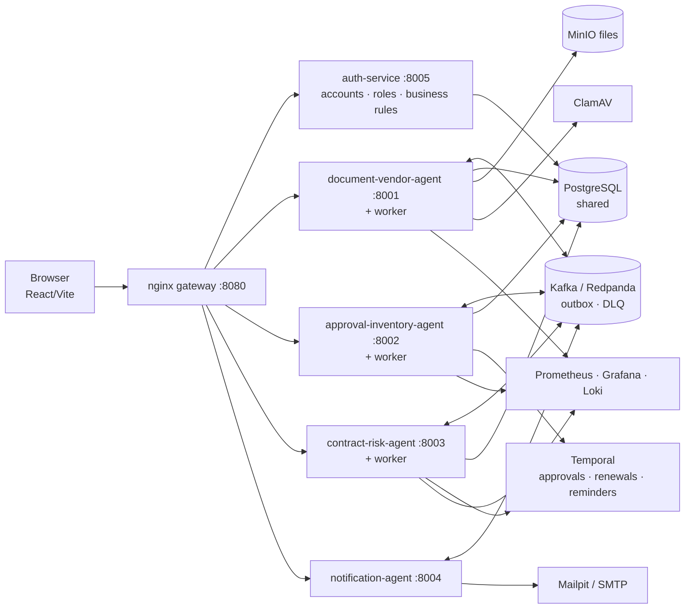

# TODO

Working context **and** task register for this repo. Part A is the
context a new session needs (what the project is, how it fits together,
what works, what's decided, what's next). Part B keeps every item's
detail and dated evidence. Research planning lives in
`RESEARCH_GAP_ANALYSIS.md` and `RESEARCH_PAPER_PLAN.md`; the short
personal checklist is `IMPLEMENTATION_PLAN.md`. What changed and when is
in `git log`. Started Sep 27, 2026; roadmap added Oct 15; Part A added
Oct 16.

> **Maintenance (for every session):** update this file, don't recreate
> it. When an item changes, update its status in the A.5 register, add a
> dated *Evidence* line to its Part B entry, and refresh A.6 (next
> actions). Keep `IMPLEMENTATION_PLAN.md` ticks in step. Record new
> decisions in A.4. At each roadmap phase also update
> `docs/project-flow.html` (its `S` statuses **and** the `DELIVERABLES`
> list behind the progress circle), `README.md` and `readmeforme.md`.

---

# Part A — Project context

## A.1 Project overview

- **Name:** IT Procurement Intelligence Platform (repo
  `ProcurementAutomation`). Student team project, Fractal Analytics
  2026–27 (Anjali, Vaidehi, Niraj, Anooj).
- **Problem:** company procurement of software and hardware is a chain of
  manual hand-offs — retyping invoices, chasing approvers, drafting
  contracts, checking invoices against orders by eye. It is slow, and the
  risky cases (fake or duplicate invoices, changed bank details,
  unreliable vendors) are easy to miss.
- **Users:** requesters (ask for purchases), approvers (decide by spend
  tier), finance (vendors, bank-detail verification, invoices, compliance
  signals), admins (business rules, users, monitoring). Stakeholders:
  Fractal mentors and evaluators.
- **Objectives:** read procurement documents automatically, route
  approvals with enforced authority, manage inventory and licences,
  generate and sign contracts, score vendor risk, and keep people in the
  loop only where a decision is needed — with every action audited.
- **Core use cases:** document intake (upload / email / drop folder) →
  classification and extraction → vendor match → request → approval →
  contract → signature → ordered → received → invoice matched.
- **Scope:** Team A/B/C basic requirements (document & vendor
  intelligence, approval & inventory, contract & risk). Out of scope for
  this repo's authors: email automation and the chatbot (Anooj's),
  Team D platform requirements.
- **Non-functional requirements in force:** identity only from the JWT;
  outbox for events; retries + DLQ; idempotent migrations; audit of every
  control; runs on one machine with Docker Compose; `APP_ENV=production`
  refuses default secrets.
- **Stage (Oct 20, 2026):** all basic requirements built (BR-1…BR-7);
  R0 done except FR-04 (red-team list) and FR-05 (a teammate's run);
  UI pass UX-1 done (dark mode, names, notification feed); the stack runs
  from a fresh clone again (REPRO-1, MinIO image); Oct 19: security
  upgrades (FR-27, mostly), deployment guide + backups (DEP-1), first
  research run (RS-01…07, RS-09: `docs/results/selective.md`);
  development ends **end of October** (mentor deadline), testing in
  November, submission in December. Open decisions: DUP-1, E2E-1, SEC-1
  (key owner).

## A.2 Architecture and implementation context

How the pieces interact:
- **Documents** (`services/document-vendor-agent`): `upload_service.py`
  scans (ClamAV), stores (MinIO), records and emits an outbox event; the
  worker runs `app/services/pipeline.py` — extraction in a killable
  subprocess (`ocr.py`: pdfplumber / Docling / PaddleOCR, `preprocess.py`
  for scans), `classification.py`, `field_extraction.py`, LayoutLMv3
  cross-check, `vendor_matching.py` (+ GSTIN/IFSC, bank-detail
  quarantine), FX (`fx.py`), learned hints (`learning.py`), invoice ledger
  match, duplicates, then `confidence.py` decides review vs automatic.
  Each stage's result is stored in `pipeline_checkpoints`. Inbound email
  (`email_intake.py`), vendor onboarding (`vendor_onboarding.py`).
- **Approvals & inventory** (`services/approval-inventory-agent`):
  `approval_service.py` (spend tiers, authority, SoD, backorders),
  Temporal approval workflow with SLA reminders, `inventory_service.py`,
  `reorder.py`, `invoice_ledger.py`, `order_monitor.py`; status changes
  validated by `shared/lifecycle.py`.
- **Contracts & risk** (`services/contract-risk-agent`):
  `contract_service.py` (generation, built-in e-sign, risk gate before
  signing), renewal workflow, `risk_service.py` (random forest + hard
  overrides), `risk_signals.py` (platform history + compliance record),
  `drift_service.py`.
- **Auth & rules** (`services/auth-service`): JWT, accounts, business
  rules table (Alembic migrations seed rules; `shared/rules_engine.get_rule`).
- **Frontend** (`frontend/src`): one home page per item; each agent's
  actions are one component under `components/<agent>/`.
- **Endpoints often needed:** `/api/documents/upload`,
  `/api/vendors/onboard[/validate]`, `/api/vendors/{id}/risk[-signals]`,
  `/api/requests/` (+ `/receive`), `/api/inventory/`
  (+ `/{id}/reorder-settings`), `/api/contracts/{id}` (+ `/sign`),
  `/api/business-rules`.
- **Config:** `.env` from `.env.example` (never commit real secrets);
  migrations per service as listed in `CLAUDE.md`.

## A.3 Current implementation status

| Component or feature | Status | Existing implementation | Remaining work | Dependencies |
|---|---|---|---|---|
| Gateway, auth, roles, business rules | COMPLETE | nginx, auth-service, rules engine; logout revokes the refresh token, 15-minute access tokens (Oct 19, FR-27) | Security P2 hardening (Part B) | — |
| Document intake: upload, drop folder, email | COMPLETE | `upload_service.py`, `inbox_watcher.py`, `email_intake.py` (BR-1) | — | ClamAV, MinIO |
| OCR / extraction | PARTIAL | pdfplumber, Docling, PaddleOCR, preprocessing on (BR-2); Docling 2.140 (Oct 19) now reads scanned PDFs with its bundled RapidOCR (before: no OCR engine, 0 characters, sent to review as unreadable) | Noisy scans worse with preprocessing (44 % vs 47 %); low-quality JPGs 0–1/6 fields (FR-11); Docling cold start; on scanned PDFs Docling joins words and the vendor name is misread (totals and numbers right) | — |
| Classification incl. "other", PO-backed / non-PO | COMPLETE | ML classifier (kept only because it beat keywords, FR-29) with keyword fallback (BR-3) | Real documents to evaluate on | — |
| LayoutLMv3 cross-check | PARTIAL | `layoutlm_crosscheck.py` | Runs only if model downloaded | `scripts/download-models.sh` |
| Review routing (confidence) | COMPLETE (heuristic) | `confidence.py`: weighted score × OCR quality, threshold 0.8, force-review rules; gate code in `selective_gate.py` (not wired in) | Measured Oct 19: 41 % accepted, 6.8 % of those wrong on the synthetic world; duplicate rule misses resubmissions with a new number (DUP-1) | RS-11 |
| Learning from corrections | PARTIAL | per-vendor hints + thresholds (`learning.py`) | Classifier retraining; evaluation (RS-10, optional) | — |
| Vendor match, onboarding, bank-detail dual control | COMPLETE | `vendor_matching.py`, `vendor_onboarding.py` (BR-4), payment hold | — | — |
| FX conversion to INR | COMPLETE | `fx.py` (Frankfurter, rate captured once) | — | internet |
| Approvals, authority, SoD, SLA reminders | COMPLETE | approval workflow (Temporal); stale workflows gone after the Oct 18 reset (OPS-1) | — | — |
| Inventory, backorders, reorder suggestions | COMPLETE | `inventory_service.py`, `reorder.py` (BR-5) | — | — |
| Invoice ledger / matching | COMPLETE | `invoice_ledger.py`, `invoice_matches` | — | — |
| Contracts: generation, built-in e-sign, renewals | COMPLETE | `contract_service.py`, renewal workflow (FR-01, FR-02) | — | — |
| Risk shown before signing | COMPLETE | `signing_risk()` (BR-6) | External e-sign path would need the check at send time | — |
| Vendor risk model | PARTIAL | RF + overrides + platform signals + sanctions screening (FR-04, BR-7, FR-14) | Red-team vs agent doc, drift min-sample decision (DRIFT-1) | decision |
| Clause extraction with a model | COMPLETE | Legal-BERT (CUAD) primary, regex fallback; CUAD test F1 0.85 / 0.80 / 0.91 vs rules 0.50 / 0.19 / 0.02 (FR-13) | Contracts from outside (we only read our own) | — |
| Licence-usage anomaly model | COMPLETE | IsolationForest + SHAP on 360 simulated licences, ROC-AUC 0.95 (FR-32) | Real usage data | — |
| Notifications | COMPLETE | notification-agent (SMTP / Mailpit), retry + DLQ, health (FR-31), coverage audit (FR-10); in-app feed with per-person read receipts and an unread-only bell (UX-1) | Gaps listed for Anooj (FR-10) | — |
| Frontend UI | COMPLETE | Ledger design system (`docs/design-direction.md`), dark mode saved per account, names instead of emails, clickable dashboard figures, one admin **System** page (UX-1) | — | — |
| Demo readiness | PARTIAL | `docs/demo-script.html` (18/18), 5-minute cut `docs/demo-5min.md` (6/6) + backup recording, `scripts/reset-demo.sh` (FR-05) | A teammate's run on fresh data | a teammate |
| Email automation, chatbot | OUT OF SCOPE | Anooj's | — | — |
| Observability (metrics, logs, correlation id) | COMPLETE | Prometheus, Grafana, Loki (FR-07) | — | — |
| Failed-events / Kafka log | COMPLETE | Control Panel (FR-06) | — | — |
| CI | PARTIAL | builds images only | Run tests in CI (FR-25) | — |
| Kubernetes / PySpark claims | BLOCKED | none | Needs an architecture decision (FR-15, FR-16) | user decision |
| Credentials for any shared deploy | BLOCKED | dev defaults; production mode checked (Oct 19): every service and worker refuses the published secrets and starts with real ones ([deployment.md](deployment.md)) | Rotate GSTINCheck key (P0) | a person |
| Backups and restore | COMPLETE | `scripts/backup.sh` / `restore.sh` (Oct 19): Postgres (app + Temporal) and MinIO; restore checked into a throwaway Postgres and volume, identical counts | Schedule it on a real host | — |
| Linux (Ubuntu VM) run | UNVERIFIED | steps in `readmeforme.md`; macOS fresh-clone build passes and every image pulls (FR-26, REPRO-1) | Full rehearsal on the VM (FR-26) | VM |
| Research: calibrated document gate | PARTIAL | First run Oct 19 (`docs/results/selective.md`): at α ≤ 5 % no calibrated gate accepts anything (H1 not supported); enterprise evidence lifts AUROC 0.74 → 0.94; current heuristic 6.8 % wrong among accepted | Duplicate-rule decision, new seed, RS-08, RS-10…12 | decision |

## A.4 Decisions, constraints and known limitations

Decisions to keep (change only after discussion):
- One shared PostgreSQL; each service owns its migrations (raw SQL or
  Alembic with its own version table). Never edit `shared/db/init.sql`.
- Events only through the transactional outbox; consumers wrapped with
  `deliver` (retry + DLQ).
- Identity from the JWT only; nobody approves their own request (admins
  included).
- Built-in e-sign only (since Oct 15); signing leads to `ordered`, then
  "received" → `fulfilled`.
- Currency: convert to INR via Frankfurter, keep the original value and
  rate.
- Image preprocessing on by default (rule `document.image_preprocessing`),
  denoise off, upscale capped at 1.5× — measured (BR-2).
- A zero-stock hardware request is created `backordered` (no ₹0 split).
- High-risk / unscored vendors need an explicit acknowledgement to sign.
- Team boundary: email automation and the chatbot are Anooj's.
- Research (Oct 16): primary contribution is the calibrated,
  enterprise-evidence document gate (`RESEARCH_GAP_ANALYSIS.md` §8); it
  ships behind a business rule with the current heuristic as default
  until results support switching.

Constraints: development ends end of October 2026; November = testing;
December = submission. One machine (Docker Compose, ~3.2 GB RAM idle).
All vendor / risk / document data is synthetic.

Known limitations: noisy scans read worse after preprocessing; drift
check reports PSI on only 7 informed vendors; external e-sign providers
not gated by the risk check; Kafka without TLS; the confidence threshold
is uncalibrated (the research addresses this).

Assumptions to validate: that enterprise evidence adds signal beyond the
document (RS hypothesis H1 — could be false); that DocILE's terms permit
our use (RS-08).

## A.5 Task register

Priority: **P0** blocks essential work · **P1** needed for the system or
the main research claim · **P2** valuable follow-up · **P3** optional.
"Core" = needed for the system, "Research" = for the paper. Details and
evidence for FR/BR items are in Part B under the same ID.

### Core functionality and existing features

| ID | Task | Status | Pri | Depends on | Files | Acceptance | For |
|---|---|---|---|---|---|---|---|
| OPS-1 | Terminate 6 stale approval workflows; cancel PR `90261afb` | COMPLETE (Oct 18: the demo-data reset (user's choice) cleared Temporal's state with Postgres, so 0 open approval workflows and PR `90261afb` is gone; before that: BLOCKED (permission; Oct 17: tried again, blocked by Claude Code's permission check; the two other open `approval-` workflows, `0ca1ad3a`/`adbfc130`, are live licence reclaims, leave them) | P0 | person / permission | Temporal (`tctl`) | All 6 `approval-…` workflows Terminated; PR not `pending_approval` | Core |
| REPRO-1 | Replace the MinIO image: `minio/minio` (and `minio/mc`, used by `install.sh`) can no longer be pulled from Docker Hub or quay.io, so a fresh clone can't start | COMPLETE (Oct 18: `pgsty/minio:RELEASE.2026-08-04T00-00-00Z`, the community continuation, chosen by the user; volume backed up first to `.run/backups/miniodata-20261018-0006.tgz`; 373 objects before and after, old documents download through the API, document pipeline e2e 52/52; `install.sh` runs `mc` inside the MinIO container; `test_images_are_pinned` allows no exceptions) | P0 | user | `docker-compose.yml`, `install.sh` | `docker compose pull` works on a clean machine; uploads and downloads pass e2e | Core |
| SEC-1 | Rotate GSTINCheck key; real secrets before any shared deploy | BLOCKED (person) for the key. Oct 19: services start with `APP_ENV=production` and real secrets (all 6 + workers), refuse the defaults; `RULES_ENGINE_INTERNAL_SECRET` now reaches every service that reads rules and is refused at its default; Temporal takes `POSTGRES_PASSWORD`; checklist in `docs/deployment.md` | P0 | key owner | `.env` | Old key revoked; services start with `APP_ENV=production` | Core |
| DEP-1 | Deployment guide, production-mode check, backup and restore | COMPLETE (Oct 19: `docs/deployment.md`; `scripts/backup.sh`, `scripts/restore.sh`, used by `reset-demo.sh`; restore checked into throwaway containers: 0 errors, identical row counts and Temporal executions, every MinIO object) | P1 | — | `docs/deployment.md`, `scripts/` | Written, and each check run | Core |
| FR-05 | Demo script | PARTIAL (`docs/demo-script.html`, verified 18/18 by `tests/e2e/demo_scenarios.py`; Oct 18: 5-minute cut `docs/demo-5min.md` with checked fallbacks, rehearsed 6/6 by `tests/e2e/demo_5min.py` (4 runs, 35–42 s of actions), backup recording `docs/demo/backup-recording.webm`, `scripts/reset-demo.sh` for a clean demo state (run end to end: 2 min 23 s); a teammate's run left) | P1 | — | `docs/showcase.html` | Script runs a reviewer through every agent | Core |
| FR-12 | Presentation draft, template-shaped docs | COMPLETE (team pastes into templates) | P1 | FR-05 | `docs/results/`, `docs/presentation-outline.md` | Draft reviewed by team | Core |
| FR-31 | Notification consumer retry + DLQ, unhealthy when stopped | COMPLETE | P1 | — | `services/notification-agent` | Failure lands in `event_dlq`; `/health` red when consumer down | Core |
| FR-08 | Model routing and fallback, demonstrable | COMPLETE | P1 | — | `extraction_router.py` | Demo shows fallback path with logged reason | Core |
| FR-09 | Business rules validated | COMPLETE | P1 | — | auth-service | Every rule has validation + test | Core |
| FR-10 | Notification coverage audit | COMPLETE (gaps listed for Anooj) | P2 | — | notification-agent | Table of events → notifications, gaps fixed or listed | Core |
| FR-04 | Risk analysis remainder (red-team vs agent doc) | PARTIAL | P2 | — | contract-risk-agent `ml/` | Part B "Done when" met | Core |
| FR-11 | Layout-analysis accuracy, schema-validated output | COMPLETE (noisy scans: known limit) | P2 | — | `preprocess.py`, `eval_extraction.py` | Noisy-scan accuracy ≥ without preprocessing | Both |
| FR-13 | Clause extraction with Legal-BERT, rules fallback | COMPLETE | P2 | — | contract-risk-agent | `docs/results/clauses.json` | Core |
| FR-14 | Sanctions screening + strategic-tier checks | COMPLETE | P2 | — | contract-risk-agent `sanctions.py` | Sanctions override in risk | Core |
| FR-29 | Train the document classifier | COMPLETE | P2 | labelled docs | `ml/train_classifier.py` | Accuracy reported vs keyword baseline | Both |
| FR-32 | Licence anomaly model evaluated and tuned | COMPLETE | P2 | — | approval-inventory-agent | `docs/results/licence-anomaly.json` | Core |
| DRIFT-1 | Decide minimum sample before PSI is reported | PENDING (decision) | P2 | user | `drift_service.py` | Rule chosen and documented | Core |
| FEAT-1 | Budget control before approval (feature expansion Phase 1) | COMPLETE (Oct 20: budgets per department × IT category × fiscal quarter; usage computed from requests + invoice allocations; over-budget / no-budget / high-risk-vendor routing to finance; `budget.threshold_crossed`; `/app/budgets`; 7 rules enforced (5 new, migration `0015`); `tests/e2e/budget_flow.py` 30/30) | P1 | — | approval-inventory-agent `budget_service.py`, `api/budgets.py`; frontend `pages/finance/Budget*`, `components/approvals/BudgetActions.tsx` | Over-budget request gets a finance step; request page shows budget left | Core |
| FEAT-2 | Contract obligation tracking (feature expansion Phase 2) | COMPLETE (Oct 20: 11 obligation types read from signed contracts by a 60 s sweep, confirmed by finance, due-date reminders (`contract.obligation.due`), SLA downtime → service credit → note on matching invoices, licence-seat breach check, reclaims respect the minimum commitment; 3 rules (migration `0016`); contract-risk Alembic `0008`; `tests/e2e/obligation_flow.py` 47/47. CUAD comparison done (`docs/results/obligations.md`): model for licence limits and termination for convenience, rules for the other nine) | P1 | CUAD run | contract-risk-agent `obligation_extraction.py`, `obligation_service.py`, `api/obligations.py`; frontend `components/contracts/ObligationActions.tsx` | 0.3 % below SLA → right credit, invoice flagged; seat breach flagged; per-type model/rules decision on file | Core |
| FEAT-3 | Sourcing: IT catalog, RFQs, vendor scorecards, partial goods receipts (feature expansion Phase 3) | COMPLETE (Oct 20: catalog with agreed prices, expiry and optional pre-approval (`catalog.preapproved_max_inr`), seat add-ons that add licence seats on receipt; RFQs with sealed quotes, quotes linked from the pipeline by `RFQ-` reference, weighted comparison (`sourcing.default_criteria`), rounds and award into a purchase request; advisory RFQ note above `sourcing.rfq_required_above_inr`; partial receipts with asset tags and status `partially_received`; invoices checked against received quantity (`invoice.match_against_received`); vendor scorecard; 4 rules (migration `0017`), contract-risk Alembic `0009`; `tests/e2e/sourcing_flow.py` 69/69) | P1 | — | approval-inventory-agent `catalog_service.py`, `sourcing_service.py`, `receipt_service.py`; contract-risk `scorecard.py`; frontend `pages/sourcing/*`, `components/approvals/{Catalog,Sourcing,Receipt}Actions.tsx` | Seat add-on adds seats; expired price can't be ordered; 50 invoiced / 30 received → variance; sealed amounts hidden from every role | Core |
| APPR-1 | A multi-level request gets its contract after the **first** approval: the approval workflow (and the direct fallback) publishes `approval.decided` `approved` at every level, and contract-risk generates and sends a contract on any `approved` (found Oct 20 by the obligation e2e: manager approved, finance pending, contract already out) | PENDING (decision: contract-risk only acts on the last level of the chain, or approval publishes a final flag / a separate event) | P1 | user | approval-inventory-agent `workflows/approval_workflow.py`, `approval_service._process_decision_direct`; contract-risk `kafka/consumer.py` | No contract until the last level approves; test for a two-level chain | Core |
| CHAT-1 | Merge `chatbot2` (Anooj's RAG start) and make the assistant answer from the platform's records | COMPLETE (Oct 21). As merged it answered nothing: the endpoint still called the old function signature (every reply was the error message), Postgres had no pgvector, the embedding model wasn't pulled, the backfill read a field no document has (0 chunks) and wasn't in the image, and search had no access control. Now: Postgres `pgvector/pgvector:0.8.1-pg16-trixie`; index of contract clauses, documents, rules, requests, vendors, licences, budgets and totals kept current every minute; per-chunk access (staff / owner / all), bank details masked; retrieve-then-generate with citations, no function tools; eval 16/16 on three runs (`tests/e2e/chatbot_eval.py`) | P1 | — | chatbot-agent `indexer.py`, `rag_service.py`, `llm_client.py` | Grounded, cited answers; requester can't retrieve others' data; "not found" instead of guesses | Core |
| NOTIF-1 | E-mails for the feature-expansion events: `budget.threshold_crossed`, `contract.obligation.due`, `rfq.issued`, `rfq.awarded`, `goods.received` | COMPLETE (Oct 21, at the user's request since Anooj is on other work: 6 templates, recipients from the budget owner / obligation owner / vendor contact / requester, priorities per event, ACLs; 81 notification tests; checked live in Mailpit) | P1 | — | notification-agent `kafka/consumer.py`, `services/routing.py`, `services/directory.py`, `templates/` | Each event reaches the right person with a readable e-mail | Core |
| RISK-1 | Merge `updated_risk` (deterministic risk scorecard) into anjali and check its integration | COMPLETE (Oct 21: 15 errors fixed — duplicate Alembic revisions, module/package clash, migration writing `business_rules` with wrong columns (service couldn't start), 4 unseeded rules (auth `0018`), High-risk alerts silently off, 43 TypeScript errors, two endpoints always 500, risk e-mail template not rendering, vendor page calling a removed endpoint, scorecard page crashing the app, demo scenarios; `tests/e2e/risk_flow.py` 49/49; see `docs/risk-merge-review.md`) | P0 | — | contract-risk-agent `scorecard/`, `collectors/`, `risk_service.py`, `api/vendors.py`, `api/rulesets.py` | All suites green; demo 18/18 | Core |
| RISK-2 | Contract signing gate disagrees with `/clearance` (ignores post-score decisions and vendor status) | PENDING (decision: risk owner) | P1 | Niraj | contract-risk `contract_service.signing_risk`, `api/vendors.get_vendor_clearance` | One clearance function used by signing; accept-risk vendor signs without a second acknowledgement | Core |
| RISK-3 | Demo vendors are provisional/Unrated (external sources unreachable, no `country`); budget routing and RFQ read `band`, so Unrated never adds a finance step; PSI drift workflow still scheduled; access rules (procurement role, evidence/disputes by any requester) | PENDING (decisions, `docs/risk-merge-review.md` G2–G9) | P1 | Niraj | contract-risk, approval-inventory | Each item decided | Core |
| DUP-1 | Duplicate check misses a resubmitted invoice with a new number: it requires numbers ≥ 85 % similar (rule `vendor.duplicate_invoice_number_fuzzy_threshold`) | PENDING (decision; found Oct 19 by RS-06: most of the errors left among the best-scored invoices) | P1 | user | `duplicate_detection.py`, auth-service rule seed | Same vendor + amount + date window flags review whatever the number, or the trade-off is documented | Core |
| E2E-1 | `document_pipeline.py`: the `slow_to_parse.pdf` case no longer times out (Docling 2.140 reads it within 120 s), 4 checks fail | PENDING (decision: new fixture, or expect `classified` and rely on the unit test for the limit) | P2 | user | `tests/e2e/document_pipeline.py` | Suite green without weakening the time-limit check | Core |
| FR-15/16 | PySpark / Kubernetes claims | BLOCKED (decision) | P3 | user | — | Built or removed from docs | Core |
| FR-17/18/19 | DB & storage pages, trace view, re-verify minutes | PENDING | P2 | — | frontend | Part B "Done when" | Core |
| FR-20…24 | R2 competitive features (delivery alerts, scorecard, report, SaaS overlap, MCP) | PENDING | P3 | R0 + R1 done, and only if asked | — | Part B "Done when" | Core |
| UX-1 | UI pass: dark mode, clickable figures, one System page, names not emails, lavender Fulfilled, less text, unread-only bell | COMPLETE (Oct 18; see Part B) | P1 | — | frontend, auth-service `0013`, notification-agent feed | Each item verified live; badge counts unread only | Core |

### Testing, deployment and documentation (R3, November)

| ID | Task | Status | Pri | Depends on | Acceptance | For |
|---|---|---|---|---|---|---|
| FR-25 | CI runs the service suites and root tests | PENDING | P1 | — | CI fails on a failing test | Core |
| TEST-1 | Fix pre-existing failing root tests (`test_mailer`; `test_email_action` needs `redis` — Anooj) | COMPLETE (Oct 17: `test-root.sh` 139 passed + 14 passed, 4 skipped = chatbot live script) | P1 | — | Root suite green | Core |
| FR-26 | Fresh-clone rehearsal on Ubuntu (UTM) | PARTIAL (Oct 18, macOS: from a copy holding only what a clone would (tracked + new unignored files, no `.env`/`dist`/`secrets`), all 6 service images and the frontend build; every third-party image is pullable (MinIO after REPRO-1). Not run as a second stack: Docker's 7.75 GB is mostly used by the live one. Still open: a full run on the VM) | P1 | VM | `docs/results/fresh-clone.md` with times | Core |
| FR-27 | Security P1s (dependency upgrades etc.) | PARTIAL (Oct 19: FastAPI 0.148 / Starlette 1.9 everywhere, Pillow 12.3, pdfplumber 0.11.10 / pdfminer 20260107, Docling 2.140, accelerate 1.15, cryptography 50, aiosmtplib 5.1, react-router 7.18, vite 6.4; pip-audit 302 → 152 findings, npm high 7 → 5; logout revokes the refresh token; access tokens 15 min; `INTERNAL_SERVICE_TOKEN` refused at its default. Left, each documented in `docs/deployment.md` §5: MLflow 2.14 (3.x is a major upgrade), paddlepaddle 2.6 (PaddleOCR 3 rewrite), Tailwind 3's `braces` (build-time only); QA-19 and the smaller QA leftovers) | P1 | — | Part B list closed | Core |
| FR-28 | Final documentation pass | PARTIAL (Oct 19: test counts, deployment guide, research results, readmeforme, README and CLAUDE.md updated; templates (`docs/forReport/`) still the owner's) | P1 | all | Templates filled | Both |

### Research (selected contribution — see `RESEARCH_PAPER_PLAN.md`)

| ID | Task | Status | Pri | Depends on | Files | Acceptance | For |
|---|---|---|---|---|---|---|---|
| RS-01 | Evidence export: one row per (document, field) and per document from `pipeline_checkpoints` + envelope | COMPLETE (Oct 19: `scripts/export_evidence.py`, read-only; per document and per field; 291 documents / 1,455 field rows from the live database) | P1 | — | new `scripts/export_evidence.py` (document-vendor-agent) | Exports document-internal and enterprise features with document id | Research |
| RS-02 | Procurement-world generator: vendor master (incl. look-alikes), POs, ledger, invoices/POs/quotes, controlled visual + business error injection, seeded | COMPLETE (Oct 19: `scripts/procurement_world.py`: 100 vendors (GSTIN, bank, currency, Zipf volume), POs, 3,000 invoices, 8 business-error types (29.8 %), 4 visual conditions; seeded; invoices only, not POs/quotes) | P1 | — | extend `scripts/synthetic_invoice_lib.py` | ~3k docs, ~100 vendors, manifest with ground truth + injection labels | Research |
| RS-03 | Batch harness: seed a world into the stack, run documents through the real pipeline, collect evidence + labels | COMPLETE, changed (Oct 19: `scripts/eval_selective.py extract|evaluate`. Not through the stack: reading runs in-process with the production code, enterprise evidence against the generated master/ledger with the production rules and the ledger's own `evaluate()`; 58 min to read 3,000, 35 s to evaluate) | P1 | RS-01, RS-02 | new `scripts/eval_selective.py` | One command produces the labelled dataset | Research |
| RS-04 | Calibrators (logistic, hist-gradient-boosting) + LTT gate at document level | COMPLETE (Oct 19: `app/services/selective_gate.py`, logistic + HGB, fixed-sequence LTT with binomial p-values; `tests/test_selective_gate.py` incl. a risk-control simulation that fails with a naive threshold) | P1 | RS-03 | new `app/services/selective_gate.py` | Gate returns accept/defer with p and evidence | Research |
| RS-05 | Baselines B0 (current), B1 doc-only calibrated, B2 rules-only | COMPLETE (Oct 19: B0, B1, B2, P and FC on the same splits) | P1 | RS-03 | eval script | All four systems scored on same splits | Research |
| RS-06 | RQ1 + RQ2 experiments, 20 vendor-grouped splits, bootstrap CIs | COMPLETE (Oct 19: 20 vendor-grouped splits, bootstrap CIs. H1 not supported at α ≤ 5 %: no calibrated gate accepts anything; P vs B1 AUROC 0.938 vs 0.741; B0 6.8 % / B2 12.8 % wrong among accepted. Exploratory P+dup: 12.1 % coverage at α = 2 % (35.4 % at 5 %). Oct 20: re-evaluated with the live duplicate-rule values (2 % / 7 days). See `RESEARCH_PAPER_PLAN.md` §9.10) | P1 | RS-04, RS-05 | `docs/results/selective.{json,md}` | Results file with coverage at α, risk, AURC | Research |
| RS-07 | Ablations per evidence group; RQ3 robustness to stale master data | PARTIAL (Oct 19: ablation and stale-master sweep run at α = 10 % (nothing passes at ≤ 5 %); PO match matters most (AUROC 0.831 without); coverage too low for a robustness curve) | P1 | RS-06 | same | Ablation + noise-sensitivity tables | Research |
| RS-08 | External validity on DocILE (check terms) or FATURA with derived context | PENDING | P2 | RS-04 | same | Run reported, or reason it could not be | Research |
| RS-09 | Failure analysis of accepted-but-wrong documents | COMPLETE (Oct 19: accepted-but-wrong by injection, visual and misread field, for P+dup-hgb at α = 10 %; top: arithmetic and overbilling on scans, misread totals on mild scans) | P1 | RS-06 | same | Categorised examples in results | Research |
| RS-10 | (optional) Drift + reviewer-feedback recalibration (RQ4) | PENDING | P3 | RS-06 | `learning.py` | Per-window risk table | Research |
| RS-11 | Integrate gate behind rule `document.review_policy` (heuristic default); review page shows evidence | PENDING | P2 | RS-06 | `confidence.py`, frontend review page | Switchable live, heuristic default unchanged | Both |
| RS-12 | Paper: figures, tables, draft, literature re-check | PENDING | P1 | RS-06…RS-09 | `RESEARCH_PAPER_PLAN.md` | Draft with traceable numbers | Research |

Proposed but **not selected** (assessed in `RESEARCH_GAP_ANALYSIS.md` §6–7):
better vendor-risk model, invoice-fraud detector, counterfactual
explanations, LLM agent orchestration.

## A.6 Immediate next actions

(Oct 19: FR-27 mostly done, DEP-1 done, RS-01…06 and RS-09 done; see
`docs/results/selective.md`.)

1. **SEC-1** — the GSTINCheck key's owner revokes it (it is in public git
   history); then decide whether to scrub the history.
2. **DUP-1** — decide the duplicate rule (number condition or not); it
   decides the research's main system too.
3. **E2E-1** — pick how the time-limit e2e case should work now that
   Docling is faster.
4. **FR-05** — a teammate runs `docs/demo-5min.md` after
   `./scripts/reset-demo.sh`.
5. **RS** — after DUP-1: re-run with a new seed (`eval_selective.py
   extract --seed 11`), then RS-08 (external validity) and RS-12.
6. **FR-25 / FR-26** — tests in CI; the fresh-clone run on the Ubuntu VM.
7. **FR-04, DRIFT-1** — red-team list; drift minimum sample.

---

# Part B — Items in detail (with dated evidence)

- **P0**: broken now, or a security exposure. Fix before the next demo /
  any shared deployment.
- **P1**: real gap in a feature or in safety; next in line.
- **P2**: hardening, cleanup, nice to have.

## P0

- [ ] (Oct 16: the same key was re-supplied and put in `.env` only — not committed; it is still in git history, so rotating it is still needed.) **Rotate the GSTINCheck API key** (`67d40c75…`): committed as a
  default before Sep 25 and still in git history. Put the new one in
  `.env` only. *Why: leaked credential.*
- [ ] **Any non-local deployment**: set `APP_ENV=production` and real
  `JWT_SECRET`, `ESIGN_WEBHOOK_SECRET`, `RULES_ENGINE_INTERNAL_SECRET`,
  `POSTGRES_PASSWORD`, `MINIO_ROOT_PASSWORD`, `KAFKA_PASSWORD_*`,
  `INTERNAL_SERVICE_TOKEN` (not in the refuse-to-start list yet), Grafana
  admin password; `EMAIL_MODE=smtp`; `AUTH_COOKIE_SECURE=true` behind
  HTTPS; build the frontend with `VITE_SHOW_DEMO_ACCOUNTS=false`.
  Services refuse to start with the published defaults outside
  development. *Why: the demo secrets are public.*

## Fractal roadmap — Oct 15, 2026

Added **Oct 15, 2026** from the Fractal Drive folder (*Fractal Analytics
Project 2026-2027*): mentor feedback (27 Jun, 4 Jul, 18 Jul, 29 Aug),
Team A minutes (27 Jun, 26 Sep), the Project Tech Stack, our submitted
Architecture, Overall Project and Individual Agent docs, the two
documentation templates, and the other teams' docs (for features worth
matching). Each "Now" line was checked against the code on Oct 15.
Items here that overlap an older P1/P2 entry say so; that entry is closed
together with the roadmap item.

Dates from the mentors: development ends **end of October**, final
presentations by end of October (10 Oct minutes), testing and
stabilisation in **November**, submission in **December**.

- **R0** (by Oct 24): what the 29 Aug feedback asked Team A to show, and
  the "overall" items that apply to us.
- **R1** (by Oct 31): things our submitted docs or the tech stack say we
  have, but the code doesn't.
- **R2** (only once R0 and R1 are done): features the other teams or
  commercial tools have, which we can add cheaply.
- **R3** (November): testing, evidence and documentation for submission.

Team boundary still applies: email automation and the chatbot are
Anooj's. Roadmap items that touch them go only as far as publishing an
event or writing a spec for him.

### Priority 1 — basic requirements still missing (checked Oct 16)

The basic scope (document & vendor intelligence, approval & inventory,
contract & risk; platform/infrastructure excluded) was checked against the
code on Oct 16. Everything else in it is built; these are the gaps, done
before any other roadmap item.

- [x] **BR-1 Email ingestion of documents.** *Now:* upload, API and the
  drop folder feed the pipeline; nothing reads documents from a mailbox.
  *Do:* poll a mailbox (IMAP; Mailpit in development) for attachments and
  send them through the same scan → store → pipeline path as an upload,
  recording the sender. Inbound only (outbound email stays with
  notifications). *Done when:* an emailed PDF becomes a classified
  document with its sender recorded, and a non-document attachment is
  rejected with a reason.
  *Evidence (Oct 16):* `app/services/email_intake.py` in the
  document-vendor worker (POP3 or IMAP, read-only; Mailpit POP3 in
  development), `email_intake` table + `documents.source/source_sender`
  (migration 0009). Live: an email to invoices@procurement.local with an
  invoice PNG and a .docx → the PNG became a classified invoice (Nova Grid
  Supplies, INV-30744, $2,450) with source "email" and the sender shown on
  the document page; the .docx was rejected ("not a PDF, PNG or JPEG");
  after a worker restart still one intake row and one document.
  `test_email_intake.py` 9 passed; document-vendor 232 passed.

- [x] **BR-2 Image preprocessing before OCR** (= FR-11's OpenCV part).
  *Now:* OpenCV installed, never used. *Do:* resize, denoise, deskew /
  rotation correction for scans and photos. *Done when:* a rotated or noisy
  scan reads correctly (before/after numbers in `docs/results/`).
  *Evidence (Oct 16):* `app/services/preprocess.py` (noise estimate,
  deskew, upscale capped at 1.5×, optional denoise) runs inside the OCR
  subprocess when the rule `document.image_preprocessing` is on (auth
  migration 0007, on by default); steps are logged per document.
  `scripts/eval_extraction.py` → `docs/results/extraction.md`: images
  47 % → 49 % of fields overall; original 47 → 53 %, rotated 4° 47 →
  53 %, half-resolution 47 → 47 %, **noisy 47 → 44 %**. Denoising made
  noisy scans worse in every run (it blurs the strokes PaddleOCR reads)
  and uncapped upscaling wrecked half-resolution scans, so denoise is off
  by default and upscaling is capped; better handling of noisy scans stays
  with FR-11. PDFs 100 %. The three low-quality JPGs stay unreadable
  either way (0–1 of 6 fields). Tests: `tests/test_preprocess.py` (5).
- [x] **BR-3 Classification: PO / Non-PO / Others.** *Now:* invoice, PO,
  quote only; an unrecognised document is forced to "invoice". *Do:* an
  `other` class for documents that are none of these (sent to review), and
  invoices marked PO-backed or non-PO (does it cite a purchase order?).
  *Done when:* tests for each class and the PO / non-PO flag.
  *Evidence (Oct 16):* `classification.py`: a document needs a
  title-level keyword (score ≥ 3) to be an invoice / PO / quote, else
  `other` (review); `field_extraction.py`: invoices get `po_reference` and
  `po_backed`. Document page offers "Other" and says "PO-backed invoice —
  cites …" / "Non-PO invoice". Tests: classification (garbled → other,
  delivery note → other, titled documents keep their class) and
  `TestPoBackedInvoices` (3 phrasings, non-PO); 5 fail on the old code.
  document-vendor 242 passed; e2e document pipeline 52/0, invoice
  lifecycle 71/0 (no real document misclassified as other).

- [x] **BR-4 Vendor onboarding and profile validation.** *Now:* vendors are
  only created from documents. *Do:* an onboarding form (name, contacts,
  GSTIN, bank details, category) that validates the profile (GSTIN format /
  checksum, IFSC, duplicates / look-alikes) and routes bank details through
  the existing two-person verification. *Done when:* a vendor can be
  onboarded from the UI and invalid profiles are rejected with reasons.
  *Evidence (Oct 16):* `app/services/vendor_onboarding.py` +
  `POST /vendors/onboard/validate` and `/vendors/onboard` (finance/admin).
  Errors block (missing name, bad email / phone, GSTIN format or check
  digit, IFSC format or unknown, account number, same GSTIN or a
  fuzzy-duplicate name); a look-alike name (70–87 % similar) and a missing
  GSTIN must be confirmed, the latter with a reason (audit-logged). Bank
  details become a pending change (`source="onboarding"`) for a second
  person, never live. UI: Vendors → "Onboard vendor"
  (`components/vendors/VendorOnboardingForm.tsx`), checked in a browser:
  inline errors, Onboard disabled until warnings are confirmed, lands on
  the new vendor's page. Live via the gateway: requester 403, bad check
  digit rejected, unconfirmed no-GSTIN 422 `confirmation_required`,
  name variant rejected as duplicate. Tests: `test_vendor_onboarding.py`
  (12); putting bank details straight on the vendor makes one fail.
  Migration `0010_vendor_profile.sql` (contact / address / category).
- [x] **BR-5 Reorder suggestions.** *Now:* a 10 %-of-stock display
  heuristic. *Do:* stored reorder point and reorder quantity per item
  (rule-backed defaults), suggestions from stock + reservations +
  backorders, shown on the inventory page. *Done when:* a backordered item
  produces a suggestion with the quantity explained.
  *Evidence (Oct 16):* `inventory.reorder_point` / `reorder_quantity`
  (NULL = rule default; rules `inventory.reorder_point_pct` 20 and
  `inventory.reorder_quantity_pct` 25, auth migration 0008).
  `app/services/reorder.py`: stock left after backordered requests ≤
  reorder point → order *owed + top-up to the point + reorder quantity*,
  each part in the explanation. Reserved units are already off the shelf
  (`available_quantity`). `GET /inventory/` returns `reorder` per item;
  `PATCH /inventory/{id}/reorder-settings` (finance/admin, audit-logged).
  Inventory page: "Reorder Suggestions" card, per-item edit, status and
  dashboard alert use it (the 10 % heuristic is gone). Live: a request for
  docks with none on the shelf → "0 on the shelf, 3 backordered → 3 owed.
  Order 3 owed + 5 to reach the reorder point (5) + 7 reorder quantity =
  15"; requester PATCH 403, negative 422; edit + reset checked in a
  browser. Tests: `test_reorder.py` (5); ignoring backorders makes one
  fail. Found and fixed on the way: creating a hardware request that
  exceeds stock returned 400 although it was saved and split (the split
  child's history was lazy-loaded outside the async context) — the
  service now reloads it; reverting the fix brings the 400 back (live).
  Split children now get `created_at`.
- [x] **BR-6 Vendor risk shown before signing.** *Now:* the contract page
  doesn't show the vendor's risk. *Do:* the risk band, reasons and hard
  overrides on the contract page and in the signing dialog; High needs an
  explicit acknowledgement before signing. *Done when:* signing a contract
  for a High-risk vendor requires that acknowledgement (test).
  *Evidence (Oct 16):* `contract_service.signing_risk()` (latest band,
  score, factors, triggered overrides) is in `GET /contracts/{id}` as
  `vendor_risk`; `sign_contract_digitally` refuses a High-risk vendor
  (overrides always make a vendor High) or an unscored / missing vendor
  without `risk_acknowledged: true` → 409 `risk_acknowledgement_required`,
  and the certificate keeps `vendor_risk_at_signing` (band, score,
  overrides, acknowledged). UI: `components/contracts/VendorRiskPanel.tsx`
  on the contract page (unsigned) and in the signing dialog, whose Sign
  button stays disabled until the risk checkbox is ticked. Live: a test
  vendor with GSTIN set to cancelled → recompute → High with the GSTIN
  override; signing without the acknowledgement 409, with it 200 and the
  certificate records it; the same in a browser (vendor restored
  afterwards). Tests: `test_signing_risk.py` (6); removing the check
  fails 3. Limit: only the built-in e-sign is gated — the only signing
  path in use since Oct 15; an external provider (DocuSign / Documenso,
  switched off) would need the check at send time.
- [x] **BR-7 Risk from delivery delays and compliance history** (= FR-30).
  *Evidence (Oct 16):* `app/services/risk_signals.py` (contract-risk-agent):
  tenure from the vendor's first record and on-time delivery (contract
  signed → first "received" marker, within the rule
  `vendor.expected_delivery_days`, 14, auth migration 0009) are
  recomputed before every score; a sweep re-scores vendors with a
  delivery since their last score. Compliance (certification, breaches,
  geography, financial stability): `PATCH /vendors/{id}/risk-signals`
  (finance/admin, before/after in the audit log, re-scores). Vendor page:
  "Risk Signals" card. Live: Acme IT Supplies (5 of 5 delivered on time)
  scores on 4 of 6 signals from history alone; a good compliance record →
  Low 0.27 on 6 of 6, a poor one → Medium 0.42; requester 403. Drift
  check now compares each vendor's latest score where ≥ 3 signals were on
  file (46 vendors with too little data are left out and counted).
  **Drift is explained, not re-baselined:** it still reports PSI 6.4, from
  7 informed vendors spread over 10 bins — mostly empty bins, and demo
  vendors that don't look like the synthetic training population. A
  minimum sample (e.g. 30 vendors) before PSI is reported would be the
  fix; that changes what the check reports, so it's left for a decision.
  Tests: `test_risk_signals.py` (7); dropping the refresh before scoring
  fails one. Also fixed: the vendor page showed its skeleton on every
  reload, unmounting cards and losing their confirmations (Recompute
  Risk's too).

### R0 — mentor feedback, 29 Aug

- [x] **FR-01 Auto-send for signature after every approval** (29 Aug,
  Team A #1; overall #4). *Now:* `auto_send_for_signature`
  (`contract_service.py`) returns `not_from_drop_folder` for every
  contract whose request didn't come from `./inbox`, so a request made in
  the app needs someone to click "Send for signature". *Do:* a business
  rule `contract.auto_send_scope` (`drop_folder` | `all`, default `all`)
  read by that function; keep "send once" and the audit entries; the
  request page shows "sent automatically" in the Signature step. *Done
  when:* an in-app request, once approved, reaches `awaiting_signature`
  with no clicks (new e2e check in `invoice_lifecycle.py` or
  `test_flow.py`); setting the rule to `drop_folder` restores today's
  behaviour (unit test).
  *Evidence (Oct 16):* rule `contract.auto_send_scope` (auth-service
  migration 0004, default `all`, invalid values rejected);
  `test_docusign.py::TestAutoSend` 9 passed (in-app sent, `drop_folder`
  skips in-app but sends drop-folder, built-in signer); e2e
  `invoice_lifecycle.py` 69/0 with the new "sent for signature with no
  clicks" + "sent automatically" checks, 67/2 with the rule set to
  `drop_folder` (those two fail); Signature step shows "Sent for signature
  automatically after approval". Status name in code is
  `pending_signature`.
- [x] **FR-02 Renewal reminders count from the notice deadline** (29 Aug,
  Team A #2; closes the P1 Contracts item). *Now:* `renewal_workflow.py`
  fires at `contract_end_date − 60/30/15` even though its docstring says
  notice deadline; a contract created inside a window fires every missed
  milestone at once. *Do:* deadline = `end_date − notice_period_days` (end
  date if unknown); skip milestones already past, except the nearest one;
  put the next reminder date on the contract page. *Done when:* unit
  tests on the schedule function (notice 30 d, notice unknown, created
  10 days before the deadline → one reminder), plus one live run with a
  short-dated contract showing `contract.renewal.due` in the Control
  Panel.
  *Evidence (Oct 16):* `app/services/renewal_schedule.py` (shared by the
  workflow and the API); `test_renewal_schedule.py` 5 passed (notice 30 d,
  notice unknown, created 10 d before the deadline → one reminder,
  between milestones, messy rule values; 2 fail with the old maths);
  live: contract 26aa6be0 set to end today+40 / notice 30 → workflow
  history shows the `renewal-from-notice-deadline` patch marker, one
  `contract.renewal.due` (alert 15) and completion; the event is on the
  Control Panel's Kafka log; contract page shows Notice Deadline and Next
  Renewal Reminder. All 47 open pre-change renewal workflows replay on
  the new code (`__stack_trace` query, 47/47). contract-risk suite 92
  passed. 10 new test contracts (in-app requests, approved, contracts
  auto-generated): all 10 workflows carry the patch marker and their
  first timer fires 2027-07-17 (deadline 2027-09-15 − 60), matching the
  contract page; the old maths would give 2027-08-16. The 47 workflows
  started before the change keep their old end-date schedule by
  decision (not restarted).
- [x] **FR-03 Reminders for pending actions** (29 Aug overall #5;
  Proposal §5.3 "reminders at 50 % and 80 % of SLA"). *Now:* only
  renewal reminders and SLA escalation exist; nothing reminds an approver
  before the SLA breaches, a signer whose contract waits, or a reviewer
  with a stale review-queue item. *Do:* one `reminder.due` event (topic
  added to `kafka-topics.yaml`, `acls.conf`, `events.md`) published via
  the outbox for: approval at 50 %/80 % of SLA (Temporal timer in
  `approval_workflow.py`, cancelled by a decision); contract in
  `awaiting_signature` for N days, and pending bank-detail verification; review-queue document older than N hours. All N
  are business rules. notification-agent templates for `reminder.due`. *Done when:* a test per source shows the event is published
  and not published after the action is taken; the event appears on the
  Control Panel.
  *Decision (Oct 16):* approval reminders as versioned timers in the approval workflow (`workflow.patched`), checking every open workflow still replays.
  *Evidence (Oct 16):* topic `reminder.due` (kafka-topics.yaml, acls.conf,
  events.md; builder + once-per-threshold marker in `shared/reminders.py`).
  Approvals: timers at `approval.reminder_sla_percents` of the SLA behind
  `workflow.patched("approval-sla-reminders")` — `test_approval_reminders.py`
  3 passed in Temporal's time-skipping server (no decision → 50 %, 80 %;
  decision at 60 % → 50 % only; 2 fail without the timers); live with a
  1 h SLA at 1 %/2 %: untouched request got both, request approved at
  ~50 s got only the first. Signature (`contract.signature_reminder_days`),
  bank-detail (`vendor.bank_verification_reminder_hours`) and review-queue
  (`document.review_reminder_hours`) sweeps: `test_reminder_sweep.py` in
  both services + `tests/test_reminders.py`; live: 143 stale reviews + 2
  waiting contracts reminded once, still 145 after six more sweeps. Shown
  on the Control Panel ("Reminder: approval sla on purchase_request …").
  Suites: approval 118, contract-risk 105, document-vendor 217, auth 60.
  Of the 5 open approval workflows, 4 replay on the new code; the 5th
  (`approval-90261afb…`, started Sep 25) has failed every task with
  TMPRL1100 since **Sep 27** — broken before this change (see P1).
  *For Anooj (spec):* notification-agent should consume `reminder.due`
  (add the read ACL with it) and send a template per `kind` to
  `recipient_role`, linking to `link`.
- [ ] **FR-04 Risk analysis on synthetic data, documented and
  evaluated** (29 Aug, Team A #3). *Now:* RandomForest on
  `ml/data/synthetic-vendors/vendor_risk_training_data.csv`, accuracy/AUC
  logged to MLflow; no dataset card, no per-band results. Missing
  features are filled with `DEFAULT_FEATURES` (0.5), but the Agent doc
  says they are "excluded, never imputed". The hard overrides the doc
  describes (sanctions match / cancelled GSTIN / failed IFSC → High) are
  not in `risk_service.py`. *Do:* `ml/evaluate_risk_model.py` writes
  `docs/results/risk-model.json` + `.md` (dataset size and class balance,
  how labels are generated, accuracy, ROC-AUC, confusion matrix per band,
  feature importances); the 10–15-profile red-team set from the Agent doc
  as a fixture with expected bands; hard overrides before the model,
  shown as a factor; `signals_used / signals_total` in the risk response
  and on the vendor page instead of silent defaults. *Done when:* the
  evaluation script runs in the image and its output is committed; tests
  for override-beats-model and missing-data-not-penalised pass;
  `docs/risk-model.md` explains dataset, criteria and results in
  presentation-ready words.
  *Partial (Oct 16):* `ml/evaluate_risk_model.py` runs in the image
  (model now trained at image build) → `docs/results/risk-model.{json,md}`:
  2,000 synthetic vendors (20 % stressed segment added — with the old 400
  typical rows "everything bad" scored Medium), ROC-AUC 0.715 vs ceiling
  0.739 (old 0.707 vs 0.702), per-band incident rate 6.5 / 20 / 40 %,
  red-team 12/12 (old data 7/12). Missing values left out (model trained
  with 20 % blanked); `signals_used/total`, hard-check states and the GSTIN
  override on the risk API and vendor page (migration 0006).
  `test_risk_model.py` 14 passed (11 new + the 3 earlier ones; 5 of the
  new fail with the old defaults/no overrides); contract-risk 103 passed; `invoice_lifecycle.py` 71/0 (risk
  check now: coverage reported, factors only from signals on file).
  `docs/risk-model.md` written; results committed (03e7f59). *Missing:* the
  12 red-team profiles are ours (the Agent doc's list isn't in the repo —
  compare them); sanctions and IFSC overrides report "not checked" (no
  data: FR-14, and IFSC results aren't stored); live vendors have no risk
  signals, so every live score is 0/6 and the drift check flags PSI 7.2.
- [ ] **FR-05 Demo script** (29 Aug, Team A #4: "explain each step, the
  workflow and the expected outcome"). *Do:* `docs/demo-script.md`, one
  table per scenario (in-app request → approval → auto-sent contract →
  signature → ordered → received; drop-folder quote; invoice match and
  mismatch; risky vendor; bank-detail change), each row = action, which
  agent and event, what you should see. A `scripts/seed-demo-data.sh`
  option for any data the scenarios need. *Done when:* someone who didn't
  build it runs every scenario from a fresh `./run.sh` using only the
  script.
  *Evidence (Oct 16):* `tests/e2e/demo_scenarios.py` holds five scenarios
  (in-app request → delivery; drop-folder quote → signed contract; invoice
  overcharge held / right invoice booked; new vendor: onboarding checks,
  compliance findings → High, signing needs acknowledgement; bank details
  need a second person) — each step: what to do in the app, agent, event,
  what you should see. It performs every step through the gateway as the
  same role, checks exactly that, screenshots the page, and writes
  `docs/demo-script.html` (rows marked "as described" or red). No seed
  option needed: each run makes its own vendors (made-up names, so a
  repeat isn't a look-alike/duplicate of the last). Result: 18/18, twice
  in a row; switching auto-send off turns scenario 1 step 3 red (checked,
  rule reset). Event names checked against `shared/kafka-topics.yaml`.
  Found and fixed on the way: a vendor onboarded through the form was never
  risk-scored or screened against sanctions before its first contract
  (only document-created vendors were) — it's now scored when its first
  contract is generated (test fails without it). *Left:* a teammate runs
  it by hand from a fresh `./run.sh`.
- [x] **FR-06 Kafka monitoring that survives a restart** (29 Aug overall
  #6; Team B #2). *Now:* Control Panel shows live events, but
  `event_monitor.py` keeps the last 500 in memory (gone on restart, no
  search); consumer lag is on System Health; DLQ rows aren't shown.
  *Do:* persist the monitor's events to an `event_log` table
  (document-vendor-agent migration, with a retention rule); filter by
  topic / correlation id / time; a "Failed events" panel listing
  `event_dlq` with the error. *Done when:* events are still there after
  `docker compose restart document-vendor-agent`; a forced consumer
  failure shows in the failed-events panel.
  *Evidence (Oct 16):* `event_log` table (document-vendor migration 0008;
  summaries only, unique per topic/partition/offset), retention rule
  `monitor.event_log_retention_days` (auth-service migration 0006, hourly
  prune). The monitor resumes after the last stored offset. Live: 472 rows
  → stop the service → a risk event published meanwhile → 473 rows after
  restart, 0 partitions with offset gaps. Filters on the API and page
  (topic, time window, text, correlation id — one approval's correlation
  id returned its approval.decided, contract.generated and
  notification.send). "Failed events" panel (`/failed-events`, summarised,
  no raw payload): the showcase out-of-order `invoice.matched` appeared
  with its PermanentEventError. `test_event_log.py` 6 passed (resume test
  fails with the old in-memory restart). document-vendor 223 passed.
  Control Panel's DocuSign labels now say built-in E-signature.
- [x] **FR-07 Application logs you can search** (29 Aug overall #7).
  *Now:* every service writes JSON logs with `correlation_id`, but only
  `docker logs` can read them. *Do:* Loki + Promtail in compose (pinned
  versions, 127.0.0.1 only), Grafana datasource, a "Logs" dashboard with
  a correlation-id variable; check every service writes one access-log
  line per request. *Done when:* one correlation id from an upload shows
  that request's log lines from all services in one Grafana query
  (screenshot into `docs/results/`).
  *Decision (Oct 16):* add Loki + Promtail (pinned, 127.0.0.1 only).
  *Evidence (Oct 16):* Loki + Promtail 2.9.8 (127.0.0.1:3100; Promtail
  reads container logs via the Docker socket, skips the log stack itself),
  Grafana "Logs" dashboard (correlation-id box, service filter). Before
  this, HTTP requests had no correlation id and the workers logged plain
  text: nginx now sends `X-Correlation-ID` ($request_id),
  `shared/http/correlation.py` sets it per request, echoes it and writes
  one JSON access line (all five services checked live), the
  document-vendor → ledger call forwards it, and the three workers log
  JSON. One upload's id (`71f1e695…`) shows lines from document-vendor,
  its worker, approval-inventory, contract-risk and notification-agent in
  one Grafana query: `docs/results/logs-correlation.png`.
  `tests/test_correlation.py` 5 passed. Note: on this Mac something else
  answers `localhost:3000`; Grafana is at `http://127.0.0.1:3000`.
- [x] **FR-08 Model routing and fallback, demonstrable** (29 Aug overall
  #2, #3; Team B #1, #5). *Now:* two routers write `model_routing_log`:
  extraction (Docling/Paddle → LayoutLMv3 cross-check) and clauses (regex →
  keyword, both rules). The chatbot uses one Ollama model with no
  fallback. *Do:* a way to show the fallback on demand (admin toggle or
  business rule "force primary failure", development only); the routing
  log on System Health shows reason and duration; `docs/model-routing.md`
  lists every router, its primary and fallback, and when the fallback
  fires. A real ML primary for clauses is FR-11. *Done when:* a test per
  router forces the primary to fail and asserts the fallback row; the
  demo script has a "fallback" scenario.
  *Evidence (Oct 16):* rule `dev.force_model_fallback` (auth migration
  0011, validated to `"extraction"`/`"clauses"`, honoured only with
  `APP_ENV=development`) forces the extraction router to its LayoutLMv3
  fallback and the clause router to its fallback, reason `forced`. System
  Health's routing log now shows duration. `docs/model-routing.md` lists
  every router, primary, fallback and when it fires — honestly: the clause
  "fallback" is the same regex extractor until FR-13, and the classifier's
  ML path is untrained until FR-29. Tests: `test_dev_force_model_fallback`
  in document-vendor and contract-risk (forced → fallback; ignored in
  production), auth validation; making the router ignore the rule fails
  one. Live: rule `["extraction"]` → uploaded PDF logged
  `layoutlmv3_fallback · forced · 3,347 ms`; invalid value 400; reset to
  `[]`. Demo step added to `docs/showcase.html`.

- [x] **FR-09 Business rules validated** (29 Aug overall #1; Team B #7).
  *Now:* `shared/rules_engine` and the Business Rules page exist; there's
  no list of what each rule changes or a test for each rule. *Do:*
  `docs/business-rules.md` (rule key, default, where it's enforced, its
  test); a test per rule that changes it and checks the behaviour
  changes. *Done when:* every key in the rules table appears in the doc
  and has a test (a root test fails if a key is missing).
  *Evidence (Oct 16):* `docs/business-rules.md` lists all 46 rules (key,
  default, what it changes, where it's read, its test). **35 enforced**,
  each with a behaviour test in `services/*/tests/test_rules_wiring.py`
  (13 document-vendor, 15 approval-inventory, 7 contract-risk) that sets
  the rule to two values through the rules-engine cache and checks the
  behaviour changes. **11 not enforced** (budget, adverse media, licence
  grace / false-positive / history, sanctions until FR-14, the superseded
  5 % PO tolerance) are listed with the reason. Found and fixed:
  duplicate detection read two never-seeded keys, so the page's 7 days /
  2 % never applied (code used 5 days / 1 %) — now reads the seeded ones;
  nine rules the code read weren't in the table (auth migration 0010 seeds
  them with the code's own fallbacks, no behaviour change). Root test
  `tests/test_business_rules_registry.py` (4) fails when a rule is
  undocumented, code reads an unseeded key, an enforced rule has no test,
  or a "not enforced" rule is read; putting the old duplicate key back
  fails it and 3 behaviour tests. Suites: contract-risk 125,
  approval-inventory 138, document-vendor 307, notification 46, auth 60;
  root 136 + `test_mailer` (old). e2e after rebuild: document pipeline
  52/52; invoice lifecycle 70/71 on the first run 30 s after the rebuild,
  then 71/71 twice — the one failure wasn't reproduced or identified.
  *Decision needed:* delete `document.invoice_po_match_tolerance_pct`
  (superseded; its 5 % would loosen a fraud control)?

- [x] **FR-10 Notification coverage audit** (29 Aug overall #8). *Do:* a
  table in `docs/notifications.md`: each lifecycle stage → event → who
  should hear → template → sent today (y/n). Hand the gaps to Anooj
  (don't build email automation). Also check whether the stale TODO lines
  "Mailpit only" and "no item links" still hold: `email_service.py` has
  used `shared/mailer.py` since Oct 11, and portal links exist in the
  consumer. *Done when:* the table is in the repo, and the P1 Platform
  lines are corrected or closed.
  *Evidence (Oct 16):* `docs/notifications.md` — every lifecycle stage →
  event → who should hear → template → priority → sent today, with counts
  from the live notification log (1,557 rows). 11 of 17 topics are
  consumed. Gaps handed to Anooj there: approval emails go to placeholder
  role addresses (158), `reminder.due` is published but not consumed (so
  FR-03 reminders reach nobody), invoice holds and "please sign" aren't
  announced, "goods received" has no event, only approval emails link to
  the item. The stale P1 line ("Mailpit only") is corrected.

- [x] **FR-11 Document layout analysis accuracy** (29 Aug overall #9; Team
  B #6; Team C #1, #4). *Now:* Oct 15 confidence work (sample scan 0.50
  → 0.93). OpenCV is in `requirements.txt` but no code imports `cv2`.
  There's no accuracy measurement over a document set. TODO still says
  image OCR crashes on Apple Silicon, while the Oct 14 commit says it's
  fixed (`LD_PRELOAD`). *Do:* `scripts/eval_extraction.py` over
  `data/synthetic-invoices` (+ a few rotated/noisy scans) → field-level
  accuracy per field into `docs/results/extraction.json`; OpenCV
  pre-processing for image pages (deskew, denoise, adaptive threshold)
  behind a rule, kept only if accuracy goes up; a JSON Schema for the
  extraction output in `shared/schemas/`. Re-check the aarch64 OCR line
  and close it. *Done when:* before/after numbers are in the results
  file; the schema is validated in a test.
  *Evidence (Oct 16):* before/after numbers in `docs/results/extraction.md`
  (BR-2: images 47 → 49 % of fields; preprocessing on, denoise off — it
  made noisy scans worse, so noisy scans stay a known limitation); the
  aarch64 OCR line is closed (P1). `shared/schemas/extraction-output.schema.json`
  (JSON Schema 2020-12, no unknown fields) validated in
  `tests/test_extraction_schema.py` (40 tests: 24 generated documents,
  empty text per type, unknown field rejected). Found while writing it:
  "Tax (18%): …" lines were never read, so every generated GST invoice
  reported its amounts as a *mismatch*; the tax pattern now accepts a rate
  ("(18%)", "@ 18%"); generated invoices add up. Reverting the pattern
  fails 3 tests.

- [x] **FR-12 Presentation draft and template-shaped documentation** (29
  Aug overall #10, #11; 18 Jul #2, #3). *Now:* the submitted Overall and
  Agent docs follow the templates, but every "Results and Evaluation"
  section says "to be completed". *Do:* a `docs/results/` folder
  holding what those sections need: one sample input and its JSON output
  per agent, screenshots taken by `tests/e2e/ui_flows.py` (Playwright),
  and the metrics from FR-04/FR-08/FR-11 and the e2e pass counts.
  Include `run.sh`/`install.sh` in the appendix (18 Jul #3). Draft deck
  outline (problem, solution, architecture, implementation, results) in
  `docs/presentation-outline.md`. *Done when:* each agent has a sample,
  a screenshot and a metric to paste into the Word doc.
  *Evidence (Oct 16):* `docs/results/README.md` — per agent a sample
  (`docs/results/samples/`, written read-only from the running stack by
  `scripts/presentation_samples.py`), screenshots (`docs/results/screens/`,
  13, by `tests/e2e/presentation_screens.py`) and its metrics, plus the
  test and e2e counts. `docs/presentation-outline.md`: 14-slide deck with
  the picture and number per slide, and what to paste into the Word
  templates (run.sh / install.sh in the appendix). Pasting into the
  Fractal templates is for the team (templates aren't in the repo).
  e2e re-run: `make e2e` 17/17 (the rule-mutation step used a watch
  threshold above the new anomalous one — now 0.3), invoice lifecycle
  71/71 (the "needs review" email check now follows whether the document
  needed review — with the ML classifier clean invoices often don't),
  document pipeline 52/52.

#### Added to R0 on Oct 16 (every yellow/red box on the flow chart)

- [x] **FR-13 Clause extraction with a model, rules as fallback**
  (Agent doc §2.2 says Legal-BERT on CUAD; code is regex). Moved from R1 on Oct 16. *Do:* either
  add `alex-apostolo/legal-bert-base-cuad` QA as primary (local cache
  like LayoutLMv3, `download-models.sh`), regex as fallback via
  `clause_router.py`, evaluated on a held-out CUAD slice → `docs/results/
  clauses.json`; **or** correct the docs to say rule-based. Ask before
  choosing (image size and CPU time).
  *Decision (Oct 16):* add Legal-BERT (CUAD) as primary, rules as fallback.
  *Evidence (Oct 16):* `app/services/clause_model.py` asks the model
  CUAD's own three questions (renewal term, notice period to terminate
  renewal, expiration date) with standard sliding-window extractive QA
  (written out — transformers 5 dropped the QA pipeline); parsers in
  `clause_extraction.py` turn passages into auto/manual, days, a date.
  `clause_router.py`: model primary; rules when the model isn't downloaded,
  fails, finds < 40 % of the clauses, or is forced (FR-08). Loaded from the
  `hf-cache` volume only (`download-models.sh`), warmed at startup (~6 s),
  one inference at a time (the fast tokenizer isn't thread-safe).
  Evaluation (`ml/evaluate_clause_model.py` → `docs/results/clauses.{json,md}`,
  decision rule fixed before running): CUAD test split, 102 lawyer-annotated
  contracts the model wasn't trained on — F1 renewal 0.85 / notice 0.80 /
  expiry 0.91 vs rules 0.50 / 0.19 / 0.02; our three templates × 20 —
  model 100 % on every value. The evaluation also caught the rules missing
  the notice period on every professional-services contract (the template
  wraps "N days" / "notice" across lines) — fixed, test over all three
  real templates. Generated contracts now keep the notice period and end
  date they were written with; an extractor disagreement goes to the audit
  log (`clause_mismatches`) instead of overwriting them. Live: three
  contracts → `legal_bert_primary`, confidence 1.0, ~3 s each. Tests:
  `test_clause_router.py` (14), template test (12); a router that ignores
  the model fails 4. Cost: contract-risk image 1.47 → 2.37 GB (CPU torch),
  model ~440 MB in `hf-cache`; CPU time ~17 s for a typical 26k-character
  outside contract (ours: under a second per question).
- [x] **FR-14 Sanctions screening and the strategic-tier checks**
  (Agent doc §2.3; Overall doc §6). Moved from R1 on Oct 16. Also store IFSC results (`validate_ifsc` exists but nothing calls it or keeps its result) so the IFSC override in FR-04 can fire. *Now:* `vendor_tier_service.py`
  lists `opencorporates`, `sanctions_screening`, `risk_model` for
  strategic vendors, but none runs. *Do:* OpenSanctions bulk file
  (downloaded by a script, refreshed by a daily job, no API key) + rapidfuzz
  match → `POST /vendors/{id}/screen-sanctions` and `/clear-sanctions-flag`
  (justification required, audit-logged); a match is an FR-04 hard
  override. OpenCorporates only behind Live Verification Mode, or drop it
  from the list. *Done when:* precision tests (a near-match is flagged, an
  unrelated company isn't); the strategic tier's checklist shows real
  results. Closes part of the P2 "external data" item.
  *Evidence (Oct 16):* `app/services/sanctions.py` (contract-risk-agent):
  `./scripts/download-sanctions.sh` downloads the OpenSanctions
  consolidated list (78 MB CSV, no key; data CC BY-NC 4.0) into the
  `sanctions-data` volume and indexes companies / organisations only
  (25,237); refreshed daily after the first download, never before.
  Names normalised (case, accents, dots, legal suffixes) and matched with
  rapidfuzz against names and aliases at the rule
  `risk.sanctions_match_threshold_pct` (90, now enforced). Screenings stored
  (`vendor_sanctions_screenings`, contract-risk migration 0007); scoring
  screens automatically against a new list version; a potential match is a
  hard override (High) until `POST /vendors/{id}/clear-sanctions-flag`
  (finance/admin, ≥ 20-character reason, audit-logged); a clearance carries
  over to newer lists for the same listed company. IFSC results stored at
  onboarding (`vendors.ifsc_verification_status`), so the IFSC override can
  fire. OpenCorporates dropped from the strategic checklist (not built).
  Vendor page: "Sanctions Screening" panel. Tests: `test_sanctions.py` (20:
  6 near-matches flagged, 6 unrelated companies not, overrides, clearance
  carry-over), rule test. Live on the real list: 6/6 well-known sanctioned
  organisations flagged at 100, 13/13 legitimate companies (all demo
  vendors, TCS, Infosys, Wipro, Airtel, Mahindra) not; Acme screened clear;
  a test vendor "Rosoboronexport OJSC" → potential match → High → cleared
  with a reason → Medium; requester 403, short reason 422, second clear
  409; a vendor onboarded with an IFSC shows gstin / sanctions / ifsc all
  "clear". Limits: token-sort matching misses a listed name with extra
  words ("Rosneft Oil Trading" vs "Rosneft Oil Company" scores 73); people
  aren't screened.

- [x] **FR-29 Train the document classifier** (flow chart: "ML classifier
  not trained"). *Now:* `classification.py` is a keyword classifier; an ML
  classifier is wired in but no trained model ships. *Do:* train it on
  `data/synthetic-classification` (+ the invoices/quotes/POs we generate),
  evaluate against the keyword classifier on a held-out set → `docs/results/
  classifier.json`; keep keywords as the fallback (FR-08 router). *Done
  when:* accuracy per class for both is in the results file and the ML
  classifier is used only if it's better.
  *Evidence (Oct 16):* `ml/classification_corpus.py` builds 1,260 labelled
  documents (generated invoices / POs / quotes in clean, OCR-noise and
  missing-title variants, layout drawn independently of type — the shared
  generator ties them, invoice=A/po=B/quote=C, which first let the model
  learn the layout; plus delivery notes, statements listing invoices,
  receipts, letters, credit notes, GRNs as *other*). `ml/train_classifier.py`
  (TF-IDF char 2–5 + logistic regression, 4 classes) runs at image build
  and keeps the model only if the shipped router (ML ≥ 0.6, else keywords)
  beats the keywords on validation **and** on document kinds held out of
  training. `docs/results/classifier.md`: test macro-F1 keywords 0.912 →
  shipped 1.0 (missing title 0.85 → 1.0); held-out layout + two unseen kinds
  of paperwork 0.844 → 1.0 (missing title 0.60 → 1.0). Kept. On the
  pipeline's own corpus (`eval_extraction.py`) document type is unchanged
  (PDFs 100 %, images 50 % — the misses are unreadable JPGs). "other" now
  always forces review whichever classifier answered (BR-3 relied on the
  keyword path's 0.5 confidence). Tests: `test_classifier_routing.py` (4;
  dropping the "other" review fails one); document-vendor 312. Limits: all
  layouts share field labels ("Invoice Number", "PO#"), so real documents
  will vary more than this test.

- [x] **FR-30 Risk signals from platform data** (done as BR-7, see above) (flow chart: "no vendor
  has risk signals recorded"; follows FR-04). *Now:* `vendor_risk_features`
  is empty, so every live score is "0 of 6 signals" and the drift check
  flags PSI 7.2. *Do:* fill what the platform knows — tenure from the
  vendor's first document/request, on-time delivery from ordered →
  received dates (Oct 15 lifecycle), plus a finance-only form for
  certification / breaches / geography, audit-logged; re-score on change.
  *Done when:* a vendor with platform history scores on ≥ 3 signals, the
  form updates the score, and the drift check is re-baselined or explained.
- [x] **FR-31 Notification consumer retry + dead-letter** (flow chart:
  "No retry / DLQ"; P1 Platform line). *Now:* notification-agent's Kafka
  consumer isn't wrapped with `shared/eventing.deliver`, and on Oct 14 it
  silently stopped for three days when its login failed. *Do:* wrap it,
  and make `/health` report unhealthy when the consumer has stopped.
  notification-agent is Anooj's service: spec + his OK first.
  *Decision (Oct 16):* allowed to change notification-agent; Anooj to be told.
  *Evidence (Oct 16):* `app/kafka/consumer.py` runs every event through
  `shared/eventing.deliver` (`event_inbox` dedupe, 3 attempts with
  backoff, then `event_dlq` — shown on Control Panel → Failed events);
  `dispatch()` raises on failure instead of logging and moving on.
  `CONSUMER_STATE` tracks starting / running / stopped; `/health` returns
  **503** with the error when the consumer has stopped (Docker's
  `curl -f` healthcheck then marks it unhealthy). `init_db` now creates
  the shared inbox/DLQ tables itself. Tests: `test_consumer_reliability.py`
  (7): failing handler → 3 attempts → dead-lettered; failed Kafka login →
  stopped; health 200/200/503; making health ignore the consumer fails
  one. Live: healthy, `kafka_consumer: running`; a risk recompute was
  consumed through deliver and queued as a digest. DLQ replay for this
  consumer isn't exposed yet (other services have `/ops/dlq/.../replay`).
  Anooj to be told (his service).

- [x] **FR-32 Licence-usage anomaly model, evaluated and tuned** (flow
  chart: "Needs tuning"). *Do:* the same treatment as FR-04 for the
  IsolationForest: precision/recall on the synthetic SSO logs' injected
  anomalies → `docs/results/licence-anomaly.json`, threshold chosen from
  that curve (business rule), and the reasons shown on the licence page.
  *Done when:* the results file exists and the threshold is justified in it.
  *Evidence (Oct 16):* the model had been trained on **5 rows** (one per
  demo licence) with contamination 0.2, so it called one licence in five
  anomalous whatever its usage. Now: `ml/usage_population.py` simulates
  licences with known patterns (steady, weekend dip, low but stable →
  normal; gradual decline, sudden drop-off, abandoned → anomalous); the
  trainer and `ml/evaluate_usage_anomaly.py` share one seeded 360/120/120
  split, so the shipped model is the evaluated one. Scale-free features
  (shares of seats / of the quarter's users) were added; the feature set
  is picked on validation (`scale_free`). `docs/results/licence-anomaly.{json,md}`:
  test ROC-AUC **0.954**, AP **0.873** vs the previous 5-licence model
  0.659 / 0.549, original features on the population 0.849 / 0.744, and a
  utilisation rule 0.687 / 0.608. Thresholds chosen on validation —
  anomalous 0.39 (precision ≥ 0.90; on test 0.83, recall 0.69), watch 0.34
  (recall ≥ 0.90; test 0.83) — via auth migration 0012 (only where the
  admin hadn't changed them) and the code fallbacks. Also fixed: scoring
  used today's date against a log that ended Sep 24, so every licence
  looked more abandoned each day; it now scores as of the data's latest
  event. Demo data regenerated with a known pattern per licence (Docker
  Pro drop-off and Notion decline → anomalous; the other three normal) —
  live: exactly that, ₹2.05 lakh potential savings. Tests:
  `test_usage_population.py` (5; switching back to the original features
  fails 3); two threshold tests updated to the evaluated values. Limits:
  synthetic data only; gradual declines are the hardest (36 % flagged
  anomalous, 71 % watch).
  *Corrections (Oct 16, audit):* (1) the demo log was wrong — the simulator
  started each day at the end time (23:59), so logins spilled into the next
  day and the weekend-dip licence had 21 % weekend logins instead of ~1 %;
  that is why "weekend ratio" topped every licence, and it was what pushed
  Docker Pro and Notion over the line. Fixed and regenerated: Docker Pro
  0.32, Notion 0.31, the normal three 0.02–0.15 — the declining two rank
  highest but sit just under watch (0.34): honest misses, consistent with
  87 % / 71 % recall on the test set. Thresholds not retuned to the demo.
  (2) Factor directions were reversed: SHAP explains IsolationForest's
  normality score, so `contribution` is now −SHAP (positive = toward
  anomalous); Docker Pro's top factor is now "retention 7d ↑ risk".
  (3) Reclaims compared the score with config.yaml's 0.6 (pre-retraining),
  so licences shown as anomalous never got one; reclaims now follow the
  anomalous rule. (4) The usage scanner still counted 30/60/90-day windows
  from today — within a month every licence would show 0 active seats; it
  now counts from the data's latest login. (5) `test-service.sh` didn't
  mount `data/`, so the demo-data test always skipped; it runs now.
  Tests: weekend-day test, factor-direction test, reclaim follows the rule;
  reverting each fix fails its test.

- [ ] **FR-33 P0 credentials** (flow chart: P0 red box): rotate the
  GSTINCheck key and set real secrets before any shared deploy. Only a
  person can do this (no key rotation by the assistant).

### R1 — what the docs and tech stack say we have

- [ ] **FR-15 PySpark in the pipeline** (Project Tech Stack:
  "Dataprocessing: PySpark"; Architecture §5.1). *Now:* no PySpark
  anywhere. *Do:* one batch job (`services/analytics-job/`, its own
  image, run by compose profile or a schedule) that reads approved
  requests, receipts and invoice matches and writes per-vendor KPIs
  (on-time delivery rate, invoice variance, order count) to a table;
  the risk model reads `on_time_delivery_rate` from it instead of
  synthetic values when present (tagged "platform data"). *Done when:*
  the job runs on the seeded data and the vendor risk page shows the
  feature's source. Ask before adding the service.
- [ ] **FR-16 Kubernetes manifests / Helm chart** (Tech Stack:
  Kubernetes; 4 Jul feedback; Architecture §5.2). *Now:* `infra/k8s/`
  is empty. *Do:* a Helm chart (or plain manifests) for the services,
  workers, gateway and frontend, using the existing images and env;
  infra (Postgres, Redpanda, MinIO, Temporal) via their charts or
  single-replica manifests; tested on local kind/minikube only. Don't
  deploy anywhere shared. Ask the mentor whether a cluster is coming.
  *Done when:* `helm install` on kind passes every `/health` through the
  gateway; the steps are in `readmeforme.md`.
- [ ] **FR-17 Database and object-storage pages** (29 Aug Team C #5,
  "applicable wherever relevant"). *Now:* Control Panel lists the latest
  MinIO files only. *Do:* admin-only "Data" page: read-only browse of
  an allowlist of tables (bank numbers and tokens masked, paginated)
  and MinIO browse/search/download of documents and signed contracts,
  through existing service APIs (no direct DB access from the gateway).
  *Done when:* an admin can find a document's row and its file without
  a terminal; a requester gets 403 (test).
- [ ] **FR-18 Request trace view** (Overall doc §7: "full request tracing
  across all four services"). *Do:* on the request and document pages,
  a "Trace" tab listing that item's events (FR-06 table), audit rows and
  routing-log rows by `correlation_id`, in time order. *Done when:* one
  in-app request shows every hop from upload to signature.
- [ ] **FR-19 Re-verify the 26 Sep minutes items**. Item-specific
  approval links (be55179), multi-document upload (Sep 26), signed-copy
  download, contract generation and the order monitor are built. Check
  each live and record the evidence in `docs/results/`. Open item: the
  order monitor's summary is published as `order.summary.generated`, but
  sending it to people "at configurable intervals" is notification work. The chatbot is.

### R2 — competitive features (only once R0 and R1 are done)

- [ ] **FR-20 Delivery tracking and late-delivery alerts** (Team B's
  Fulfillment agent; builds on Oct 15 `ordered` → `received`). Expected
  delivery date on an ordered request, an overdue `reminder.due`, and
  on-time rate feeding FR-15.
- [ ] **FR-21 Vendor scorecard + guided buying** (Architecture §3.3, SAP
  Ariba/Coupa; Team B Analytics agent). Vendor page scorecard (risk band,
  on-time rate, invoice variance, spend); the request wizard suggests an
  existing approved vendor or contracted price for the same item.
- [ ] **FR-22 Scheduled procurement report** (Team C's planned Report
  Generation agent). Weekly PDF: spend by department, pending approvals,
  contracts nearing their notice deadline, high-risk vendors. Stored in
  MinIO and downloadable; sending it by email goes to Anooj.
- [ ] **FR-23 Duplicate / overlapping SaaS detection** (Overall doc
  §11; Zylo/Torii). Group licences by category taxonomy, flag overlaps,
  estimate consolidation savings on the Spend page.
- [ ] **FR-24 Read-only MCP server** (Overall doc §11). Expose the
  existing read endpoints (request status, contract renewals, vendor
  risk) as MCP tools with a service token; coordinate with Anooj so the
  chatbot can use the same tools.

### R3 — November: testing, evidence, submission

- [ ] **FR-25 CI runs the tests** (= P1 Platform "CI only builds
  images"): service suites, root tests, `npm run typecheck`, ruff (= P2
  lint).
- [ ] **FR-26 Fresh-clone rehearsal on Ubuntu** (4 Jul / 18 Jul
  feedback; mentor's Ubuntu VM requirement). Follow only `readmeforme.md` on a
  clean Ubuntu VM, run every e2e suite, and record times and results in
  `docs/results/fresh-clone.md`.
- [ ] **FR-27 Security P1s before any shared demo**: dependency upgrades,
  contract access, shorter tokens (existing P1 entries), the GSTIN key
  rotation (P0).
- [ ] **FR-28 Final documentation pass**: fill both templates from
  `docs/results/`, update the architecture diagram (draw.io) and
  `docs/project-flow.html`, and remove claims that are still not built.

## P1

- [x] (Fixed Oct 16: with nothing in stock the request is created as
  `backordered` itself — no split, no approval workflow, announced with
  approval.requested like a backordered portion; checked live. The 5
  empty requests from the BR-5 checks were deleted. Their approval
  workflows are still running — terminating them needs the same
  permission as the item below.) A hardware request with **nothing** in stock is split into a
  backordered child and an empty "immediate" child (0 items, ₹0) that
  still goes to the approval queue (`inventory_service.split_backorder`).
  Skip the immediate child when no units are available — needs a check of
  what the approval workflow and events expect. *Why: approvers see ₹0
  requests with no items.*
- [x] (OPS-1. *Evidence (Oct 18):* the demo-data reset, the user's
  choice, cleared Temporal's state together with Postgres: 0 open
  `approval-` workflows and request `90261afb` no longer exists. Nothing
  was terminated by hand.) (Oct 16: decided — terminate it; the terminate command was blocked by
  Claude Code's permission check, so it is still Running. Run:
  `docker compose exec temporal sh -c 'tctl --address $(hostname -i):7233
  --ns default workflow terminate -w approval-<id> -r "<reason>"'` for it
  and for the five `approval-` workflows of the deleted empty requests:
  0dd86364…, d56a14dd…, 85bb3920…, 0eaef1d6…, 40227bd7…. Its request
  stays `pending_approval` — cancel or reject it afterwards.)
  Approval workflow `approval-90261afb-5b86-4463-bcf3-3fc6d422fb5d`
  (started Sep 25) has failed every workflow task with a
  non-determinism error (TMPRL1100) since Sep 27 — an earlier change to
  `approval_workflow.py` without versioning. It can't progress or be
  queried. Terminate or reset it (needs a decision). *Why: a request stuck
  in pending_approval forever.*

**Security audit follow-ups**
- [x] (Fixed Oct 19, FR-27: FastAPI 0.148 + Starlette 1.9 in all six
  services (pydantic 2.14, instrumentator 8.1), Pillow 12.3, pdfplumber
  0.11.10 / pdfminer.six 20260107, Docling 2.140 + docling-ibm-models 4,
  accelerate 1.15, cryptography 50. *Evidence:* every service suite passes;
  `import app.main` (and `app.worker`) in each image; real extraction in
  the new image: text PDF via pdfplumber, scanned PDF via Docling (needed
  its new models: `download-models.sh` now fetches them), image via
  PaddleOCR; pip-audit 302 → 152 findings, the rest MLflow, paddlepaddle,
  imgaug, pytest. FastAPI 0.148 no longer installs python-multipart and
  jinja2: approval-inventory-agent crashed at startup until they were
  declared.) Upgrade FastAPI/Starlette (starlette 0.37.2 advisories), Pillow
  10.4.0, pdfminer.six 20231228 (via pdfplumber) — all parse untrusted
  uploads; needs a coordinated upgrade and a retest of Docling/Paddle.
  *Why: known CVEs on the upload path.*
- [ ] (Oct 19: still 2.14.3, kept on purpose and listed in
  `docs/deployment.md` §5; 3.x changes the model registry.) MLflow 2.14.3
  has many advisories; bound to localhost for now.
  *Why: must not be exposed as is.*
- [x] (Fixed Oct 17, QA audit QA-07: requesters see only contracts on their
  own requests, 404 otherwise; `test_contract_access.py`, verified live.)
  Contracts and contract PDFs are readable by any signed-in user;
  restrict to staff + the request's requester. *Why: commercial data
  leak to requesters.*
- [x] (Fixed Oct 19: logout records the token's `jti` in
  `auth_revoked_refresh_tokens` (auth-service Alembic `0014`) and refresh
  refuses it. *Evidence:* `test_logout_ends_a_copied_refresh_cookie`
  (real Postgres) fails with the check removed; live through the gateway a
  cookie copied before logout gets 401.) `/auth/logout` leaves the refresh token valid for its 7 days (only
  logout-all revokes). Record revoked `jti`s and check them on refresh.
  *Why: a stolen refresh token survives logout.* (QA-06,
  `docs/quality-audit-report.md`)
- [ ] `create_request` commits the row before staging `approval.requested`,
  so a failed outbox write leaves a `pending_approval` request with no
  event or workflow. Stage the event before the first commit. (QA-19)
- [ ] Smaller audit leftovers: currency not validated (QA-13), trailing-slash
  redirect drops the gateway port (QA-15), Redis down → 500 not 503
  (QA-16), error messages echo input / token decoder detail (QA-17), no
  CHECK on inventory quantities (QA-20), `react-router` advisory (QA-21),
  chatbot root tests skipped for lack of `pytest-asyncio` (QA-22, Anooj).
- [x] (Fixed Oct 19: default `JWT_EXPIRY_MINUTES` 15 in
  `shared/auth/config.py`, compose and `.env.example`; the frontend already
  refreshes silently on a 401. *Evidence:* live login returns
  `expires_in_minutes = 15`.) Access tokens stay valid for up to `JWT_EXPIRY_MINUTES` (60) after a
  user is disabled or demoted — other services verify tokens without a
  DB lookup. Shorten to ~15 min (the frontend refreshes silently) or add
  a revocation check. *Why: disabling an account isn't immediate.*

**Document pipeline**
- [ ] Scanned PDFs pay Docling's cold model load (~60 s) per document,
  since extraction runs in a killable child process. Keep a warm process
  pool. *Why: throughput.*
- [x] (Fixed — zlib clash, `LD_PRELOAD=libz.so.1`; Oct 16 BR-2 evaluation
  read the PNGs at 6/6 fields on arm64.) Images OCR badly on Apple Silicon: PaddleOCR crashes in the aarch64
  worker image, so PNG/JPG uploads fail with "couldn't read any text".
  Reproduce: `docker compose exec document-vendor-agent-worker python -c
  "from paddleocr import PaddleOCR"`. *Why: image uploads don't work on
  the team's Macs.*
- [x] (Done by FR-29, Oct 16.) The ML document classifier (`ml/train_classifier.py` →
  `classifier.joblib`) is wired in but no model is trained or shipped, so
  classification is always keyword-based. Train it in the image build or
  remove the dead path. *Why: docs and pitch mention ML classification.*

**Approvals / inventory**
- [x] (Fixed by FR-32, Oct 16: trained on 360 simulated licences, not 5.) Anomaly model ranking looks wrong on the seeded data (a license at
  76 % utilisation scores anomalous). Tune before quoting savings.
- [ ] Two different SSO log generators: the committed dataset comes from
  `services/approval-inventory-agent/scripts/generate_sso_logs.py`
  (5 licenses); the repo-root `scripts/generate_sso_logs.py` makes a
  different 8-license set and would break the seeded licenses if run.
  Keep one. *Why: regenerating the data silently breaks the demo.*
- [ ] Seed or stub a demo reclaim request so the license page's approval
  panel can be shown without creating one first; and add
  `tests/e2e/ui_flows.py` (Playwright) to CI once tests run there.
- [ ] Signing up doesn't create an approval-authority assignment: a user
  promoted to approver can't approve until an admin adds one on the
  Controls page. Surface this on the Users page. *Why: confusing for
  real users.*

**Contracts**
- [x] Renewal reminders fire 60/30/15 days before `contract_end_date`,
  not before the notice deadline (`end_date − notice_period_days`).
  *Why: reminders can arrive after the notice window closed.* Closed by
  FR-02 (Oct 16).
- [ ] The Documenso client is only tested against mocked HTTP; run it once
  against a real Documenso instance before calling it integrated.
  Without Documenso settings, signing is simulated.

**Platform**
- [x] (Fixed Oct 17.) Redpanda kept its data in the container layer, so
  recreating it (image update, `up --build`) dropped topics, consumer
  offsets and Kafka users: events not yet consumed were lost and services
  failed auth until `redpanda-init` re-ran. Now on the `redpanda-data`
  volume. *Evidence (Oct 17):* outbox 0 unpublished and every group's lag
  0 before switching; after `up -d --force-recreate --no-deps redpanda`
  with init **not** re-run: 17/17 topics, 8 users still there, 4 groups
  Stable. `test_stateful_stores_keep_data_on_named_volumes` (fails on the
  old compose file). e2e after the switch: gateway 17/17, invoice
  lifecycle 71/71, document pipeline 52/52, auth 42/42. Redis stays
  in-memory on purpose (`--save ""`): it only holds the idempotency cache.
- [x] (Fixed Oct 17.) An `/api/` path no service owns fell through to the
  SPA: `index.html` with a 200, so a typo'd endpoint looked like success.
  nginx now answers `{"error":{"code":"not_found",…}}` with a 404.
  *Evidence:* live, `/api/nope` → 404 JSON, every service route and the
  trailing-slash 301 unchanged; every API prefix in `frontend/src/api` is
  routed; `test_nginx_unknown_api_path_is_json_404_not_the_spa` (fails
  without the block). Note: an edit replaces the bind-mounted
  `nginx.conf` inode, so `nginx -s reload` sees no file; use
  `docker compose restart nginx`.
- [ ] CI only builds images. Run `scripts/test-service.sh all`, the root
  tests and `npm run typecheck` in `.github/workflows/ci.yml` (e2e needs
  the full stack). *Why: this audit found three bugs a CI run of the
  fresh-clone e2e would have caught.*
- [x] Wrap notification-agent's consumer with `shared/eventing.deliver`
  (retry + DLQ) like the other consumers. *Why: a failing event is
  dropped.* (Done by FR-31, Oct 16.)
- [ ] Move the remaining direct publishes to the outbox:
  `risk.score.updated`, `vendor.offboarded`, renewal alerts, the
  email-action notification and `order.summary.generated`. *Why: an event
  can be lost on a crash between commit and publish.*
  *Oct 16:* approval-inventory-agent now runs an outbox relay;
  `approval.requested`, `approval.decided` (auto-approval and the
  Temporal-down path — which sent it after the commit and ignored errors,
  so a Kafka blip meant no contract), `license.usage.updated` and the
  reclaim warning go through the outbox. Test
  `test_outbox_publishing.py` (fails on the old code). Temporal
  activities still publish directly — a failure there is retried by
  Temporal, not lost.
- [x] **Audit, Oct 16 — "works in the demo, would fail on a fresh clone or
  in a month"** (beyond FR-13 / FR-32 / outbox above):
  `.env.example` set `SMTP_HOST=smtp.gmail.com` with `EMAIL_MODE=dev`, so a
  fresh clone sent account emails to Gmail with placeholder credentials
  (`test_mailer` had been failing on exactly this) — SMTP lines now
  commented out. Its `LLM_API_BASE_URL=http://<IP_OF_YOUR_EXTERNAL_MACHINE>`
  overrode the working default — now commented out, model
  `llama3.2:3b`. Root tests: `scripts/test-root.sh` runs
  `test_email_action.py` (14) in the approval image instead of failing to
  import. `test-service.sh` mounts `data/`. Clause rules missed every
  professional-services notice period (line wrap). Clause model inference
  serialised (tokenizer not thread-safe). All suites and all four e2e
  scripts green afterwards.
- [ ] **Decision needed — LayoutLMv3 cross-check false alarms.** On our
  generated quotes LayoutLMv3 often reads the *subtotal* as the total
  (e.g. 366.00 vs the real 431.88), and any disagreement forces review, so
  about half of dropped quotes wait for a person even when the document's
  own arithmetic (subtotal + tax = total) is consistent. Options: keep it
  (safe, more reviews), or ignore a disagreement when LayoutLMv3's total
  equals the document's subtotal and the amounts add up. Not changed
  without a decision (it relaxes a check). The demo script handles both.
- [ ] Chatbot (Anooj): `tests/test_chatbot_e2e.py` only checks that a
  reply arrives — with `llama3.2:3b` it searched for the literal text
  "vendor name" and told a requester risk scores are "publicly available",
  and still passed. Assert on content (tool called, no data a requester
  may not see). Ollama is installed on the owner's Mac via Homebrew
  (`brew services`), model `llama3.2:3b` (2 GB) to save space; `llama3.1`
  (4.9 GB) chains tools better.
- [ ] `digest_service.flush_due_digests` retries a permanently failing
  digest forever.
- [ ] notification-agent (Anooj): real recipients — resolve approval levels
  through `approver_assignments` instead of placeholder role addresses —
  consume `reminder.due` and `invoice.matched`, and links to the item in
  every template. Details and counts: `docs/notifications.md` (FR-10).
  *(Oct 16: the "Mailpit only" part is closed — `email_service.py` has sent
  through `shared/mailer.py` since Oct 11, SMTP with `EMAIL_MODE=smtp`.)*
- [ ] Assistant/chatbot must call `/orders/summary/latest` with a staff or
  service token (requesters get 403).

### UX-1 — UI pass (Oct 18)

- **Dark mode**: `:root[data-theme="dark"]` in `frontend/src/styles/tokens.css`
  redefines every token; Tailwind's `white` now means "text on a solid
  fill" (`--on-fill`), surfaces use `sheet`. Saved per account
  (`auth_users.theme`, migration `0013_user_profile`, `PATCH /auth/me`),
  applied before first paint by `public/theme-init.js`. Account settings →
  Appearance: Light / Dark / Match device.
- **Names**: `auth_users.display_name`; `seed_demo_users.py` names the
  demo accounts Anjali (admin), Niraj (finance), Anooj (requester),
  Vaidehi (approver); `approver2@` has none. `GET /auth/people` feeds
  `usePeople()` / `<PersonName>`; for an admin a name opens
  `/app/users/:id`.
- **Notifications**: per-person read receipts (`notification_reads`);
  `GET /notifications/feed`, `/unread-count`, `POST /{id}/read`,
  `/read-all`. "Important" = urgent, delivered, not a digest roll-up or
  `contract.signed`, addressed to you or a mailbox your role reads
  (`config.yaml` `role_mailboxes`). History and the system log keep the rest.
- **Admin nav**: one **System** item → `/app/system` (cards for System
  Health, Users, Controls, Control Panel, Business Rules, Audit); each page
  keeps its route.
- **Clickable figures**: `MetricCard to=…`; lists read their filter from
  the URL (`/app/requests?status=…&scope=…`, `/app/vendors?risk=High`,
  `/app/contracts?renewal=60`, `/app/approvals?due=overdue`,
  `/app/licenses?status=…`, `/app/inventory#reorder`).
- **Fulfilled** status: lavender `received` role + package-check glyph.
- The "SaaS procurement — Engineering" request on hold came from
  `tests/e2e/ui_flows.py`, which creates that request as test data and
  leaves it pending if it stops early. Not present after the Oct 18 reset.
- *Evidence (Oct 18):* auth-service 74 passed (4 new profile tests,
  Postgres-backed); notification-agent 58 passed incl. `tests/test_feed.py`
  (4, real Postgres; dropping the urgent-only filter makes it fail);
  `test-root.sh` 142 + 14 passed; `npm run build` clean; Playwright:
  four dashboards in both themes, no page errors; badge 2 → 1 on reading
  one → gone after "Mark all as read", still gone after reload and in a new
  session; Dark chosen in settings applied in a fresh browser.

## P2

- [ ] approval-inventory-agent registers its own `HTTPException` handler
  with uppercase codes (`NOT_FOUND`) over the shared one (`not_found`).
- [ ] Lint: ~78 unused imports and ~15 redefinitions (e.g. duplicate
  imports in approval-inventory-agent `main.py` / `api/requests.py`).
  Add ruff to the repo and CI.
- [ ] `GET /inventory` runs the anomaly scorer per license per request
  (N+1); read the stored `anomaly_score`.
- [ ] Exact duplicate detection covers invoices only (POs/quotes
  uploaded twice aren't flagged).
- [ ] Batch upload scans files one at a time on one DB session.
- [ ] `mem_limit` / `cpus` on heavy containers (document worker: Docling
  + Paddle + LayoutLMv3, up to 4 in parallel).
- [ ] Health checks for `temporal-ui`, `mlflow`, `prometheus`, `grafana`,
  `nginx`; pin the `latest` images (redpanda, minio, prometheus, grafana,
  kafka-exporter, temporal-ui, mailpit) — a Temporal UI breakage already
  came from an unpinned image.
- [ ] Refresh tokens aren't rotated and there's no per-session revocation
  list (logout clears this browser's cookie; "sign out everywhere" ends
  all sessions). Fine for now; revisit for production.
- [ ] Kafka traffic is SASL_PLAINTEXT (no TLS); fine on one Docker host.
- [ ] TLS/HSTS at the gateway for anything beyond localhost.
- [ ] Sign-up returns 503 when HaveIBeenPwned is unreachable (offline
  demos can't create accounts). Decide: keep failing closed, or allow
  with a warning.
- [ ] The "you already have an account" email has no cooldown (the gateway
  per-IP limit is the only brake).
- [ ] Purge used/expired `auth_tokens` and old `auth_login_attempts` rows.
- [ ] `/documents/learning/stats` is readable by any signed-in user
  (vendor names and review counts only).
- [x] (Fixed Oct 19: react-router-dom 7.18.4, vite 6.4.4, `npm audit fix`.
  *Evidence:* typecheck + build pass; every list page and client-side
  navigation checked in a browser, no page errors. Left: `braces` /
  `micromatch` / `postcss-selector-parser` through Tailwind 3, build-time
  only, no patched `braces`.) Frontend: react-router 6 → 7 (open-redirect advisory), vite/esbuild
  major (dev server only); no ESLint configured.
- [x] (Oct 19: aiosmtplib 5.1.3; notification suite 58 passed.) notification-agent: aiosmtplib 3.0.1 → 5.x.
- [ ] Classifier retraining from `extraction_feedback`; today learning
  covers field labels and per-vendor thresholds only.
- [ ] `seed_demo_users.py` prints the demo password to stdout; fine
  locally, not in a shared log pipeline.
- [ ] Remove the dead `vendorsApi.logOutcome` frontend call or wire it up.
- [ ] Repo cleanup (README-VM.md reference fixed Oct 16): `install.sh` points to a `README-VM.md` that doesn't
  exist; `docker-compose.override.yml.example` is a stale 15-line stub;
  `infra/k8s/` is empty; `frontend/legacy-static/` is unused.
- [ ] External data for vendor risk (OpenCorporates, SEC EDGAR, SSL Labs),
  sanctions screening (OFAC / OpenSanctions), and validating clause
  extraction against CUAD — the "future scope" items; all current risk
  data is synthetic.
- [ ] Built-in e-sign seal is an unkeyed SHA-256 (tamper-evident only if
  the audit log is trusted); sign it with a server key (HMAC) if it has to
  stand on its own. The certificate also stores the drawn signature image
  in the audit row.
- [ ] Grafana: an approval SLA-breach panel needs a counter in
  approval-inventory-agent.

## The five platform capabilities (proposed and built Sep 26)

Outbox / DLQ / state machine / reconciler, approval authority, invoice
ledger, bank-detail quarantine + payment hold, learning from corrections —
all built and on the Controls page. What's partial is listed above:
outbox coverage, notification-agent DLQ, classifier retraining, and the
P0 ledger foreign key.
