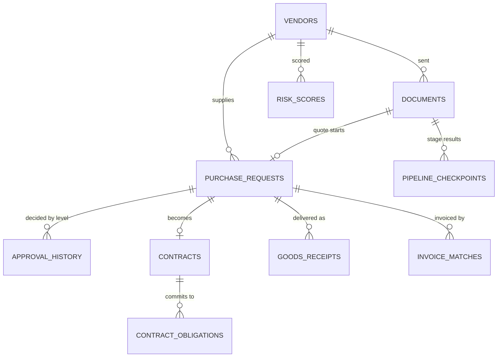

# Data model

One PostgreSQL database, shared by all services. Each service creates and
migrates its own tables; base tables come from `shared/db/init.sql`.

## Core entities

## Tables by owner

| Owner | Main tables |
|---|---|
| document-vendor-agent | `documents`, `pipeline_checkpoints`, `vendors`, `vendor_payment_change_requests`, `email_intake`, `model_routing_log`, `extraction_feedback`, `vendor_field_hints` |
| approval-inventory-agent | `purchase_requests`, `approval_history`, `approver_assignments`, `approval_delegations`, `inventory`, `licenses`, `license_usage`, `budgets`, `catalog_items`, `rfq_*`, `goods_receipts`, `invoice_matches`, `invoice_allocations`, `email_action_tokens` |
| contract-risk-agent | `contracts`, `contract_obligations`, `sla_credits`, `risk_scores`, `risk_rulesets`, `vendor_decisions`, `vendor_evidence`, `vendor_sanctions_screenings`, `vendor_scorecards` |
| notification-agent | `notification_log`, `notification_digest_queue`, `notification_reads`, `notification_templates` |
| auth-service | `auth_users`, `auth_tokens`, `auth_revoked_refresh_tokens`, `business_rules`, `business_rule_history` |
| chatbot-agent | `chat_sessions`, `chat_messages`, `document_embeddings` (pgvector) |
| shared | `audit_log`, `event_outbox`, `event_inbox`, `event_dlq`, `event_log` |

## Files

Original documents live in MinIO (bucket `documents`, key
`<document id>/<file name>`). Contract PDFs are rendered from the stored
contract text when downloaded, so the database holds the source of truth.
