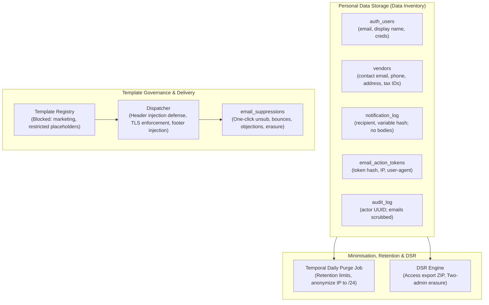

# Privacy Controls & Personal Data Governance

> **DRAFT - requires legal review**  
> **Notice**: This document and the associated privacy controls represent internal technical architecture drafts. The platform does not claim full legal compliance with GDPR, India DPDP Act, UK GDPR, or spam regulations; formal legal review by qualified counsel is required prior to commercial production deployment.

---

## 1. Scope and Operational Stance

### 1.1 Purely Operational B2B Messaging
The platform is designed exclusively for business-to-business (B2B) procurement workflows. All automated electronic messaging falls strictly under operational transactions:
- **Transactional Notifications**: Purchase request approvals, rejection notices, invoice match alerts, contract signature invites.
- **Security & Account Alerts**: Password reset links, verification tokens, security breach notifications, new login alerts.
- **Contract & Fulfillment Reminders**: SLA breach warnings, obligation fulfillment due dates, contract renewal milestones.
- **Operational Digests**: Daily batched summaries of non-urgent pending actions for approvers and buyers.

**Zero Marketing Stance**:
The system strictly does NOT send marketing, promotional, promotional discount, or commercial sales communications. The category `marketing` is rejected by API validation and cannot be chosen or saved in template governance.

### 1.2 High-Water-Mark Baseline: Uniform Technical Controls
Rather than fragmenting technical controls across jurisdictions, the system enforces a single high-water-mark baseline everywhere:
- Technical controls are implemented to the GDPR standard across all environments.
- Notice wording, statutory terminology, and deadline timers vary by jurisdiction using the configurable regime rule (`privacy.regime_by_country`):
  - **EU/EEA**: General Data Protection Regulation (GDPR) — 30-day DSR deadline, 72-hour supervisory authority notification.
  - **UK**: UK GDPR and Data Protection Act 2018 — 1 calendar month DSR deadline.
  - **India**: Digital Personal Data Protection Act, 2023 (DPDP Act) — Data Principal requests, Data Fiduciary obligations.
  - **US / CA / AU / Others**: State and federal privacy disclosures, anti-spam baseline (CAN-SPAM, CASL, Spam Act 2003).
- **Default Rule for Unknown Country**: When a user or vendor contact's jurisdiction is missing or unverified, the system defaults to the strictest standard (EU GDPR).

---

## 2. Architecture of Technical Controls

---

## 3. Core Technical Principles

1. **Minimisation by Default**:
   - Email bodies are not stored in logs (`privacy.store_email_bodies=false`).
   - Audit logs store actor user IDs, never raw email addresses.
   - Restricted fields (bank account numbers, IFSC codes, PAN, passwords, raw API tokens) are strictly barred from email templates.
2. **Deterministic Retention & Automated Purge**:
   - Automated daily Temporal purge job removes or anonymizes expired records according to Business Rules.
   - IP addresses and user agents older than retention are truncated to IPv4 `/24` and cleared.
   - Statutory retention and legal hold flags (`vendors.legal_hold`, `purchase_requests.legal_hold`) prevent premature destruction of audit or tax evidence.
3. **Data Subject Rights (DSR)**:
   - Full data portability export: generates an encrypted ZIP of machine-readable JSON files spanning all personal data stores.
   - Safe Erasure: Two-admin approval required; records are pseudonymised to `erased:<hash>`, maintaining foreign-key audit trail integrity without retaining PII.
4. **Transport Security & Anti-Tracking**:
   - TLS strictly required for all SMTP transports outside local development.
   - Zero open-tracking pixels, zero click redirects, zero remote images in email templates.
   - One-click RFC 8058 list unsubscribe headers for digest emails.

---

## 4. Documentation Index

The following draft documents provide detailed guidance and registers:
- [`data-inventory.md`](data-inventory.md): Full register of every store of personal data across the 6 services.
- [`processing-records.md`](processing-records.md): Article 30 GDPR processing records table.
- [`privacy-notice.md`](privacy-notice.md): Multi-jurisdictional privacy notice draft for buyers and vendors.
- [`processor-checklist.md`](processor-checklist.md): Sub-processor evaluation and Data Processing Agreement checklist.
- [`dpia-lite.md`](dpia-lite.md): Data Protection Impact Assessment Lite for automated procurement.
- [`retention-schedule.md`](retention-schedule.md): Technical retention schedule mapped to business rules.
- [`dsr-procedure.md`](dsr-procedure.md): Step-by-step Standard Operating Procedure for fulfilling DSRs.
- [`incident-runbook.md`](incident-runbook.md): 72-hour security incident and data breach response runbook.
