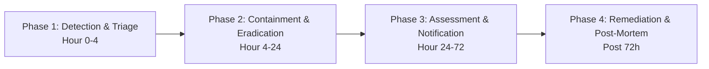

# Privacy Incident & Breach Response Runbook

> **DRAFT - requires legal review**  
> **Mandatory Notification Window**: 72 hours under GDPR Article 33 / UK GDPR.  
> **Classification**: Incident Response Standard Operating Procedure

---

## 1. Statutory Guidance & Notice
> **GDPR Guidance**: Notify the competent supervisory authority within **72 hours** of becoming aware of a personal data breach where feasible, unless the breach is unlikely to result in a risk to the rights and freedoms of natural persons. Confirm exact obligations and deadlines for your specific operating jurisdictions with legal counsel.

---

## 2. Platform Incident Register (`privacy_incidents`)

Every security event involving potential compromise or unauthorized disclosure of personal data must be recorded immediately in `privacy_incidents`:
- `id`: Unique Incident UUID.
- `detected_at`: ISO timestamp when the platform or team first detected the incident.
- `description`: Technical summary of the vulnerability, breach vector, or unauthorized exposure.
- `data_categories`: Types of personal data exposed (e.g., employee emails, vendor tax IDs, approval tokens).
- `subjects_affected_estimate`: Estimated count of impacted data subjects.
- `contained_at`: Timestamp when the technical vulnerability or access path was severed.
- `authority_notified_at`: Timestamp when formal notification was submitted to regulatory authorities.
- `individuals_notified_at`: Timestamp when impacted individuals were communicated with.
- `notes`: Ongoing investigation findings and remedial actions.

---

## 3. Four-Phase Incident Response Protocol

### Phase 1: Detection & Triage (Hour 0 to Hour 4)
1. **Log Entry**: Record incident in the Privacy Admin UI (`POST /admin/privacy/incidents`).
2. **Clock Initialization**: The administrative console starts the 72-hour countdown timer calculated from `detected_at`.
3. **Escalation**: Alert the Incident Commander, Chief Information Security Officer (CISO), and Legal Counsel.

### Phase 2: Containment & Eradication (Hour 4 to Hour 24)
1. **Access Revocation**: If compromised credentials or tokens are suspected, immediately invoke `POST /auth/revoke-tokens` or bump `token_version` in `auth_users` to terminate active sessions.
2. **Network Isolation**: If an external processor or outbound integration is compromised, deactivate SMTP settings or block external fetches via `shared/net/safe_http.py`.
3. **Record Containment**: Set `contained_at` in `privacy_incidents`.

### Phase 3: Assessment & Authority Notification (Hour 24 to Hour 72)
1. **Risk Evaluation**: Assess whether high risk to individuals' rights and freedoms exists (identity theft, financial fraud, reputational damage).
2. **Supervisory Authority Filing**:
   - **EU/EEA**: File preliminary notice with Lead Supervisory Authority (e.g. DPC Ireland, CNIL France, BfDI Germany).
   - **UK**: File report with Information Commissioner's Office (ICO).
   - **India**: Submit report to the Data Protection Board of India / CERT-In pursuant to DPDP and IT (Security Rules) guidelines.
3. Record `authority_notified_at`.
4. If high risk is present, draft direct notifications to affected data subjects and record `individuals_notified_at`.

### Phase 4: Remediation & Post-Mortem
1. Complete code patches, regression tests, and security review.
2. Archive root-cause analysis in `docs/privacy/incidents/<incident-id>.md`.
