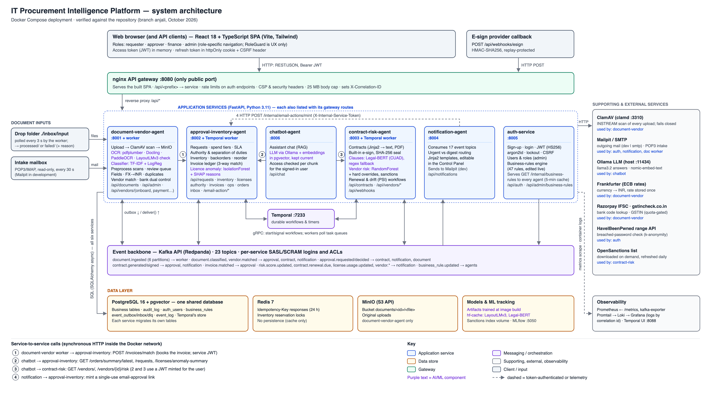

# IT Procurement Intelligence Platform

Five cooperating services ("agents") that automate IT procurement:
reading invoices, POs and quotes; routing purchase requests for approval;
tracking inventory and SaaS license usage; generating contracts and
collecting e-signatures; scoring vendor risk; and emailing the people
involved. They share one Postgres database, talk over Kafka, and sit
behind one nginx gateway that also serves the React frontend.

A student team project (Anjali, Vaidehi, Niraj, Anooj). It's a working,
tested prototype, not a production deployment — see [TODO.md](TODO.md)
for what's open (with the roadmap), `git log` for what changed, and
[docs/index.html#showcase](index.html#showcase) for how to present it (the 5-minute demo, the full walkthrough for external evaluators, the what's-new run for mentors); [docs/presentation.html](presentation.html) holds what to show while presenting.

- [Architecture](#architecture)
- [Prerequisites](#prerequisites)
- [Setup](#setup)
- [Configuration](#configuration)
- [Using it](#using-it)
- [Testing](#testing)
- [Project structure](#project-structure)
- [How it works](#how-it-works)
- [Troubleshooting](#troubleshooting)
- [Documentation site (MkDocs)](#documentation-site-mkdocs)

## Architecture

```
 browser ──► nginx :8080 ──┬─ /            React app (frontend/dist)
                           └─ /api/<svc>/  ─► FastAPI services
                                              │
      document-vendor-agent  approval-inventory-agent  contract-risk-agent
      notification-agent     auth-service
                                              │
   Postgres · Kafka (Redpanda) · Temporal · Redis · MinIO · ClamAV · Mailpit
```

| Service | Port | Does |
|---|---|---|
| document-vendor-agent (+ worker) | 8001 | Upload (virus scan, type checks) → MinIO; worker extracts text, classifies, extracts fields, matches/vets vendors, books invoices against the ledger, flags duplicates |
| approval-inventory-agent (+ worker) | 8002 | Purchase requests, Temporal approval workflows, approval authority, inventory, license usage anomaly model + reclaim, invoice ledger, order monitor |
| contract-risk-agent (+ worker) | 8003 | Contract generation (text + PDF), e-sign webhook / Documenso client, renewal reminders, vendor risk model (RandomForest, MLflow) and drift check, offboarding |
| notification-agent | 8004 | Consumes events, renders email templates, sends immediately or in digests (to Mailpit) |
| auth-service | 8005 | Accounts, login/sessions, email verification and password reset, roles, business-rules engine |

Infrastructure (22 containers in total, `docker-compose.yml` +
`docker-compose.override.yml`): Postgres, Redis, Redpanda (Kafka API) and
its one-shot `redpanda-init`, Temporal + Temporal UI, MinIO, ClamAV,
Mailpit, MLflow, Prometheus, Grafana, kafka-exporter, nginx. Every image
is pinned (`tests/test_env_example.py`). MinIO is `pgsty/minio`, the
community continuation, because `minio/minio` can no longer be pulled;
`install.sh` creates the bucket with the `mc` inside that container.

Shared contracts:
- Kafka events: [`shared/schemas/events.md`](../shared/schemas/events.md)
  (envelope + payload per topic), topic list `shared/kafka-topics.yaml`,
  per-service permissions `infra/redpanda/acls.conf`.
- REST envelope: `{"data": …, "meta": …}` or
  `{"error": {"code", "message"}}`, enforced by
  `shared/http/error_handlers.py`.
- Auth: `shared/auth/` (JWT verification, `require_role`), used by every
  service at router level; only `/health`, `/metrics` and the signed
  e-sign webhooks are unauthenticated.

## Prerequisites

- **Docker** with Compose v2 (`docker compose`): Docker Desktop on macOS /
  Windows, Docker Engine + compose plugin on Linux. Give Docker about
  8 GB of memory (ClamAV alone holds ~1 GB; the document worker loads
  Docling and, if downloaded, LayoutLMv3).
- **Internet** for the first build, for the breached-password check at
  sign-up (HaveIBeenPwned; sign-up returns 503 without it), and for the
  optional model downloads (LayoutLMv3 ~500 MB, Legal-BERT ~440 MB) and
  the sanctions list (~78 MB).
- **Ollama** on the host for the assistant (chatbot):
  `brew install ollama && brew services start ollama && ollama pull llama3.2:3b && ollama pull nomic-embed-text`
  (~2.3 GB). The assistant is retrieval-augmented: it searches an index of
  contract clauses, document text, business rules and current records
  (requests, vendors, licences, budgets, totals) and answers only from what
  it finds, citing the source (`CT-…`, `DOC-…`, `PR-…`, a rule key). The
  index is built on start-up and kept current every minute; each chunk
  carries who may see it (staff; the owner of a request, contract or
  document; or everyone for rules and vendors), and bank details are masked
  before indexing. Before retrieving, it decides what the message means
  (`intent.py`): greetings, "like what", remarks and topic-only messages get a
  direct reply with example questions for the user's role; a name matching
  several vendors gets "which one?"; licence anomalies are answered from the
  live usage scores (`topics.py`: criteria, the threshold rule, closest
  licences, next steps). Evaluation: `python tests/e2e/chatbot_eval.py` →
  `docs/results/chatbot-eval.md`. Without Ollama the rest of the platform
  works; the assistant can't answer.
- **Python 3 + pip** on the host only for the end-to-end test scripts.
- Node is **not** needed: `run.sh` builds the frontend in a container.
- **Windows**: WSL2 with Docker Desktop's WSL integration; run `./run.sh`
  inside WSL (`run.ps1` / `run.bat` re-launch it there — not re-verified
  in the Sep 27 audit).

## Run on Linux (Ubuntu VM in UTM on a Mac)

Measured Oct 16: the running stack uses ~3.2 GB RAM idle and more while
reading scans; its images are ~15 GB, plus build cache and data volumes.

1. **Create the VM.** UTM → Create a New Virtual Machine →
   **Virtualize** (not Emulate: an Apple Silicon Mac runs ARM64 Linux at
   full speed, emulated x86 would be far too slow) → Linux → the
   **Ubuntu Server 24.04 LTS ARM64** ISO. Give it **4+ CPU cores, 10 GB
   RAM (8 GB minimum), 80 GB disk**; network "Shared Network". Install
   with the defaults and tick **Install OpenSSH server**.
2. **Install Docker and git** (inside the VM):
   ```bash
   sudo apt update && sudo apt install -y git curl python3-venv
   curl -fsSL https://get.docker.com | sudo sh
   sudo usermod -aG docker $USER && newgrp docker   # or log out and back in
   docker run --rm hello-world
   ```
3. **Get the code and start it:**
   ```bash
   git clone https://github.com/AnoojShete/ProcurementAutomation.git
   cd ProcurementAutomation && git checkout anjali   # the branch with the latest work
   ./run.sh                          # first run builds everything: 20-40 min on 4 cores
   ./scripts/download-models.sh      # optional: LayoutLMv3 cross-check + Legal-BERT clauses (~1 GB)
   ./scripts/seed-demo-data.sh       # demo vendor, requests, licences, stock
   ```
   `.env` is created from `.env.example`; don't copy the Mac's `.env`
   (it holds real keys).
4. **Open it from the Mac.** Find the VM's address with `ip -4 addr`
   (e.g. `192.168.64.5`). Simplest is an SSH tunnel, so every link and
   email works as `localhost` (only the app on :8080 listens outside the
   VM; Grafana, Mailpit, Temporal UI, MinIO listen inside it only):
   ```bash
   ssh -N -L 8080:localhost:8080 -L 8025:localhost:8025 -L 3000:localhost:3000 \
       -L 8088:localhost:8088 -L 9001:localhost:9001 <user>@192.168.64.5
   ```
   then http://localhost:8080 (stop the Mac's own stack first, or use
   other local ports). Without the tunnel, http://192.168.64.5:8080 also
   works for the app, but email links point at `APP_BASE_URL`
   (`localhost:8080`).
5. **Tests in the VM:** `./scripts/test-service.sh all`, and for the e2e
   scripts `python3 -m venv .venv && . .venv/bin/activate && pip install
   -r tests/e2e/requirements.txt`, then `make e2e` etc. (wait a minute
   between suites — gateway rate limits).

## Setup

```bash
git clone <repo-url>
cd ProcurementAutomation
./run.sh                        # whole stack; ends with "All services healthy."
./scripts/seed-demo-data.sh     # demo vendor, approved request, 5 licenses, 4 hardware SKUs
./scripts/download-models.sh    # optional, once per machine: LayoutLMv3 + Legal-BERT (~1 GB)
```

Then open **http://localhost:8080** and sign in with a
[demo account](#demo-accounts), or create your own.

What `run.sh` does: `install.sh` (creates `.env` from `.env.example` if
missing, starts infrastructure, applies `shared/db/init.sql`, creates Kafka
users/topics/ACLs and the MinIO bucket) → builds the images that need it →
builds the frontend in a `node:20-alpine` container if it changed → starts
the services (each applies its own migrations on start) → recreates nginx
last → waits for health checks. It prints one line per step plus an agent
health table; full output goes to `.run/run.log` and its tail is shown on
failure.

Images are rebuilt only when files under `services/<name>/` or `shared/`
changed since their last build, so the first run takes several minutes and
later runs take seconds. `./run.sh --build` rebuilds everything,
`./run.sh --no-build` just starts the existing images, `--verbose` shows all
output. Each worker runs its service's image (it isn't built separately).

`scripts/ensure-docker.sh` starts Docker Desktop / the daemon if it isn't
running. `make run | up | down | logs | reset | test | e2e` are shortcuts
(`make reset` deletes all data: `docker compose down -v` + `install.sh`).

Teardown: `docker compose down` (keeps data) or `docker compose down -v`
(deletes all volumes).

Before a demo: `./scripts/reset-demo.sh` backs up Postgres and MinIO to
`.run/backups/`, deletes only the data volumes (model caches, the
sanctions list and ClamAV signatures stay), restarts, seeds, and runs the
five demo scenarios so the history comes from the real flows (~3 min;
`--yes` skips the question). The e2e suites leave test data behind, so
run it after them.

Backups: `./scripts/backup.sh` dumps every Postgres database (app,
Temporal) and archives the MinIO volume into `.run/backups/` without
stopping anything; `./scripts/restore.sh` lists them and
`./scripts/restore.sh <stamp>` puts one back (it backs up the current data
first, so a restore can be undone). What is and isn't backed up, and the
checklist for a deployment beyond this machine (production secrets, HTTPS,
the advisories still open), are in [index.html#deploy](index.html#deploy).

## Configuration

Everything is read from `.env` (git-ignored; created from `.env.example`).
The demo compose defaults work without editing it. `tests/test_env_example.py`
keeps the two in step: every variable the compose files read is listed in
`.env.example`, and everything listed there is read by something. Image
versions are pinned in the compose files (the same test fails on a new
`:latest`), so a fresh clone gets the versions that were tested.

| Setting | Default in the demo | Notes |
|---|---|---|
| `APP_ENV` | `development` (set by compose) | Unset means **production**: services refuse the published default secrets below, don't seed demo accounts, disable showcase endpoints and simulated signing, and refuse `EMAIL_MODE=dev`. |
| `JWT_SECRET`, `ESIGN_WEBHOOK_SECRET`, `RULES_ENGINE_INTERNAL_SECRET`, `POSTGRES_PASSWORD`, `MINIO_ROOT_PASSWORD`, `KAFKA_PASSWORD_*` | published dev values | Must be real secrets outside development. |
| `JWT_EXPIRY_MINUTES` / `JWT_REFRESH_EXPIRY_DAYS` | 15 / 7 | Access token lifetime is also how long a disabled user's current token keeps working. |
| `EMAIL_MODE` | `dev` | `dev` = Mailpit (nothing leaves the machine, read mail at :8025); `smtp` = real delivery. |
| `SMTP_HOST`, `SMTP_PORT`, `SMTP_SECURITY`, `SMTP_USERNAME`, `SMTP_PASSWORD` | blank | Leave blank for `dev`. For `smtp`: port defaults to 587, security to `starttls` (`ssl` for 465). |
| `EMAIL_FROM`, `EMAIL_REPLY_TO` | `Procurement Platform <noreply@procurement.local>`, blank | With Gmail, `EMAIL_FROM` must be your Gmail address. |
| `APP_BASE_URL` | `http://localhost:8080` | Used to build the links in emails. |
| `PUBLIC_BASE_URL` | `http://localhost:8080` | External gateway URL used for email action links (`/email-action/*`). In production, **must be HTTPS** because plain HTTP exposes action tokens to network sniffing. |
| `INTERNAL_SERVICE_TOKEN` | `dev-internal-service-token-change-me` | Secret for internal service-to-service calls (`POST /internal/email-actions/mint`). Never exposed at the gateway. Change it for any shared deployment (until Oct 17 compose didn't pass it on, so it was always the default). |
| `ENABLE_SIGN_SIMULATED` | `false` | When false, `POST /contracts/{id}/sign-simulated` is disabled. Set true only for demo/dev without Documenso/DocuSign. |
| `AUTH_LOCKOUT_THRESHOLD` / `_WINDOW_MINUTES` / `_MINUTES` | 5 / 15 / 15 | Wrong passwords per address before a temporary lock. |
| `AUTH_COOKIE_SECURE` | off in development, on otherwise | Leave unset (or empty) for that default; set `false` only to test production mode over plain HTTP. |
| `APP_SHOWCASE_MODE` | on in development only | Enables the Controls page scenario endpoints. |
| `EMAIL_INTAKE_*` (`ENABLED`, `PROTOCOL`, `HOST`, `PORT`, `SSL`, `USER`, `PASSWORD`, `ADDRESS`) | Mailpit's POP3 mailbox | The mailbox documents are read from (pop3 or imap). |
| `GSTINCHECK_API_KEY` | placeholder | Only for live GSTIN lookups (off by default, admin toggle). |
| `GUARDIAN_API_KEY` | unset | Adverse-media check in live mode (free key, open-platform.theguardian.com). Unset = that check is "not assessed", never "no adverse media". |
| `APP_DOCUMENSO_API_TOKEN` / `_WEBHOOK_SECRET` | written by `scripts/documenso_setup.py` | With a token, contracts are signed by both parties through Documenso (below); without, the built-in e-sign. `APP_DOCUMENSO_API_URL` defaults to the `documenso` service. |
| `DOCUMENSO_PUBLIC_URL` | `http://localhost:3010` | Where browsers load the signing frame from; also in nginx's CSP `frame-src`. |
| `DOCUMENSO_NEXTAUTH_SECRET`, `DOCUMENSO_ENCRYPTION_KEY`, `_SECONDARY_KEY`, `DOCUMENSO_SIGNING_PASSPHRASE` | published dev values | Must be real secrets outside development. |
| `VITE_SHOW_DEMO_ACCOUNTS` (frontend build) | shown | Set to `false` when building for real users to hide the demo-login buttons. |

> [!NOTE]
> **Authorization vs. Signature**: An email approval records an **AUTHORIZATION** decision; the e-signature provider's flow (Documenso / DocuSign) produces the legally binding **DIGITAL SIGNATURE**. An email approval button is never described or treated as a digital signature.

Only **auth-service** uses the email settings. notification-agent still
sends every notification to Mailpit. Its email work belongs to Anooj, except the feature-expansion e-mails
(budget threshold, obligation due/breach, RFQ invitation/award/thank-you, goods received) and the final-checklist
work (editable templates, approvers resolved to real people, next-level and reminder emails, signer and vendor
emails), built on 21 Oct at the user's request. Recipients without an assigned person are still placeholder
role addresses.

### Company SMTP server (Email Settings)

Since 22 Oct admins can set the company's own SMTP server in the app
(**Email Settings**, sidebar and Control Panel; `/api/smtp` →
notification-agent `app/api/smtp_settings.py`, with a test-send). The password
is stored encrypted with AES-256-GCM (`shared/security/encryption.py`) using
`MASTER_ENCRYPTION_KEY` (or `ENCRYPTION_KEY`, then `SMTP_ENCRYPTION_SECRET`;
at least 32 bytes). Since 24 Oct a missing or short key stops the service
outside development, and each new ciphertext gets its own salt (`v2:`; old
`v1:` values still decrypt). **Open issue:** `encryption.py` reads a missing
`APP_ENV` as development, while every other service reads it as production,
so a deployment that forgets `APP_ENV` silently uses the built-in key, which
is public in the repo. Set `APP_ENV=production` and a real key before a shared
deployment; compose passes neither to notification-agent today.

### Real email with Gmail

1. Turn on 2-Step Verification on the Google account, then create an app
   password at https://myaccount.google.com/apppasswords.
2. In `.env`:
   ```
   EMAIL_MODE=smtp
   SMTP_HOST=smtp.gmail.com
   SMTP_USERNAME=you@gmail.com
   SMTP_PASSWORD=<16-character app password>
   EMAIL_FROM=Procurement Platform <you@gmail.com>
   ```
3. `docker compose up -d auth-service && docker compose restart nginx`.
   auth-service refuses to start if the SMTP settings are incomplete.
4. Sign up at http://localhost:8080/signup with a real address, click the
   link in the email, sign in, then use "Forgot password?" and reset it.
5. Check the stored password is a hash:
   ```bash
   docker compose exec postgres psql -U postgres -c \
     "SELECT email, left(hashed_password, 30) AS hash_prefix, email_verified_at
      FROM auth_users WHERE email = 'you@gmail.com';"
   ```
   `hash_prefix` shows `$argon2id$v=19$m=65536,t=3,p=4` (argon2id and its settings), never the password.

Other SMTP providers take the same settings (see `.env.example`). Steps
1–5 with a real Gmail account were not run in the audit; the same flow
runs automatically against Mailpit in `tests/e2e/auth_flows.py`.

## Using it

| What | URL |
|---|---|
| App | http://localhost:8080 |
| API (through the gateway) | http://localhost:8080/api/… |
| Email action (single-action token) | http://localhost:8080/email-action/… |
| Mailpit (all dev email) | http://localhost:8025 |
| Grafana (admin / admin) — Logs dashboard by correlation id | http://127.0.0.1:3000 |
| Temporal UI | http://localhost:8088 |
| MLflow | http://localhost:5050 |
| MinIO console (minioadmin / minioadmin) | http://localhost:9001 |
| Prometheus | http://localhost:9090 |

Only :8080 is reachable from other machines; every other port is bound to
127.0.0.1. Service ports 8001–8005 are for debugging only.

### Demo accounts

Seeded when `APP_ENV=development`, password `DemoPass123!` for all
(`@demo.example.com`): `admin@` **Anjali**, `finance@` **Niraj**,
`requester@` **Anooj**, `approver@` **Vaidehi**, and `approver2@` (no
name, for separation-of-duties checks). Five fictional colleagues give the
approver picker something to choose from: `requester2@` Rohan Mehta,
`requester3@` Sneha Kulkarni, `approver3@` Kavya Iyer, `approver4@` Arjun
Desai (both on the manager level) and `finance2@` Meera Joshi (finance
level). The login page has one-click buttons for the four team personas.
Pages show these names wherever the data holds an email.

### Roles and accounts

- **requester**: create purchase requests, upload documents, see own items.
- **approver** / **finance**: approval inbox (only levels they're assigned
  to in the approval authority matrix), licenses, vendors, risk (finance).
- **admin**: everything, plus **System** (`/app/system`): cards for
  System Health, Users, Controls, Control Panel, Business Rules and Audit.

Sign-up creates a *requester* after the email is confirmed; an admin
changes roles on **Users** (`/app/users`). A new approver also needs an
assignment on the Controls → Approval authority tab before they can
approve. Everyone can set their name, the theme (Light / Dark / Match
device, saved on the account) and password, and sign out of all devices,
on **Account settings** (`/app/account`, click your name in the sidebar).

### Finding your way around the app

- **Every item has one home page, and its actions live there.** A request
  (approve / reject) → `/app/requests/:id`; a contract (download, send
  for signature, sign, signature certificate) → `/app/contracts/:id`; a
  license (usage, anomaly reasons, reclaim, and any open reclaim request's
  approve / reject) → `/app/licenses/:id`; a vendor (risk, bank-detail
  verification) → `/app/vendors/:id`; a document (review) →
  `/app/documents/:id`. Lists, dashboards and the approval inbox open
  those pages — a license reclaim in the approval inbox opens the license
  page, the same page the Licenses tab opens.
- **The same action panel everywhere.** Each agent's actions are one
  component (`frontend/src/components/approvals/ApprovalActions.tsx`,
  `components/contracts/ContractActions.tsx`,
  `components/vendors/PaymentChangeVerify.tsx`) that talks only to that
  agent's API, reused wherever the item appears — so approving or signing
  works the same from every entry point.
- **Clickable lifecycle.** On a request, click any step of the Procurement
  Lifecycle for its details; the Approval step has approve / reject, the
  Contract step the contract's actions, and the Signature step opens the
  signing dialog. `?step=approval` in the URL opens a step directly.
- **Back arrow** at the top left of every page except the dashboard (and
  on the signed-out pages, back to sign-in).
- **Every dashboard figure opens its list**, filtered to what it counts:
  the filter is in the URL (`/app/requests?scope=mine&status=pending_approval`,
  `/app/vendors?risk=High`, `/app/contracts?renewal=60`,
  `/app/approvals?due=overdue`, `/app/licenses?status=anomalous`) and a
  chip above the list clears it.
- **Notifications**: the bell counts unread *important* notifications
  (urgent and delivered, sent to you or to a mailbox your role reads);
  reading one on the Notifications page lowers it. History and the
  system log (staff) hold everything else.

API example:

```bash
curl -s -X POST http://localhost:8080/api/auth/login -H 'Content-Type: application/json' \
  -d '{"email":"approver@demo.example.com","password":"DemoPass123!"}'
# {"data": {"access_token": "…", "token_type": "bearer", "expires_in_minutes": 60}}
# (the refresh token is set as an httpOnly cookie, not returned)
curl -s http://localhost:8080/api/requests/ -H "Authorization: Bearer <access_token>"
```

## Testing

Counts from Oct 16 unless a row says otherwise; the fresh-clone setup was
last verified on Sep 27 (separate Docker project, empty volumes). The test
plan and scenario matrix are in [readmeforme.md#appendix-d-testing-strategy](#appendix-d-testing-strategy);
the Oct 17 audit's findings and fixes in [quality-audit-report.md](quality-audit-report.md).

| Command | What | Result |
|---|---|---|
| `./scripts/test-service.sh all` (or `make test`) | Each service's pytest suite inside its image, source mounted | Oct 25: 1,330 passed (contract-risk 346, approval-inventory 290, document-vendor 375, notification 138, auth 115, chatbot 66). After a `requirements.txt` change, rebuild the service image first or its suite fails to import |
| root tests (command below) | `shared/` code and config checks (Kafka ACLs vs code, nginx rules, lifecycle, outbox, mailer) | Oct 25: 169 + 14 passed, 4 skipped (the chatbot's live script) |
| `make e2e` | Bash flow through the gateway: login, ClamAV reject/accept, request → approve → contract → signed webhook → risk → email → business-rule change | 17/17 (Oct 19) |
| `python tests/e2e/auth_flows.py` | Sign-up → email → confirm → login → change password → logout → forgot/reset, expired / reused links, lockout, enumeration, rate limit (reads Mailpit) | 42/42 |
| `python tests/e2e/invoice_lifecycle.py` | One fresh vendor's quote + invoice through all five agents, no DB shortcuts | 71/71 (Oct 19; adds auto-send after approval, mark-as-received, risk signal coverage) |
| `python -m pytest tests/e2e/test_flow.py` | Core flow + webhook bad-signature / replay | passed |
| `python tests/e2e/document_pipeline.py [--quick]` | Normal / huge / corrupt / empty / wrong-type / pathological files, duplicates, outages | 48/52 (`--quick`, Oct 19): `slow_to_parse.pdf` no longer hits the 120 s limit with Docling 2.140 (TODO E2E-1); 52/52 on Oct 15 |
| `python tests/e2e/ui_flows.py` | Browser (Playwright): back arrow, clickable lifecycle, approve and sign from lifecycle steps, approval-inbox routing, license page's open-request panel | 11/11 (needs `pip install playwright && python -m playwright install chromium`) |
| `python tests/e2e/demo_scenarios.py` | The five demo scenarios performed in a browser and checked → `docs/index.html#demo-script` | 18/18 |
| `python tests/e2e/demo_5min.py` | The 5-minute demo (`docs/index.html#demo-5min`) rehearsed and recorded → `docs/demo/backup-recording.webm` (replaced only when every step passes) | 5/5 (Oct 31, both parties sign in Documenso) |
| `cd frontend && npm run typecheck` | TypeScript | clean |

```bash
# once, for the e2e scripts
pip install -r tests/e2e/requirements.txt
# root tests (shared/ code, config checks) — each part in the image that has its dependencies
./scripts/test-root.sh
# screenshots in docs/showcase/ from the live stack; ends with "STEPS THAT FAILED" if a pipeline breaks
python tests/e2e/showcase_screens.py
# the demo script: five scenarios performed and checked live → docs/index.html#demo-script (~5 min)
python tests/e2e/demo_scenarios.py
# the 5-minute demo, rehearsed and recorded → docs/demo/backup-recording.webm
python tests/e2e/demo_5min.py
```

`scripts/test-service.sh` mounts `data/` read-only, so tests on the demo
data (e.g. the licence demo) run instead of skipping.

Notes:
- auth-service's account-flow tests need Postgres: with the stack running,
  `test-service.sh` gives them a throwaway `auth_test` database; otherwise
  they're skipped.
- The gateway rate-limits auth endpoints per IP. Running several e2e
  scripts back to back can hit it — wait a minute between suites.
- The image name in the root-test command follows the folder name
  (`<folder>-auth-service`).
- There's no Python linter configured; CI (`.github/workflows/ci.yml`)
  only builds images.

### Budgets (feature expansion Phase 1)

Finance sets a budget per **department × IT category × fiscal quarter**
(`/app/budgets`, or `POST /api/budgets/import` with many rows); categories are
hardware, software (licence requests), SaaS and IT services. Each new request
records the budget it draws on and the result of the check
(`within | warning | over | no_budget`). Nothing is stored as "spent": a
budget's usage is computed from its requests — *pending* while awaiting
approval or stock, *committed* once approved, *consumed* once invoiced — so
rejections and cancellations release money automatically. The budget row is
locked while a request is checked, so two simultaneous requests can't both
fit into the last rupees. Over-budget requests get a `finance_head` step (rule
`budget.over_budget_requires_finance_approval`); requests without a budget
follow `budget.no_budget_policy`; a request that takes a budget past
`budget.warning_threshold_pct` publishes `budget.threshold_crossed`. The
request page shows the budget line; e-mail approval of an over-budget request
is refused (`approval.email_action_allowed_over_budget`).
`python tests/e2e/budget_flow.py` checks the whole flow.

### Contract obligations (feature expansion Phase 2)

A signed contract is read for what it commits both sides to after
signature: SLA uptime and service credits, licence limits (users,
transfer, territory), price-increase cap, audit rights, warranty,
termination for convenience, minimum commitment, exit terms, data
protection, liability cap and insurance
(`contract-risk-agent/app/services/obligation_extraction.py`). A background
sweep in the contract-risk API (`obligation_service.run_obligation_sweeps`,
every 60 s) reads newly signed contracts — rules for every type, Legal-BERT
only for types listed in `MODEL_TYPES`, which are the ones where the model
beat the rules on CUAD and read every template value — licence limits and
termination for convenience (`ml/evaluate_obligation_model.py`,
`docs/results/obligations.md`); when the model abstains, the rules fill in. Each finding is stored as *to confirm*;
nothing is tracked until finance or an admin confirms it on the contract
page (`/app/contracts/:id`, *Obligations*), which sets its due date and
recurrence (SLA review monthly, audit window yearly, warranty and minimum
commitment from the signing date, price cap at the end date). The same
sweep then:

- publishes `contract.obligation.due` before each due date
  (`contract.obligation_reminder_days`, default 30 and 7 days), on the day of
  a monthly SLA review, and once when overdue — one per threshold, recorded
  as an `obligation_events` row so it is never sent twice;
- compares a confirmed licence limit linked to a licence with
  `licenses.assigned_seats` and marks it *breached* (and back *open* once
  within it).

Recording a month's measured uptime computes the service credit
(`credit_pct_per_step` for each `step_pct` or part of one below the commitment,
capped; monthly fee = request amount ÷ 12). The credit is *expected*
(`contract.sla_credit_auto_expect`) until finance marks it *applied* or
*waived*; meanwhile every invoice matched to that request carries a note
saying so (`invoice_ledger.expected_credit_notes`, shown on the document
page; `GET /api/invoices/ledger/{id}` lists `expected_credits`). Licence
reclaims never go below a confirmed minimum commitment
(`UsageService.contract_minimum_seats`). The licence page shows
"Contract limit: N seats · M assigned". Tables: `contract_obligations`,
`obligation_events`, `sla_credits` (contract-risk Alembic `0008`).
`python tests/e2e/obligation_flow.py` checks the whole flow.

### Sourcing (feature expansion Phase 3)

**IT catalog** (`/app/catalog`, approval agent `catalog_service.py`): approved
items with an agreed price, vendor, lead time, warranty and an optional
`valid_until`. A request line `{"catalog_item_id", "quantity"}` takes its
price, vendor and request type from the catalog whatever the client sent; a
switched-off or expired item is refused (`422 catalog_unavailable`), and
items from two vendors go in separate requests. Hardware items with a stock
SKU reserve stock as usual. A *seat add-on* (item linked to a licence) adds
its seats to `licenses.total_seats` when the request is received, and is
flagged if it would exceed the contract's confirmed seat limit (Phase 2).
`catalog.preapproved_max_inr` (default 0 = off) drops the manager step for
catalog-only requests up to that amount; finance steps stay.

**RFQs** (`/app/sourcing`, `sourcing_service.py`): finance or admin invites
two or more vendors with a deadline. Quotes come in by hand or from the
document pipeline: a quote whose text carries the RFQ reference
(`RFQ-3F9A2C`) from an invited vendor is linked within 30 s
(`sweep_quotes`). While an RFQ is sealed and open, the API returns who has
quoted but no amounts, to every role. It closes at the deadline (or earlier
once everyone quoted); then each quote is scored 0–1 per criterion among the
round's quotes and weighted by `sourcing.default_criteria` (price, lead
time, warranty, support rating, vendor risk band, on-time rate from the
scorecard; unknown = 0.5). A shortlist can go to another round; *award*
creates the purchase request (budget check and approval as usual,
`rfq_id` set). A request above `sourcing.rfq_required_above_inr` with no RFQ
or catalog price gets an advisory note on its page. Events `rfq.issued`,
`rfq.awarded`.

**Partial receipts** (`receipt_service.py`, `POST /api/requests/{id}/receipts`):
deliveries per line with asset tags; the first partial one moves the request
to `partially_received`, the one that completes it to `fulfilled` (licence
activation, stock release and seat add-ons happen then, once). *Mark as
received* records whatever is still outstanding. Once a request has
receipts, an invoice line for more than has been received is a variance
(`invoice.match_against_received`). Event `goods.received`.

**Vendor scorecard** (contract-risk `scorecard.py`, `GET /api/vendors/{id}/scorecard`,
table `vendor_scorecards`): on-time delivery rate, invoice accuracy (matched
without variance), RFQ response rate, SLA breach months and risk band;
recomputed on each vendor page view and nightly.
`python tests/e2e/sourcing_flow.py` checks all four.

### GST and TDS (feature expansion Phase 4)

All rates, thresholds and section codes are seeded with the values current in
October 2026 and **must be confirmed by the finance team or a chartered
accountant** before real use.

**GST check of every invoice** (document agent, stage `tax_agent` between
`currency_agent` and invoice matching; `tax_extraction.py` reads, `tax_check.py`
decides). It reads the supplier and buyer GSTIN, place of supply, taxable
value, CGST / SGST / UTGST / IGST, HSN/SAC per line and the IRN, then checks:
supplier GSTIN valid (format and check digit) and the vendor master's;
addressed to our GSTIN (`gst.buyer_gstin`); CGST + SGST when supplier and
place of supply are in one state, IGST otherwise; the rate expected for the
HSN/SAC codes (table `gst_rates`, longest prefix wins, editable on the GST
page); taxable value + GST = total (`gst.tax_tolerance_inr`). A supplier with
no GSTIN outside India: services are **reverse charge** (we pay 18 % IGST,
shown as GST payable), goods pay IGST at customs. Result in
`documents.tax_check`. A failed check forces review and publishes
`invoice.tax_flagged`; it **never changes the confidence score**
(`field_extraction.py` is untouched, so the review-gate study stays
comparable). No GST breakdown at all is *incomplete* (only noted) unless
`gst.require_breakdown` is on.

**E-invoice QR** (`einvoice.py`): the QR is found on the first two pages
(OpenCV's WeChat detector), its IRP signature (RS256 JWT) verified offline,
and seller GSTIN, buyer GSTIN, number, total and IRN compared with the
printed invoice. Key: `EINVOICE_PUBLIC_KEY` (PEM text) or `EINVOICE_PUBLIC_KEY_FILE` (the IRP's published key)
in production; in development the demo key `shared/einvoice/demo-irp-public-key.pem`,
whose private half `data/einvoice-demo/demo-irp-signing-key.pem` signs test
invoices (`scripts/gst_invoice_lib.py`). Production never trusts the demo
key. A missing QR is flagged only for a vendor whose turnover (tax profile)
is above `gst.einvoice_required_turnover_inr`.

**GSTR-2B** (`gstr2b.py`, `POST /api/gst/2b`, finance/admin): upload the 2B
JSON from the GST portal; entries are matched on supplier GSTIN + invoice
number (fuzzy, `vendor.duplicate_invoice_number_fuzzy_threshold`) and
compared on taxable value and tax: matched, value mismatch, *missing in 2B*
(our invoice of that month; ITC at risk), *not in our books*. A file for
another GSTIN is refused. Kept in `gstr2b_uploads`.

**TDS at booking** (approval agent `tds_service.py`, in
`invoice_ledger.book_invoice`): when an invoice is matched to its request, the
section is the vendor's (tax profile) or the category's
(`tds.category_sections`: hardware 194Q, software 194J(b), SaaS and services
194J(a)); the base is the amount before GST in INR (sent by the document
agent); nothing is deducted until one invoice or the year's total with the
vendor passes the section's threshold (194Q: only the part above ₹50 lakh);
the rate is the lower-deduction certificate's while valid, else the
section's, or the no-PAN rate. Kept on `invoice_matches` (`tds_*`,
`net_payable`) and shown in the request's invoice ledger and the TDS
register (`GET /api/tds/register`, totals per quarter and section).
Suppliers outside India are left to a CA (noted). Sections: table
`tds_sections`, editable.

**Vendor tax profile** (`/api/tds/vendors/{id}`, vendor page): PAN (must match
the GSTIN's PAN), TDS section, lower-deduction certificate rate and expiry,
Udyam number and MSME category, yearly turnover. Finance/admin edit,
approvers read; changes are audited.

**MSME deadlines** (`GET /api/tds/msme`): booked invoices of micro and small
enterprises are due `msme.payment_days` (45) after acceptance (later of
booking and last delivery), *due soon* `msme.warning_days` before.
Nothing is paid from the platform: *Paid at the bank*
(`POST /api/tds/invoices/{document_id}/paid`) records it and clears the list.

Page: `/app/gst` (approver, finance, admin): month figures, invoices with
their check, 2B reconciliation, MSME deadlines, TDS register, rate tables.
`python tests/e2e/gst_flow.py` checks every acceptance point (44 checks).

### Bulk approval and signing mandates (24 Oct)

Approvers and finance can tick several requests in the inbox and approve them
in one step. `services/approval-inventory-agent/app/services/bulk_service.py`
holds the single eligibility check (`bulk_eligibility`), used by the inbox,
the batch email page and `POST /api/requests/bulk-decision`. A request is
eligible only if it is pending at your step and within your authority, isn't
your own, is in INR and at most `approval.bulk_approve_max_amount`, isn't over
budget, its type isn't in `approval.bulk_excluded_request_types`, its vendor
is cleared (fails closed if contract-risk can't be reached) and it has no open
invoice mismatch. A batch is idempotent per approver and `Idempotency-Key`,
limited by `approval.bulk_actions_per_hour`, `approval.bulk_approve_max_items`
and `approval.bulk_approve_max_batch_total`, and each request is decided in its
own session through `ApprovalService.process_decision`, so authority, audit and
`approval.decided` are the same as for a single approval. Batches are kept in
`approval_batches` / `approval_batch_items`; the approver gets a
`bulk_approval_confirmation` email.

**Signing mandates** (`/app/signing-authority`, finance; contract-risk-agent
`app/api/mandates.py`, table `signing_mandates`): a finance user re-enters
their password and accepts a standing mandate with a maximum amount per
contract, valid for at most `contract.mandate_max_days`. With
`contract.auto_sign_enabled` on (off by default), when finance gives the final
approval in bulk or from an email link (`contract.auto_sign_allow_email_channel`)
and holds an active mandate, the contract-risk consumer signs the contract
straight away, provided it's within both the mandate and
`contract.auto_sign_max_amount` and the vendor isn't blocked. The certificate
names the batch and mandate. A bulk batch that would auto-sign needs an extra
acknowledgement (422 otherwise). This is an internal authorisation record with
a sealed PDF, not a legally recognised e-signature.

Also in this change: a next-action bar on request and contract pages
(`components/ui/NextActionBar.tsx`, server-computed `next_action`), a
reorder-suggestion drawer that creates a request (`PlaceReorderModal.tsx`,
roles in `reorder.create_request_roles`), and the ivory palette in
`styles/tokens.css`.

Vendor clearance for bulk and email approval (fixed 25 Oct): there is no
user JWT to forward, so approval-inventory-agent calls contract-risk's
`GET /internal/vendors/{id}/clearance` with `X-Internal-Service-Token`
(`INTERNAL_SERVICE_TOKEN`, the same secret notification-agent uses for
`/internal/email-actions/*`). It runs the same `clearance.evaluate` as the
public route, and any failure still counts as not cleared. nginx has no route
to `/internal/` (`tests/test_security_config.py`).

Batch-approval digest (25 Oct, `app/services/bulk_digest.py`): a background
loop in approval-inventory-agent checks every minute and, once per IST day
from `approval.bulk_digest_time_ist`, sends each approver with at least
`approval.bulk_digest_min_items` bulk-eligible requests one email
(notification.send, template `bulk_approval_digest`) with a batch link to
`/email-action/batch/<token>`, at most `approval.bulk_approve_max_items`
requests. Eligibility is `bulk_eligibility`, so the email never offers more
than the inbox. The batch token and the email commit together (outbox); a new
digest revokes the approver's older unused links; a Redis key plus "a token was
minted today" stop a second send after a restart. `approval.bulk_digest_enabled`
switches the digest; `approval.bulk_email_enabled` switches the whole channel
(no digest, no minting, batch pages say "turned off").

Signing-mandate password (fixed 25 Oct): contract-risk forwards the caller's
bearer token to auth-service `POST /auth/verify-password` (rate-limited like
login at the gateway), which checks the JWT user's password, counts a wrong one
toward lockout and starts no session. No fallback passwords; auth-service down
→ 503; wrong password → 400 `wrong_password` (the web client signs out on any
401). The gateway now routes `/api/mandates` to contract-risk. On 25 Oct `ruff check --select F821` found
seven undefined names, six of them from this change. The worst was `get_rule`
in contract-risk's consumer: every final approval failed after its contract
was generated, so the contract was never sent for signature. The others were
`get_rule` in `requests.py` (reorder requests) and `email_action.py` (batch
page), `select` in `requests.py` (next action of an approved request),
`datetime`/`timezone` in the consumer and `models.py`, and `logger` in
`rulesets.py` (older). The live run found four more: the parallel risk checks'
sessions were never committed (every score failed, so contract generation
returned 500), notification-agent's `UserRef` pointed at a `users` table
(it's `auth_users`; no approval or contract e-mail was sent), and the approval
agent's `Contract` stub had no `status` while `bulk_eligibility` read
`AuthorityDecision.reason_code` (it's `code`), so `GET /requests/` returned
500 for admin and finance. All are fixed with a test that fails without the
fix. The unit tests that came with the change mocked these objects, which is
why they passed.

### Research experiment (selective automation)

The study in [RESEARCH_PAPER_PLAN.md](RESEARCH_PAPER_PLAN.md) runs on
generated invoices with known ground truth, inside the
document-vendor-agent image (the stack doesn't need to be running; ~1 h
to read 3,000 documents, then a few minutes):

```bash
docker run --rm -e APP_ENV=development -e HF_HUB_OFFLINE=1 -e GIT_COMMIT=$(git rev-parse --short HEAD) \
  -v "$PWD:/repo" -v procurementautomation_paddleocr-models:/root/.paddleocr \
  -w /repo/services/document-vendor-agent --entrypoint python procurementautomation-document-vendor-agent \
  scripts/eval_selective.py extract     # then the same with: scripts/eval_selective.py evaluate
```

`extract` renders the procurement world (`scripts/procurement_world.py`)
and reads every document with the production code, caching the result in
`data/procurement-world/` (git-ignored; resumable). `evaluate` computes the
evidence, runs the gates (`app/services/selective_gate.py`) on 20
vendor-grouped splits and writes `docs/results/selective.{json,md}`. One
worker: PaddleOCR takes ~5 GB, so two don't fit next to the stack in 8 GB.
`scripts/export_evidence.py` exports the same kind of evidence from the
live database (read-only).

## Project structure

```
services/
  document-vendor-agent/     app/ (api, services/pipeline.py, kafka, worker), migrations/*.sql, tests/
  approval-inventory-agent/  app/ (api, services, workflows, ml), migrations/0001_*.sql, ml/, tests/, README.md
  contract-risk-agent/       app/ (api, services, workflows), migrations/ (Alembic), ml/, templates, tests/
  notification-agent/        app/ (kafka, services, templates/*.j2), migrations/*.sql, tests/
  auth-service/              app/ (api/auth.py, api/users.py, account_tokens, lockout, emails), migrations/ (Alembic), tests/
shared/
  auth/          JWT create/verify, require_role
  eventing/      transactional outbox, consumer inbox / retry / dead-letter
  db/            init.sql (base schema), sql_runner.py
  http/          error envelope handlers
  mailer.py      SMTP / Mailpit sender
  lifecycle.py   purchase-request state machine
  rules_engine/  business-rules client
  runtime_env.py APP_ENV rules
  kafka_security.py, idempotency.py, logging/, infra/, taxonomy/, live_mode/, audit/, schemas/events.md
frontend/        React + TypeScript + Vite + Tailwind: src/pages (one home page per item), src/api (one module per agent),
                 src/components/<agent>/ (each agent's action panels); legacy-static/ = old version, unused
infra/           nginx/nginx.conf, redpanda/ (acls.conf, bootstrap.sh), prometheus/, grafana/ (k8s/ is empty)
tests/           root tests; e2e/ (run.sh, auth_flows.py, invoice_lifecycle.py, document_pipeline.py, test_flow.py, ui_flows.py,
                 showcase_screens.py, demo_scenarios.py, demo_5min.py)
data/            synthetic datasets + provenance READMEs
scripts/         test-service.sh, test-root.sh, seed-demo-data.sh, reset-demo.sh, download-models.sh, ensure-docker.sh, ci-build.sh,
                 generate_sso_logs.py
run.sh, install.sh, Makefile, docker-compose.yml, docker-compose.override.yml, .env.example, simulate_esign.py
```

## How it works

### Security and accounts

- **Passwords**: argon2id (64 MiB, t=3, p=4); legacy bcrypt hashes still
  verify and are re-hashed at login. 12–128 characters, must not contain
  the email, checked against HaveIBeenPwned (k-anonymity; fails closed).
- **Sign-up** → confirmation email (link valid 24 h) → login. Links are
  single-use, only their SHA-256 is stored, and the token sits after `#`
  so it never reaches server logs. Password reset links last 30 min.
- **No account enumeration**: sign-up, resend and forgot-password always
  give the same answer; a wrong email and a wrong password give the same
  401; timing is equalised with a dummy hash.
- **Lockout**: 5 wrong passwords for an address in 15 min lock it for
  15 min (tracked for unknown addresses too). Gateway rate limits: 30/min
  per IP on login / register / verify / reset / change-password, 6/min on
  forgot-password / resend.
- **Sessions**: access token (15 min) in memory; refresh token (7 days) in
  an httpOnly, SameSite=Strict cookie scoped to `/api/auth`, with
  double-submit CSRF on refresh and logout. Refresh tokens carry the
  user's `token_version`; changing / resetting a password, a role change,
  disabling the account or "sign out everywhere" bumps it, ending other
  sessions at their next refresh. Logout records the refresh token's `jti`
  (`auth_revoked_refresh_tokens`), so a copy of the cookie can't be
  refreshed afterwards.
- **Everywhere**: identity for audit fields comes from the JWT, never the
  request body; role checks on every route; uploads virus-scanned (fail
  closed) and type-checked by content; bank numbers masked for non-finance
  roles; published default secrets refused outside development; every
  port except the gateway bound to localhost; CSP and security headers;
  unexpected errors logged with a traceback but returned as a generic 500;
  validation errors never echo submitted values.
- **Kafka**: each service logs in with its own SASL/SCRAM account and may
  only use its own topics (`infra/redpanda/acls.conf`, kept in sync with
  the code by `tests/test_kafka_acls.py`). Traffic is not TLS-encrypted
  (single Docker host).

### Document pipeline

| Stage | Where | Outcome |
|---|---|---|
| Gateway | nginx | Over 25 MB → JSON 413 |
| Upload checks | `api/documents.py`, `upload_service.py` | Empty → 400; virus → 422; ClamAV down → 503; type from bytes (not extension) → 415; PDF page / image pixel caps; sanitised names |
| Store + record | MinIO + `documents` row `pending` + audit + outbox event, one transaction | MinIO down → 503, nothing half-written |
| Claim | worker (Kafka, 6 partitions) | `pending → processing`; a redelivered event can't process twice |
| Read the file | separate process, 120 s limit | pdfplumber for text PDFs, Docling for scans, PaddleOCR for images (deskewed and upscaled ≤ 1.5× first while the rule `document.image_preprocessing` is on; numbers in `docs/results/extraction.md`); unreadable / blank / too slow → `failed` with a readable message |
| Understand | `services/pipeline.py` | ML classifier (trained at image build, used when ≥ 0.6 sure; keywords otherwise — FR-29) → field extraction → LayoutLMv3 cross-check (if downloaded) → vendor match / GSTIN / IFSC, first-seen bank details held → learned labels → invoice ledger match → duplicate check (per-vendor lock) → confidence (< 0.8 → review queue) |
| Save | one transaction | `classified` + events; a dependency down → back to `pending`, retried after 1–4 min, `failed` after 5 attempts |

A sweep every minute re-queues documents stranded in `pending` or
`processing`.

Re-measure extraction accuracy (adds rotated / noisy / half-resolution
copies of every image, with and without preprocessing):

```bash
docker run --rm -e LD_PRELOAD=libz.so.1 -v "$PWD/services/document-vendor-agent:/app" \
  -v "$PWD/shared:/app/shared" -v "$PWD/data/synthetic-invoices:/data:ro" -v "$PWD/docs/results:/out" \
  -w /app --entrypoint python procurementautomation-document-vendor-agent scripts/eval_extraction.py
```

### Reorder suggestions

Each hardware item has a reorder point and a reorder quantity — set per
item (Inventory → pencil, admin/finance; `PATCH
/inventory/{id}/reorder-settings`) or, when empty, a share of the item's
total stock from the rules `inventory.reorder_point_pct` (20) and
`inventory.reorder_quantity_pct` (25). An item needs reordering when the
stock left after its backordered requests is at or below the reorder
point; the suggestion is *owed + top-up to the reorder point + reorder
quantity*, explained on the Inventory page
(`app/services/reorder.py`).

### Vendor onboarding

Finance / admin: Vendors → **Onboard vendor**. The profile is checked
by `POST /vendors/onboard/validate` as you go and again on save
(`POST /vendors/onboard`, `app/services/vendor_onboarding.py`):

| Check | Result |
|---|---|
| Name missing, bad email / phone / account number, GSTIN format or check digit, IFSC format or not in the directory | error — blocks |
| Same GSTIN as a vendor, or a name ≥ the fuzzy-match threshold (88) | error — duplicate |
| Name 70–87 % similar to a vendor | must be confirmed (possible impostor) |
| No GSTIN | must be confirmed with a reason (audit-logged) |

Bank details are never written onto the vendor: they become a pending
payment change (`source="onboarding"`) that a second person verifies.

### Email intake

Documents emailed to `invoices@procurement.local` (setting
`EMAIL_INTAKE_ADDRESS`) enter the same path as an upload — virus scan,
MinIO, pipeline — read by the document worker over POP3 or IMAP
(`EMAIL_INTAKE_PROTOCOL/HOST/PORT/SSL/USER/PASSWORD`; in development it
reads Mailpit's POP3, so mail sent to Mailpit's SMTP on :1025 is picked up
within 30 s). The mailbox is only read: each message is handled once
(`email_intake` table, with the reason for any rejected attachment), and
mail to other addresses is ignored. The document page shows "By email from
<sender>". Emailed documents follow the normal reviewed flow.

### Drop folder → signed contract (fully automated)

Put a vendor quote (PDF/PNG/JPEG/TIFF/WebP) in `./inbox/input`. No clicks after that:

| Step | Who | Kafka event |
|---|---|---|
| File noticed (size stable for one 3 s poll), moved to `inbox/.processing/` | document-vendor-agent-worker (`inbox_watcher.py`) | — |
| ClamAV scan → MinIO → `documents` row, uploader `inbox@procurement.local` | same code as a UI upload | `document.ingested` |
| Read / classify / match vendor | worker pipeline | `document.classified`, `vendor.matched` |
| File held in `inbox/.processing/<document id>/` until the pipeline ends, then moved to `inbox/processed/` (classified) or `inbox/failed/` (pipeline failed, `.error.txt` with the document's error) | worker (`inbox_watcher.settle`) | — |
| Quote → purchase request (skipped while it needs review, for duplicates, or without vendor/total) | approval-inventory-agent consumer | `approval.requested` |
| Auto-approved under the spend threshold, else the normal approvers | approval-inventory-agent | `approval.decided` |
| Contract generated, then sent for signature **once** (built-in e-sign: an authorised signatory signs in the app) | contract-risk-agent consumer | `contract.generated` |
| Signed in the app → request `ordered` | contract-risk-agent → approval-inventory-agent | `contract.signed` |

The file ends up in `inbox/processed/`, or in `inbox/failed/` with a
`.error.txt` (file, time, document id, reason) — rejected at upload or
failed in the pipeline. Control Panel → Documents shows each folder's count
and every dropped file's stage. Since Oct 16 requests made in the app are auto-sent for
signature too (rule `contract.auto_send_scope`, `drop_folder` restores the
old behaviour).

**Control Panel** (admin, `/app/control-panel`, in the sidebar) is
organised in sections (`?section=`): Overview, Documents (Input / Being
read / Processed / Failed counts, each dropped file's stage, every failure
reason), Processing and logs, Approvals (every queue with SLA countdown),
Notifications (template editor and recent emails), Contracts and
e-signatures (every contract with *Pending E-Signature* / *E-Signature
Complete* and its unsigned / signed PDF), Storage and Administration. It shows the Kafka
event log (every topic, read through a read-only `event-monitor` Kafka
login, payloads reduced to ids and statuses — no bank details; stored in
`event_log`, so it survives restarts, filterable by topic, time, text and
correlation id, kept `monitor.event_log_retention_days`), a **Failed
events** panel (open dead-letter entries with their error), each
dropped file's current step with links to its document / request /
contract, and the MinIO and DocuSign connections.

**Risk before signing.** The contract page and the signing dialog show
the vendor's latest risk (band, score, main factors, any hard override).
Signing needs the signer to tick an acknowledgement exactly when the
vendor isn't cleared for `purpose=contract` (the same decision as
`/clearance`, `app/services/clearance.py`: score, overrides, human decisions,
vendor status); the API refuses it otherwise (409
`risk_acknowledgement_required`, from `/sign` with the built-in e-sign or
`/signing-session` with Documenso). The band and the acknowledgement are
recorded: on the signature certificate (built-in), or in the audit log's
`signing_opened` entry when the company's signatory opens Documenso's frame. A **non-remediable override** (sanctions match
R-SAN-01, prohibited country R-JUR-01) blocks signing outright (409
`vendor_blocked`; the dialog says why), and an admin can't accept that risk
(400 `non_remediable_override`).

**Sanctions screening.** `./scripts/download-sanctions.sh` (once; ~80 MB,
no API key, OpenSanctions consolidated list, CC BY-NC 4.0) builds an index
of listed companies in the `sanctions-data` volume; contract-risk-agent
refreshes it daily afterwards. Each vendor is screened when scored (and
from the vendor page); a name at or above `risk.sanctions_match_threshold_pct`
(90) is a potential match and a hard override (High) until finance clears
it with a reason (`POST /vendors/{id}/clear-sanctions-flag`, audit-logged).

**Vendor risk scoring** is the deterministic vendor risk scorecard (merged 21 Oct from `updated_risk`): a 100-point ruleset —
identity and compliance 39, operational performance 35, cyber 17, company standing 6, reputation 3 —
over observations gathered by collectors (local records first, then format checks, then external
sources behind a circuit breaker). Bands: Low 0–24, Medium 25–49, High 50+. Hard overrides
(a sanctions match, a cancelled GSTIN, an invalid bank route) force High. Every vendor gets a band
(owner decision, 30 Oct 2026): a check whose status is `not_assessed` is left out and the
remaining points are re-weighted to 100 (`weighted_points = total_points × all_max / checked_max`,
e.g. 7 points over the 57 points checked = 12/100; `risk_scores.score` stores it / 100), and a
vendor with no check done is High until one completes. Missing information *about the vendor*
(no country, GSTIN, registration date, financial evidence, bank details, website or mail domain:
`engine.vendor_unverified`) counts as that check's full points instead, and a vendor with no verified
GSTIN or registration date is High (`identity_verified`). Detect-only checks that couldn't run (news,
breach) don't count against coverage. A vendor whose required checks are incomplete is
`provisional` and is never cleared, whatever its band (clearance reads `rating_status`, not the
band); `not_rated` means nothing could be assessed. Every score stores its snapshot and SHA-256, so it can
be replayed exactly (`GET /vendors/{id}/risk/{score_id}/replay`). `GET /vendors/{id}/clearance?purpose=`
answers whether a vendor may be used for activation, a purchase or a contract, taking post-score
decisions (approve, approve with conditions, accept risk — admin only, reject) and vendor status into
account. Evidence, disputes, a remediation plan and what-if simulation are on the vendor's scorecard
page (`/app/vendors/{id}/risk`); admins manage rulesets (draft, validate, dry-run, activate) under
Business Rules, and a weekly monitoring report replaces PSI drift monitoring (retired; the worker
ends the old schedule). The earlier random forest is archived in `ml/archive/`. The red-team set
(`ml/redteam_scorecard.py`, 27 profiles through the real engine and clearance, run by
`tests/test_risk_redteam.py`) and the ruleset's evaluation on the forest's test split
(`ml/evaluate_scorecard.py`, ROC-AUC 0.738 vs 0.715) are written up in `docs/index.html#risk`, with
the merge review (G1–G11, all closed or decided). Rule `approval.unrated_vendor_requires_finance`
(off) gives purchases from vendors whose checks are incomplete (provisional Low/Medium) a finance step.
A sweep re-scores vendors after a delivery. `tests/e2e/risk_flow.py` checks the module and
everything that reads it (signing, budget routing, RFQ scoring, notifications, onboarding).

### Contract e-signature (Documenso, two parties)

Both parties sign on the platform's own pages; Documenso (self-hosted, the
`documenso` service, :3010) does the signing inside an embedded frame and
seals the executed PDF. Setup, once (and after `reset-demo.sh`, which does
it): `python scripts/documenso_setup.py`, then `docker compose up -d
contract-risk-agent contract-risk-agent-worker && docker compose restart nginx`.

1. **Send** (contract page, or automatically after approval when the vendor
   has a contact email): the PDF goes to Documenso as one envelope with the
   company's signatory first and the vendor's second, one signature field
   each, placed over the PDF's signature lines (`contract_pdf.SignatureSlot`).
   Documenso emails nobody. A blocked vendor's contract isn't sent.
2. **Company signs** on the contract page: only the named signatory (JWT
   email) gets the frame, after the vendor-risk check (acknowledged when
   required, kept in the audit log).
3. Documenso's webhook (`DOCUMENT_RECIPIENT_COMPLETED`) records it and the
   vendor is emailed (`shared/mailer.py`) a `/sign#token=` link: random,
   only its SHA-256 stored, valid `APP_VENDOR_SIGNING_LINK_DAYS` (30); a new
   link from the contract page replaces it.
4. **Vendor signs** on `/sign` (no account) in the same frame.
5. Both signed: the contract is `signed` (`contract.signed` through the
   outbox) and the signed copy is Documenso's PDF: signatures on the lines,
   a PAdES signature with `secrets/documenso/cert.p12`, and its signing
   certificate (who, when, device). A decline puts the contract back in draft.

Code: contract-risk-agent `signing_service.py`, `esign_client.py` (Envelope
API), `api/vendor_signing.py` (the only unauthenticated contract route),
table `contract_signers` (Alembic `0015`); frontend
`components/contracts/{EmbeddedSigning,DocumensoSignModal}.tsx`,
`pages/sign/VendorSigningPage.tsx`. Tests: `tests/test_two_party_signing.py`,
`tests/e2e/esign_flow.py`.

Legal standing: a simple electronic signature with an audit trail. In India
a contract formed electronically is valid (IT Act 2000 s.10A) and the record
is evidence (Bharatiya Sakshya Adhiniyam s.63 certificate), but it is not
one of the signatures the Act presumes genuine (Aadhaar eSign, DSC), and
some documents can't be signed electronically at all (First Schedule). The
development certificate is self-signed; production needs one from a
certifying authority. Signing mandates still sign company-only with the
built-in e-sign.

The DocuSign client is kept but unused. To try it anyway: the DocuSign block in `.env.example`,
`APP_ESIGN_AUTO_PROVIDER: docusign` in contract-risk-agent's environment
in `docker-compose.override.yml` (compose doesn't pass it through
otherwise), restart contract-risk-agent, then
**Grant consent** on the Control Panel once.

### Platform controls

Visible on the **Controls** page (`/app/controls`, finance + admin), each
with a live scenario (showcase mode):

| Control | Where |
|---|---|
| Transactional outbox, consumer retry + dead-letter table, purchase-request state machine, reconciler | `shared/eventing/`, `shared/lifecycle.py`, `approval-inventory-agent/app/services/order_monitor.py`, `/api/ops/*` |
| Approval authority + separation of duties + delegations | `approval-inventory-agent/app/services/approval_authority.py`, `/api/authority/*` |
| Picking the manager-level approver: optional on the request's Review step; only that person (or their delegate) can decide that level and only they are emailed and reminded; a pick that's no longer assigned falls back to everyone on the level | `purchase_requests.selected_approver`, `approval_authority.check_selection`, `/api/authority/approvers` |
| Invoice ledger: line-level three-way match, partial invoicing, 1 % tolerances (business rules) | `approval-inventory-agent/app/services/invoice_ledger.py`, `/api/invoices/*` |
| First-seen bank details → verification queue + payment hold (dual control) | `document-vendor-agent/app/services/pipeline.py`, `/api/vendors/payment-changes/pending` |
| Learning from reviewer corrections (per-vendor field labels and review thresholds) | `document-vendor-agent/app/services/learning.py` |

Not everything is covered yet: some events are still published directly
rather than through the outbox, and notification-agent's consumer isn't
wrapped with the retry / dead-letter handler (TODO.md).

### Other features

- **Approvals**: spend tiers from the business-rules engine (≤ ₹500 auto,
  ≤ ₹5,000 manager, above that manager + finance); a Temporal workflow per
  request with SLA escalation. Decisions apply asynchronously (the UI
  polls). `approval.requested` / `approval.decided` go through the outbox
  (relay in the API process), so a decision can't be recorded without its
  event.
- **License intelligence**: IsolationForest trained on 360 simulated
  licences, SHAP reasons (`contribution` > 0 = pushes toward anomalous);
  windows are counted back from the log's latest login, not today. A licence
  whose status is "anomalous" (rule `license.anomaly_anomalous_threshold`)
  gets a reclaim request with a grace period
  (`services/approval-inventory-agent/README.md`, `docs/results/licence-anomaly.md`).
- **Contracts**: Jinja2 templates → text + PDF; clause extraction on the
  generated text — Legal-BERT fine-tuned on CUAD (`clause_model.py`,
  regex rules as fallback, `docs/results/clauses.md`); the notice period and
  end date the contract was written with are kept, a disagreeing reading is
  logged to the audit trail; sent for signature automatically after every approval
  (business rule `contract.auto_send_scope`); signed with the **built-in
  e-sign** — the only option offered in the UI since Oct 15 (an
  approver/finance/admin signs in the app — typed or drawn signature,
  consent, and a SHA-256 seal of the contract and signer details in the
  audit log, viewable as a signature certificate; the signer is always the
  signed-in account). The HMAC-signed, replay-protected
  `POST /api/webhooks/esign` remains for tests and integrations; the
  DocuSign / Documenso clients are kept in the code but unused. Signed
  copy download. Signing sets the request to `ordered`; "Mark as
  received" sets `fulfilled`. The
  seal is an unkeyed hash: it shows tampering only as far as the audit log
  itself is trusted.
  Renewal reminders via a Temporal workflow, counted back from the notice
  deadline (end date − notice period); the contract page shows the next one.
- **Vendor risk**: a deterministic 100-point scorecard with hard overrides
  (sanctions, cancelled GSTIN, bank route → High), rating statuses
  (assessed / provisional / not rated — never a false Low), a clearance gate,
  decisions, evidence, disputes and exact replay. The random forest it
  replaced (ROC-AUC 0.715, `docs/index.html#risk`) is archived.
- **Vendor vetting**: GSTIN format + checksum (+ optional live lookup with
  quota auto-cutoff), IFSC via Razorpay's free API, spend-based tiers.
- **Business rules**: 28 tunable rules edited live on an admin page with
  history; services refresh via Kafka.
- **Order monitor**: hourly summary of open orders (`/api/orders/summary/latest`).
- **Reminders** (`reminder.due`, `shared/reminders.py`): approvers at 50 % /
  80 % of the SLA (Temporal timers, stopped by a decision); signers after
  3 days; bank-detail verifiers and document reviewers after 24 h — all
  business rules, each item reminded once per threshold. Emails for them
  are notification-agent work (spec in TODO FR-03).
- **Observability**: Prometheus metrics on every service, a provisioned
  Grafana dashboard (request rate, latency, errors, Kafka lag), JSON logs.
  Every API request gets a correlation id (nginx `X-Correlation-ID`,
  echoed in the response) that follows it through events into every
  service; Loki + Promtail collect all logs, and Grafana's **Logs**
  dashboard shows one id's lines across services. Open Grafana at
  `http://127.0.0.1:3000` (admin / admin) if `localhost:3000` is taken by
  something else on your machine.

### Migrations

Each service owns its tables and migrates on start:
Alembic for auth-service and contract-risk-agent (own version tables,
since all services share one database), ordered raw SQL files for the
others (split by `shared/db/sql_runner.py`, idempotent). Base tables come
from `shared/db/init.sql` (applied by `install.sh`; don't edit it for new
work).

## Troubleshooting

- **502 from the gateway after rebuilding a service**: nginx caches upstream
  addresses at boot — `docker compose restart nginx`.
- **429 "Too many requests from your network"**: gateway rate limit on auth
  endpoints; wait a minute.
- **429 "Too many failed sign-in attempts"**: account lockout; wait 15 min or
  reset the password.
- **Sign-up returns 503**: the breached-password service is unreachable (no
  internet).
- **No confirmation email in Mailpit**: `docker compose logs auth-service |
  grep "account email"` shows the reason.
- **First document upload is slow** (~45 s): models loading.
- **LayoutLMv3 "skipped_model_unavailable"**: run `./scripts/download-models.sh`.
- **ClamAV unhealthy / uploads 503**: it needs ~1 GB RAM; raise Docker's
  memory limit.
- **`minio/minio` or `minio/mc` won't pull**: they left Docker Hub and
  quay.io; the compose file uses `pgsty/minio` — pull again from a current
  checkout.
- **Leftover "E2E Test Vendor" / "Zenith Test Systems" rows**: e2e test
  data; `./scripts/reset-demo.sh` clears it (it backs up first).

## Documentation site (MkDocs)

The presentable documentation (overall template: introduction → conclusion;
one page per agent in the four-part agent template; Control Panel; APIs,
configuration, deployment, testing, troubleshooting; final-checklist
traceability) is a MkDocs Material site: pages in `docs/guide/`, config
`mkdocs.yml`, images reused from `docs/assets/` and `docs/showcase/` by
`scripts/mkdocs_hooks.py`.

```bash
python3.12 -m venv .venv-docs && . .venv-docs/bin/activate   # 3.9-3.13
pip install -r requirements-docs.txt
mkdocs serve            # http://127.0.0.1:8000
mkdocs build --strict   # what CI runs (.github/workflows/docs.yml) -> .run/docs-site/
mkdocs gh-deploy        # GitHub Pages (or Actions -> Docs -> Run workflow, tick deploy)
python scripts/render_diagrams.py   # architecture.png + functional-flow.svg/.png (Playwright)
python docs/assets/make_architecture_carousel.py   # architecture-1/-2.svg: the site's carousel and deck slides 4-5
```

## Data provenance

All data is synthetic; see each folder's README under `data/`
(`synthetic-invoices`, `synthetic-vendors`, `synthetic-sso-logs`,
`synthetic-classification`) and [`data/README.md`](../data/README.md) for
the retention policy and which tables hold personal data.

---

# Appendices

Folded in from separate files on 21 Oct 2026 to keep the number of documents down.

## Appendix A: System architecture



Vector version: [`assets/architecture.svg`](assets/architecture.svg) (use this
in the report; it scales without blurring). The figure is generated by
[`assets/make_architecture_svg.py`](assets/make_architecture_svg.py) — edit the
script and re-run it rather than editing the SVG by hand. For presenting, the
same architecture is split in two clickable parts, `assets/architecture-1.svg`
and `-2.svg`, from `assets/make_architecture_carousel.py`: the MkDocs page
shows them as a carousel and the Slides tab (`presentation.html#slides`, the
local final-review deck) as slides 4 and 5. A rendering of the
older feature/status chart (`index.html#status`) is in
[`assets/project-flow-render.png`](assets/project-flow-render.png).

Checked against the code on 17 Oct 2026 (branch `anjali`, working tree
including uncommitted changes).

### Components

| Component | Responsibility |
|---|---|
| **Web browser** (React 18 + TypeScript, `frontend/`) | One page per item (request, contract, licence, vendor, document); role-based navigation. Keeps the access token in memory; the refresh token is an httpOnly cookie protected by a CSRF header. |
| **nginx gateway** (`infra/nginx/nginx.conf`, port 8080) | The only public port. Serves the built SPA and proxies `/api/<prefix>` to the owning service, rate-limits the login and email-sending endpoints, adds security headers and a per-request `X-Correlation-ID`, caps uploads at 25 MB (100 MB for batches). |
| **document-vendor-agent** (8001) + worker | Takes documents in by upload, a drop folder (`./inbox/input`) or an intake mailbox. Scans each one with ClamAV, stores it in MinIO and queues it (`document.ingested`). The worker reads the file (pdfplumber / Docling / PaddleOCR, with image preprocessing), classifies it (TF-IDF + logistic regression, with a keyword fallback), extracts fields, cross-checks them with LayoutLMv3, matches or creates the vendor, sends bank details to a two-person check, converts the amount to INR, books invoices against the ledger, flags duplicates and decides whether a person must review it. |
| **approval-inventory-agent** (8002) + Temporal worker | Purchase requests, spend tiers and one approval workflow per request (SLA escalation and reminders), approval authority and separation of duties, inventory reservations and backorders, reorder suggestions, the three-way invoice ledger, licence-usage anomaly scoring (IsolationForest + SHAP), single-use email approval links, and an hourly order monitor. |
| **contract-risk-agent** (8003) + Temporal worker | Generates contracts from Jinja2 templates (text and PDF). Reads their clauses with Legal-BERT, falling back to regex rules. Built-in e-signature with a SHA-256 seal. Scores vendor risk (random forest plus hard overrides: GSTIN, sanctions, IFSC), screens vendors against sanctions lists, runs renewal-reminder workflows and a weekly PSI drift check. |
| **notification-agent** (8004) | Consumes 17 event topics and decides urgent vs digest. Renders Jinja2 email templates (admins edit them in the Control Panel: overrides and new templates in `notification_templates`, rendered in Jinja's sandbox), sends them through the shared mailer (Mailpit in development) and logs every notification. Serves each person's in-app feed from that log with read receipts (`notification_reads`), so the bell counts only unread, important notifications. |
| **auth-service** (8005) | Sign-up with email verification, login, refresh, logout and password reset (argon2id, lockout, breached-password check). Admin user management; each person's display name and theme (light / dark / match device). The business-rules engine: 47 tunable rules with a change history. |
| **chatbot-agent** (8006) | Retrieval-augmented assistant: a local Ollama LLM answers from an index (pgvector) of contract clauses, document text, business rules and current records, with access checked per chunk. |
| **Kafka (Redpanda)** | Event backbone: 23 topics, one SASL/SCRAM login per service, permissions in `infra/redpanda/acls.conf`. Events are written to a transactional outbox and relayed; consumers dedupe, retry, then dead-letter. |
| **Temporal** | Durable workflows: approvals (SLA timers and reminders), contract renewals, weekly drift check. |
| **PostgreSQL** | One shared database. Each service migrates its own tables; it also holds the outbox, inbox and DLQ tables, the event log and Temporal's own data. |
| **Redis** | Idempotency-key responses (24 h), inventory reservation locks. |
| **MinIO** | Original uploaded files (bucket `documents`). |
| **Supporting services** | ClamAV (malware scan, fails closed), Mailpit/SMTP, Ollama, Frankfurter (FX), Razorpay IFSC, gstincheck.co.in (quota-gated, off by default), HaveIBeenPwned, OpenSanctions. |
| **Observability** | Prometheus (metrics from every API and two workers, plus kafka-exporter), Promtail → Loki → Grafana (logs searchable by correlation id), Temporal UI, MLflow. |

### Data flow: one document, from arrival to a matched invoice

1. **Arrival.** A document arrives through `POST /api/documents/upload`, the drop folder or the intake mailbox. ClamAV scans it, its type is checked from its bytes (not its name), it is stored in MinIO, and a `documents` row is written. `document.ingested` goes into the outbox **in the same transaction**, so the row and the event are saved together or not at all.
2. **Claim and read.** The document worker consumes the event and claims the row (`pending → processing`; only one worker can claim it). Text extraction runs in a child process with a 120-second limit.
3. **Pipeline stages.** Classify → extract fields → LayoutLMv3 cross-check → vendor match (bank details go to dual control; look-alike vendor names are flagged) → learned per-vendor hints → FX to INR → invoice ledger (`POST /invoices/match` on approval-inventory-agent) → duplicate check (advisory lock per vendor) → confidence score and review decision.
4. **Results.** The results, an audit row and the `document.classified` and `vendor.matched` events commit together. If a dependency is down, the document goes back to `pending` and a sweep retries it with back-off; after 5 attempts it is marked failed.
5. **Downstream reactions.** contract-risk-agent scores the vendor (`risk.score.updated`). notification-agent emails the people involved. approval-inventory-agent turns a quote dropped into the drop folder into a purchase request.
6. **Approval.** A request runs an `ApprovalWorkflow` in Temporal. Each decision is checked against the approver's assignment, amount limit and separation-of-duties rules, then signalled to the workflow, which publishes `approval.decided`.
7. **Contract and signature.** contract-risk-agent generates the contract and sends it for signature automatically. Signing (built-in e-sign; vendors rated High or not yet scored need an explicit risk acknowledgement) publishes `contract.signed`, and the request moves to `ordered`.
8. **Receipt and invoice.** "Mark as received" moves the request to `fulfilled`. An invoice booked by the ledger moves it to `partially_invoiced` or `invoice_received`. Every status change goes through the state machine in `shared/lifecycle.py`.

### Gap found by this review (fixed 21 Oct)

`approval.decided` is published once per approval level, and
contract-risk-agent used to generate a contract on **any** "approved"
decision, so for a manager + finance request the contract existed before
finance decided. Since 21 Oct `_handle_approval_decided` generates only
after the final level (`is_final_approval`: `level_<n>` with n = the chain
length, or `auto`); test `TestContractOnlyAfterFinalApproval`, checked live
with a ₹42,000 request. Contracts already generated early in the
development database were left as they are.

## Appendix B: Model routing and fallback (FR-08)

Where the platform chooses between a primary model and a fallback, when the
fallback fires, and how to show it on demand. Checked against the code on
16 Oct 2026.

Every routed decision is written to `model_routing_log` (route, model,
fallback and its reason, confidence, duration) and shown on **System
Health → Model Routing Log** (admin); counts are also exported as the
Prometheus metric `model_routing_total`.

### Routers

| Router | Service / file | Primary | Fallback | Fallback fires when | Logged as |
|---|---|---|---|---|---|
| **Text extraction** | document-vendor-agent · `app/services/extraction_router.py` | pdfplumber (PDF text layer) · Docling (scanned PDFs) · PaddleOCR (images) — in a killable subprocess with a time limit | LayoutLMv3 second reading of the image (`_layoutlm_image_fallback`); if that fails, the primary's text is kept | an **image**'s OCR quality is below `document.extraction_fallback_confidence_threshold` (0.5) — reason `low_confidence`; or forced (below) — reason `forced`. A file that can't be read at all fails with a message for the uploader instead | `docling_text` / `docling_paddleocr` / `layoutlmv3_fallback` |
| **Clause extraction** | contract-risk-agent · `app/services/clause_router.py` | Legal-BERT fine-tuned on CUAD (`alex-apostolo/legal-bert-base-cuad`, `clause_model.py`) finds the renewal, notice and expiry passages; parsers turn them into values (FR-13) | regex rules (`clause_extraction.extract_clauses`) | the model isn't downloaded (`model_unavailable`), raised (`exception`), found fewer than 40 % of the three clauses (`low_confidence`, rule `contract.clause_extraction_fallback_threshold`), or forced (`forced`) | `legal_bert_primary` / `regex_fallback` |
| **Document classification** | document-vendor-agent · `app/services/classification.py` | ML classifier (TF-IDF + logistic regression, `ml/artifacts/classifier.joblib`, trained at image build — FR-29) when ≥ 0.6 confident | keyword classifier | the model is less than 60 % sure, or no model was kept (training keeps it only if it beats the keywords) | not routed through the log |

Not routers, listed for completeness:
- **LayoutLMv3 cross-check** (document-vendor-agent pipeline): a second
  opinion on every document when the model is downloaded; disagreement
  forces review. It never replaces the primary result.
- **Assistant / chatbot**: one local Ollama model, no fallback. It belongs
  to another team member and isn't covered here.

Measured, not assumed: Legal-BERT beats the rules on CUAD's 102 test
contracts (F1 0.85 / 0.80 / 0.91 vs 0.50 / 0.19 / 0.02) and reads every
value of our own templates — `docs/results/clauses.md`. For contracts we
generate, the notice period and end date we wrote stay authoritative; a
disagreement by the extractor is written to the contract's audit log
(`clause_mismatches`), not stored.

### Showing the fallback on demand (development only)

The business rule **`dev.force_model_fallback`** (Business Rules page,
category Risk & Compliance) lists routers whose primary is treated as
failed: `["extraction"]`, `["clauses"]` or both. It is honoured only when
`APP_ENV=development`; in production it is ignored.

Demo:
1. Business Rules → *Force Model Fallback (demo)* → set `["extraction"]`.
2. Upload any document (Documents → Upload).
3. System Health → Model Routing Log: the newest row is
   `layoutlmv3_fallback · layoutlmv3 · forced`, with its duration.
4. Set the rule back to `[]`.

For clauses, set `["clauses"]` and generate a contract (approve a request,
or Contracts → Generate): the log shows `regex_fallback · regex · forced`.

### Tests

- `services/document-vendor-agent/tests/test_rules_wiring.py::test_dev_force_model_fallback`
  — forced → `layoutlmv3_fallback` with reason `forced`; ignored with
  `APP_ENV=production`.
- `services/contract-risk-agent/tests/test_rules_wiring.py::test_dev_force_model_fallback`
  — the same for clauses.
- `services/contract-risk-agent/tests/test_clause_router.py` — model
  passages become values; no model / a model error → the rules; generated
  contracts keep their written terms.
- `…::test_document_extraction_fallback_confidence_threshold` and
  `…::test_contract_clause_extraction_fallback_threshold` — the natural
  (low-confidence) fallback follows its rule.
- `services/auth-service/tests/test_business_rules.py::test_force_model_fallback_accepts_only_known_routers`.

## Appendix C: Notification coverage audit (FR-10)

Checked **16 Oct 2026** against `services/notification-agent/app/kafka/consumer.py`
(what is consumed), `app/services/routing.py` (urgent vs digest),
`app/templates/` (what is rendered), `app/services/directory.py` (who
receives it), and the live notification log (`GET /api/notifications/log`,
1,557 rows on the development stack).

"Sent today" means the event is consumed **and** an email is sent or
queued for the daily digest. Counts are from the development log, so they
reflect test traffic, not real usage.

### Lifecycle stage → event → who hears → template → sent today

| Stage | Event (producer) | Should hear | Template | Priority | Sent today | Log count | Item link |
|---|---|---|---|---|---|---|---|
| Document needs review | `document.classified` with `needs_review` (document-vendor) | Finance / reviewer | `document_classified` | digest | ✔ | 171 queued | ✘ |
| Bank details changed | `vendor.payment_details_flagged` (document-vendor) | Finance (urgent, fraud control) | `vendor_payment_details_flagged` | urgent | ✔ | 2 sent | ✘ |
| Request needs approval | `approval.requested` (approval-inventory) | The approver for the level | `approval_requested` | urgent | ✔ — **but to a placeholder address** (see gap 1) | 162 sent | ✔ portal + one-click action link |
| Request decided | `approval.decided` (approval-inventory) | Requester | `approval_decided` | urgent | ✔ | 156 sent | ✘ |
| Contract generated | `contract.generated` (contract-risk) | Requester | `contract_generated` | urgent | ✔ | 203 sent | ✘ |
| Contract waiting for a signature | `notification.send` from `send_for_signature` (contract-risk) | The signer | `contract_ready_for_signature` | urgent | ✔ (21 Oct; before, the template didn't exist and the generic fallback went out) | — | ✔ signing link |
| Contract signed → ordered | `contract.signed` (contract-risk) | Requester | `contract_signed` | urgent | ✔ | 87 sent | ✘ |
| Goods received | `goods.received` (approval-inventory, Phase 3) | Requester | `goods_received` | digest | ✔ (21 Oct) | 17 queued | ✔ request link |
| Invoice matched / held | `invoice.matched` (approval-inventory) | Finance (on a hold or mismatch) | — | — | ✘ not consumed (gap 3) | — | — |
| Renewal / notice deadline | `contract.renewal.due` (contract-risk) | Contract owner | `contract_renewal_due` | urgent at the configured alert levels, else digest | ✔ | 1 sent | ✘ |
| Something waiting too long | `reminder.due` (all three agents, FR-03) | Approvers of the level, the signer, finance or reviewers | `reminder_due` | urgent | ✔ (21 Oct) | — | ✔ item link |
| Vendor risk changed | `risk.score.updated` (contract-risk) | Risk / procurement team | `risk_score_updated` | urgent if High, else digest | ✔ | 2 sent + 132 queued | ✘ |
| Vendor offboarded | `vendor.offboarded` (contract-risk) | Procurement, contract owners | `vendor_offboarded` | urgent | ✔ | 3 sent | ✘ |
| Licence usage / reclaim | `license.usage.updated`; reclaim warnings via `notification.send` (approval-inventory) | Licence owner, admin | `license_usage_updated`, `generic_fallback` | digest; `notification.send` uses its `priority` | ✔ | 336 queued; 48 sent + 109 queued | ✘ |
| Budget near / over its limit | `budget.threshold_crossed` (approval-inventory, Phase 1) | Budget owner, else finance mailbox | `budget_threshold_crossed` | urgent when over, digest at the warning threshold | ✔ (21 Oct) | 10 sent + 5 queued | ✔ budget link |
| Contract obligation due / overdue / breached | `contract.obligation.due` (contract-risk, Phase 2) | Obligation owner, else the requester | `contract_obligation_due` | urgent for breach, overdue or ≤ 7 days; else digest | ✔ (21 Oct) | 5 sent | ✔ contract link |
| RFQ issued | `rfq.issued` (approval-inventory, Phase 3) | Each invited vendor (contact e-mail, else a placeholder vendor address) | `rfq_invitation` | urgent | ✔ (21 Oct) | 26 sent | quotes the RFQ reference for automatic matching |
| RFQ awarded | `rfq.awarded` (approval-inventory, Phase 3) | Winner; thank-you to the other vendors | `rfq_awarded`, `rfq_not_selected` | urgent | ✔ (21 Oct) | 4 + 8 sent | — |
| Daily digest | digest flush loop | Each recipient with queued items | `digest_summary` | — | ✔ | 145 sent | ✘ |
| Order status summary | `order.summary.generated` (approval-inventory, hourly) | Procurement (optional) | — | — | ✘ not consumed (fine: shown in the app / assistant) | — | — |
| Internal only | `document.ingested`, `vendor.matched`, `business_rule.updated` | nobody | — | — | n/a | — | — |

Delivery: `email_service.py` sends through `shared/mailer.py` since 11 Oct —
Mailpit with `EMAIL_MODE=dev`, any SMTP provider with `EMAIL_MODE=smtp`.
Failures are retried and dead-lettered since FR-31.

### Gaps (the five feature-expansion events were added on 21 Oct; gap 5 is closed by `goods.received`; gaps 1, 2 and 4 closed on 21 Oct for the final checklist)

Since 21 Oct: approval emails go to the people assigned to the level in
`approver_assignments` (placeholder only when nobody is assigned), the next
level is asked when one level approves or the workflow escalates past a missed SLA
(the workflow's `sla_breach_escalation` notice is turned into an approval request
to the next level, 23 Oct), `reminder.due` is emailed, the signer
gets `contract_ready_for_signature` with a signing link, and the vendor's
contact gets `contract_signed_vendor`. Every template is editable in the
Control Panel (Notifications).

1. ~~**Approval emails reach a placeholder, not the approver.**~~ Fixed.
   `approval.requested` carries role names in `approval_chain`
   (`dept_manager`, `finance`…); `directory.as_email` turns them into
   `dept_manager@users.procurement.local` (158 such rows). Resolve the
   level to real people through `approver_assignments` (the approval
   authority table) and their account email.
2. ~~**`reminder.due` is published but never emailed.**~~ Fixed. Add it to
   `CONSUME_TOPICS` (the ACL already allows it), a `reminder_due`
   template using `kind`, `detail`, `waiting_hours` and `link`, recipient
   from `recipient_role` via the same resolution as gap 1. FR-03's
   reminders only reach people once this exists.
3. **Invoice holds aren't announced.** Consume `invoice.matched` and email
   finance when the result is a hold or mismatch (not on clean matches).
4. ~~**Nobody is asked to sign.**~~ Fixed. Either a `contract.sent_for_signature`
   event or using `contract.generated` with the signer as recipient.
5. **"Goods received" has no event.** Needs an event from
   approval-inventory-agent first (`order.received`), then a template —
   the producer side is ours, the email side is Anooj's.
6. **Only approval emails link to the item.** The other templates should
   include the item's page (`/app/requests/:id`, `/app/contracts/:id`,
   `/app/vendors/:id`, `/app/documents/:id`) built from `PUBLIC_BASE_URL`,
   as `approval_requested` already does.
7. **Default recipient** `procurement-ops@example.com` receives everything
   without a named person (753 rows) — fine for development, needs a real
   distribution list.

### In the app (Oct 18)

The bell and the Notifications page read the same log through
`GET /notifications/feed` with per-person read receipts
(`notification_reads`, `app/services/feed.py`). A person's feed is mail
to their own address plus the role mailboxes in `config.yaml`
`role_mailboxes`. The default "Important" view and the unread count keep
only urgent, delivered notifications, minus digest roll-ups and
`contract.signed`; "History" shows everything sent to you, and staff
also get the whole log. Email sending is unchanged.

## Appendix D: Testing strategy

How the procurement platform is tested: what is covered, the environment the
tests need, the scenario matrix used for the October 2026 quality audit, and
what is not covered. Findings and fixes from that audit are in
[quality-audit-report.md](quality-audit-report.md).

### 1. Scope

In scope: the five FastAPI services (document-vendor, approval-inventory,
contract-risk, notification, auth), their workers, the shared library
(`shared/`), the nginx gateway, the React frontend, and the flows between
them over Kafka, Temporal, Postgres, Redis, MinIO and ClamAV.

Out of scope for changes (tested only, by team agreement): the chatbot agent
and the email automation (Anooj's). External providers (DocuSign, Documenso,
GSTIN lookup, SMTP) are tested only through their error paths and test
doubles; nothing was sent to a real provider.

### 2. Test layers

| Layer | Where | Framework | What it proves |
|---|---|---|---|
| Unit + router tests | `services/<svc>/tests/` | pytest, FastAPI `TestClient` with dependency overrides | Business rules, validation, authorization, error mapping — no live dependencies |
| Shared / config tests | `tests/*.py` | pytest | `shared/` code, Kafka topic + ACL registry, business-rule registry, log redaction, security config |
| DB-backed auth tests | `services/auth-service/tests/test_account_flows.py` | pytest + throwaway `auth_test` database | Single-use links, lockout, enforced in SQL |
| Gateway e2e (bash) | `tests/e2e/run.sh` (`make e2e`) | curl + python | Health, auth, rules engine through nginx |
| Cross-agent e2e | `tests/e2e/invoice_lifecycle.py`, `document_pipeline.py`, `auth_flows.py` | python `requests` | One invoice through all five agents; upload pipeline; account flows with Mailpit |
| Frontend static | `frontend/` | `tsc --noEmit`, `vite build` | Types and build |
| Exploratory / audit probes | audit scratch scripts (not committed; cases listed in §5) | python `requests`, Playwright | Edge cases, IDOR, failure injection, UI crawl at 3 viewports |

New in this audit (all run inside the service images):

| File | Covers |
|---|---|
| `services/approval-inventory-agent/tests/test_qa_audit_regressions.py` (32 tests) | Amount/department/quantity validation, NaN body → 422, bounded `limit`, malformed id on approve/reject → 400, stock released when a request can't be saved |
| `services/contract-risk-agent/tests/test_contract_access.py` (22) | Requester sees only contracts on own requests (list, detail, PDFs, certificate, renewals); staff see all; Documenso non-JSON → 400; bounded `limit` |
| `services/notification-agent/tests/test_notification_log_access.py` (8) | Requester sees only notifications addressed to them, cannot widen with `?recipient=`; staff unchanged |
| `services/document-vendor-agent/tests/test_list_limits.py` (13) | Bounded `limit` on documents, review queue, vendors, model-routing log |
| `services/document-vendor-agent/tests/test_pipeline_resilience.py::test_short_digital_pdf_keeps_its_text` | One-line digital PDF is not reported as blank |

Every new test was shown to fail against the pre-fix code (run against a copy
of the service with the fixed files restored from `HEAD`), except the tests
that guard valid input from being rejected, which pass both before and after
by design.

### 3. Environment

- macOS (Apple Silicon), Docker Desktop, the full compose stack
  (`./run.sh`), `APP_ENV=development`, `EMAIL_MODE=dev` (Mailpit).
- Postgres 16.15, Redpanda, Temporal, Redis, MinIO, ClamAV, nginx on `:8080`.
- Service tests run in each service's own image with the source mounted
  (`scripts/test-service.sh`), so they test the working tree, not the image.
- Host Python for e2e: a virtualenv with `pip install -r tests/e2e/requirements.txt`
  (+ `playwright` for UI checks). Playwright used the cached Chromium build.
- Demo accounts (`requester@`, `approver@`, `approver2@`, `finance@`,
  `admin@demo.example.com` and the five fictional colleagues, password in
  `docs/readmeforme.md`).

The tests that need Postgres (auth account flows) use the separate
`auth_test` database. Audit probes used the demo database, with
disposable data tagged `QA-PROBE` (requests' `comments`, uploaded file names,
inventory SKU `QA-PROBE-SKU`) so it can be found and removed.

### 4. Commands

Start the system:

```bash
./run.sh                       # whole stack; rebuilds changed images
./scripts/seed-demo-data.sh    # demo vendor, request, licenses, inventory (first run)
```

After changing a service: `docker compose up -d --build <svc> <svc>-worker && docker compose up -d && docker compose restart nginx`, then `docker compose ps`.

Run the tests:

```bash
./scripts/test-service.sh all                 # every service suite (in its image)
./scripts/test-service.sh contract-risk-agent # one service
./scripts/test-root.sh                        # tests/ (shared code, config)
cd frontend && npm run build                  # typecheck + build
make e2e                                      # gateway e2e
python tests/e2e/invoice_lifecycle.py         # five-agent flow
python tests/e2e/document_pipeline.py --quick
python tests/e2e/auth_flows.py                # needs EMAIL_MODE=dev
```

Wait about a minute between e2e suites — the gateway rate-limits logins
per IP. `tests/e2e/demo_scenarios.py` and `showcase_screens.py` also rewrite
files under `docs/`; run them only when you mean to refresh those.

Ad-hoc lint (no linter is configured):
`docker run --rm -v "$PWD:/w:ro" -w /w --entrypoint sh procurementautomation-auth-service -c "pip -q install ruff && ruff check --no-cache --select F services shared tests"`.

### 5. Scenario matrix (October 2026 audit)

Status values: PASS, FAIL (defect found), FIXED (failed before, passes after
the fix), BLOCKED, NOT RUN. "Evidence" names the probe log line or test.

#### 5.1 Authentication and sessions

| ID | Feature | Input / setup | Expected | Actual | Status |
|---|---|---|---|---|---|
| AUTH-01 | API auth | No token | 401 | 401 | PASS |
| AUTH-02 | API auth | Garbage token | 401 | 401 (message includes decoder detail) | PASS (see QA-17) |
| AUTH-03 | JWT | `alg: none`, role=admin | 401 | 401 "alg value is not allowed" | PASS |
| AUTH-04 | JWT | Role changed, original signature | 401 | 401 signature failed | PASS |
| AUTH-05 | JWT | `exp` changed | 401 | 401 | PASS |
| AUTH-06/07/08 | RBAC | Requester → admin, ops DLQ, users | 403 | 403 / 403 / 307 redirect drops port | PASS / QA-15 |
| AUTH-09/10 | Login | Wrong password / unknown email | Same 401 for both | Same message | PASS |
| AUTH-11/12 | Login | Empty / non-JSON body | 422 | 422 | PASS |
| AUTH-13 | Internal | `/internal/email-actions/mint` via gateway | Not reachable | 405 from nginx | PASS |
| SES-01 | Refresh | Cookie + CSRF header | 200 | 200 | PASS |
| SES-02 | Refresh | Cookie without CSRF header | 403 | 403 | PASS |
| SES-03 | Logout | Replay refresh cookie after `/auth/logout` | 401 | 401 (Oct 19; was 200) | PASS — QA-06 fixed: logout records the `jti` (`test_logout_ends_a_copied_refresh_cookie`) |
| SES-04/05 | Logout-all | Other device refreshes | 401 | 401 "session has ended" | PASS |
| SES-06 | Logout-all | Old access token | 401 | 200 until expiry (≤15 min since Oct 19; was 60) | FAIL — accepted: tokens are checked without a DB lookup; window shortened |
| e2e | Account flows | `auth_flows.py` | all pass | 42/42 | PASS |

#### 5.2 Purchase requests and approvals

| ID | Input / setup | Expected | Before | After | Status |
|---|---|---|---|---|---|
| REQ-01 | amount −1000 | 422 | 500 | 422 | FIXED (QA-04) |
| REQ-02 | amount 0 | accepted (auto tier) | 200 | 200 | PASS |
| REQ-03 | amount `NaN` | 422 | 500 **and row stored**; request list then 500 for all users | 422; DB CHECK also rejects | FIXED (QA-01) |
| REQ-04/05 | `Infinity`, 1e300 | 422 | 500 | 422 | FIXED (QA-04) |
| REQ-06 | department "   " | 422 | 200 (blank stored) | 422 | FIXED (QA-12) |
| REQ-07/08/19 | bad type, missing amount, items not list | 422 | 422 | 422 | PASS |
| REQ-09 | 10k-char comment, Hindi + emoji department | stored intact | 200 | 200 | PASS |
| REQ-10 | currency "NOTACURRENCY" | 422 | 200 | 200 | FAIL — QA-13 (open, low) |
| REQ-11/18 | approver creates; requester approves | 403 | 403 | 403 | PASS |
| REQ-12/13 | GET non-UUID / unknown id | 400 / 404 | 400 / 404 | 400 / 404 | PASS |
| REQ-14/16 | `limit=-1`, `limit=10^7` | 422 | 500 | 422 | FIXED (QA-05) |
| REQ-17 | approve non-UUID id | 400 | 500 | 400 | FIXED (QA-10) |
| SOD-01 | admin approves own request | 403 | 403 SEPARATION_OF_DUTIES | — | PASS |
| RACE-01 | 10 concurrent approvals (2 approvers) | one decision, one contract | 1 history row, 1 audit row, 1 contract (2 callers got 200 — idempotent reply) | — | PASS |
| IDEM-01 | same `Idempotency-Key` twice | same request id | same id | — | PASS |

#### 5.3 Inventory

| ID | Input | Expected | Before (available / reserved) | After | Status |
|---|---|---|---|---|---|
| INV-01 | hardware, `quantity: -3` | 422, stock unchanged | 200; 5/0 → **8/−3** | 422; 5/0 | FIXED (QA-02) |
| INV-02 | `quantity: "two"` | 422 | 500 | 422 | FIXED (QA-02) |
| INV-03 | valid reservation, request insert fails | reservation released | 500; **1 unit stayed reserved** | 422 at the API; failed inserts now release (unit test) | FIXED (QA-03) |
| INV-04 | `quantity: 0` | 422 | 200 | 422 | FIXED (QA-02) |
| LIC-03 | reorder settings negative | 422 | 422 | — | PASS |

#### 5.4 Contracts and e-signature

| ID | Input | Expected | Before | After | Status |
|---|---|---|---|---|---|
| CON-01 | requester lists contracts | own only | all 278 (44 not theirs) | 239 = exactly own | FIXED (QA-07) |
| CON-02/03 | requester reads / downloads someone else's contract, signed copy, certificate | 404 | 200 + PDF | 404 on all four; finance still 200 | FIXED (QA-07) |
| CON-04 | non-UUID id | 400 | 400 | 400 | PASS |
| CON-05 | `within_days=-5` | empty list | empty | — | PASS |
| HOOK-01/02 | e-sign webhook bad signature / empty | 401 / 422 | 401 / 422 | — | PASS |
| HOOK-03 | Documenso non-JSON body | 400 | 500 | 400 | FIXED (QA-14) |
| HOOK-04/05 | Documenso no secret, DocuSign no signature | 401 | 401 | — | PASS |

#### 5.5 Documents and vendors

| ID | Input | Expected | Actual | Status |
|---|---|---|---|---|
| DOC-01 | empty file | 400 | 400 | PASS |
| DOC-02 | `.exe` | 415 | 415 | PASS |
| DOC-03 | filename `../../etc/passwd.pdf` | name reduced, key namespaced | stored as `passwd.pdf` under `documents/<id>/` | PASS |
| DOC-04 | text file named `.pdf` | 415 | 415 | PASS |
| DOC-05 | EICAR test string | rejected | 422 "malware detected (Eicar-Test-Signature)" | PASS |
| DOC-06 | no file field | 422 | 422 | PASS |
| DOC-U | Hindi / quote in filename, then download | 200, safe header | `filename="__QA-PROBE.pdf"`, `qa_22probe.pdf` | PASS |
| DOC-09 | `limit=-1` | 422 | 500 → 422 | FIXED (QA-05) |
| DOC-SHORT | valid one-line digital PDF | processed, sent to review | failed "no text, may be blank" → classified + needs review | FIXED (QA-11) |
| VEN-02/03/05 | onboard empty, bad GSTIN, as requester | 422 / reported / 403 | as expected | PASS |
| e2e | `document_pipeline.py --quick` | all pass | 52/52 | PASS |

#### 5.6 Notifications

| ID | Input | Expected | Before | After | Status |
|---|---|---|---|---|---|
| NOT-01 | requester opens Notifications page / bell | own notifications | 403 on every page (bell), error page | 200, only rows addressed to them | FIXED (QA-08) |
| NOT-02 | requester `?recipient=procurement-ops@…` | still own only | (403) | own only | FIXED (QA-08) |

#### 5.7 Failure and recovery (local stack, dependency stopped then started)

| ID | Setup | Expected | Actual | Status |
|---|---|---|---|---|
| FAIL-01 | ClamAV stopped, upload | refuse, retryable | 503 "scanning unavailable, try again" | PASS |
| FAIL-02/03 | Redis stopped, create request | clear error, no partial data | generic 500; no rows written | PASS (message: QA-16) |
| FAIL-04/05 | Redis stopped, list / login | still work | 200 / 200 | PASS |
| FAIL-06 | Redis started again | creates work | 200 | PASS |
| DB-DOWN | Postgres unavailable | — | — | NOT RUN (shared stack; the other services' health and DLQ behaviour are covered by existing unit tests) |

#### 5.8 Frontend (Playwright crawl)

Every route (20 + 5 detail pages) as admin at 390 / 768 / 1440 px and as
requester at 390 / 1440 px, then finance at 1440 px after the fixes.

| ID | Check | Result | Status |
|---|---|---|---|
| UI-01 | Uncaught page errors | none | PASS |
| UI-02 | Horizontal overflow at phone width | none on any page | PASS |
| UI-03 | Failed API calls (requester) | 403 on `/notifications/log` (every page) and `/vendors/<id>/payment-changes` → fixed | FIXED (QA-08, QA-09) |
| UI-04 | Form controls without an accessible name | 11 (document review form, search/filter boxes) → aria-labels added | FIXED (QA-18) |
| UI-05 | 401 on `/auth/me` at each full page load | session bootstrap before silent refresh; harmless console noise | PASS (noted) |
| UI-06 | Keyboard-only navigation, colour contrast, screen-reader pass | — | NOT RUN |

#### 5.9 Static checks and dependencies

| Check | Result |
|---|---|
| `tsc` + `vite build` | pass |
| `ruff --select F` (undefined names etc.) | 0 undefined names; 130 unused / duplicate imports (cosmetic, not changed) |
| `npm audit --omit=dev` | Oct 17: 2 moderate (`react-router` 6.x open redirect). Oct 19: react-router 7.18 and vite 6.4 — 0 runtime advisories; build-time `braces` / `postcss-selector-parser` via Tailwind 3 remain (`docs/index.html#deploy` §5) |
| Python advisories | Oct 19, `pip-audit` on each image: 302 → 152 after upgrading FastAPI 0.148 / Starlette 1.9, Pillow 12.3, pdfminer.six 20260107, Docling 2.140, cryptography 50, aiosmtplib 5.1; left: MLflow 2.14 (+ pyarrow, protobuf), paddlepaddle 2.6, imgaug, pytest (`docs/index.html#deploy` §5) |

### 6. Limitations

- No load or soak test was run; the only concurrency test is ten parallel
  approvals of one request. No performance claims are made.
- Postgres, Kafka and Temporal outages were not injected (shared dev stack).
- `tests/test_chatbot_e2e.py` (4 async tests) is skipped by pytest — there
  is no `pytest-asyncio` in that image — so it never runs. Chatbot is out of
  scope; flagged to its owner.
- `tests/e2e/demo_scenarios.py` was not rerun in this audit because it
  rewrites `docs/index.html#demo-script`, which has uncommitted changes.
- No real e-sign provider, SMTP server or GSTIN API was called.
- Accessibility was checked automatically (labels, alt text, overflow), not
  with a screen reader or keyboard-only walk-through.
